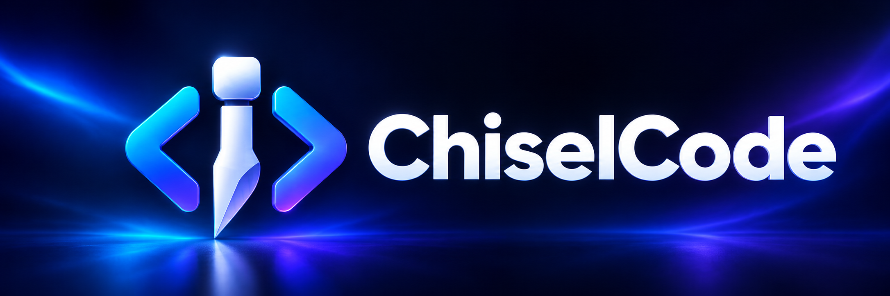

<p align="center">
  
</p>
<p align="center"><strong>От вопроса о коде до проверяемого изменения — прямо в терминале.</strong></p>
<p align="center">Помощник для разработки с несколькими API-провайдерами, историей проектов и просмотром изменений перед подтверждением.</p>
<p align="center">
  <a href="https://github.com/TheAsrada/ChiselCode/actions/workflows/quick.yml"></a>
  <a href="https://github.com/TheAsrada/ChiselCode/releases/latest"></a>
  <a href="LICENSE"></a>
</p>
<p align="center">
  <a href="https://github.com/TheAsrada/ChiselCode/releases/latest">Скачать</a> ·
  <a href="docs/README.md">Документация</a> ·
  <a href="docs/getting-started.md">Быстрый старт</a> ·
  <a href="CONTRIBUTING.md">Участие в проекте</a> ·
  <a href="CHANGELOG.md">История изменений</a>
</p>

## Что умеет ChiselCode

ChiselCode читает проект, ищет причины ошибок, предлагает план, изменяет файлы и запускает проверки. Перед записью и командами показывает запрос разрешения. Поддерживаются Anthropic, OpenAI, AgentRouter и совместимые API, в том числе локальные серверы.

Разговоры, черновики и результаты сохраняются между запусками. Для отдельных задач доступны помощники и рабочие копии Git. Возможности расширяются через MCP, навыки и пакеты расширений.

## Быстрый старт

1. Скачайте [установщик последнего релиза](https://github.com/TheAsrada/ChiselCode/releases/latest).
2. Откройте новый терминал и запустите `chisel`. В мастере выберите сервис, укажите ключ и модель.
3. Выберите папку проекта и отправьте первую задачу:

```text
/cwd "C:\path\to\project"
Объясни структуру проекта и найди команды для запуска тестов.
```

На macOS/Linux используйте путь вида `/home/user/project`. Для обычного API нужен собственный ключ; [локальный сервер без ключа](docs/custom-providers.md#локальный-сервер-без-ключа) подключается через manifest.

| Платформа | Установщик |
| --- | --- |
| Windows x64 | `ChiselCode-Setup-<версия>.exe` |
| macOS Apple Silicon | `ChiselCode-Setup-<версия>-macos-arm64.pkg` |
| macOS Intel | `ChiselCode-Setup-<версия>-macos-x64.pkg` |
| Debian / Ubuntu x64 | `ChiselCode-Setup-<версия>-linux-amd64.deb` |

[Установка и обновление](docs/installation.md) · [Первая задача](docs/getting-started.md) · [Подключение провайдера](docs/providers.md).

## Ваш рабочий цикл

```text
Найди причину ошибки и предложи план исправления.
Внеси изменения и запусти подходящие проверки.
Покажи результат и объясни ограничения проверки.
```

**Shift+Tab** переключает Plan/Build, **F4** — режим разрешений. При запросе подтверждения прочитайте diff или команду: **y** разрешает, **n / Esc** отклоняет. **Ctrl+C** останавливает текущую задачу; **Ctrl+G** возвращает на главную.

Разрешённый shell работает с правами вашего пользователя. Это не системная песочница. [Границы доступа и безопасность](docs/security.md).

## Документация

| Задача | Руководство |
| --- | --- |
| Освоить чат, вкладки и команды | [Интерактивный режим](docs/interactive.md) · [Горячие клавиши](docs/keybindings.md) |
| Сменить модель или аккаунт | [Выбор модели](docs/model-picker.md) · [Провайдеры](docs/providers.md) |
| Настроить проект, оформление и разрешения | [Конфигурация](docs/configuration.md) · [Темы](docs/themes.md) · [Разрешения](docs/permissions.md) |
| Продолжить разговор или использовать помощников | [Сессии](docs/sessions.md) · [Помощники](docs/subagents.md) · [Рабочие копии](docs/worktrees.md) |
| Подключить новые возможности | [MCP](docs/mcp.md) · [Навыки](docs/skills.md) · [Расширения](docs/extensions.md) |
| Исправить проблему | [Решение проблем](docs/troubleshooting.md) |
| Разрабатывать ChiselCode | [Разработка](docs/development.md) · [Архитектура](docs/architecture.md) |

**[Оглавление документации](docs/README.md)** содержит остальные задачи и руководства. Отчёты, результаты проверок и историю реализации ищите в [материалах для участников](docs/contributors/README.md); изменения выпусков — в [CHANGELOG](CHANGELOG.md).

## Участие в проекте

Баги и предложения: [GitHub Issues](https://github.com/TheAsrada/ChiselCode/issues). Перед изменениями прочитайте [руководство участника](CONTRIBUTING.md); об уязвимостях сообщайте по [Security Policy](SECURITY.md).

ChiselCode распространяется по лицензии [MIT](LICENSE).
