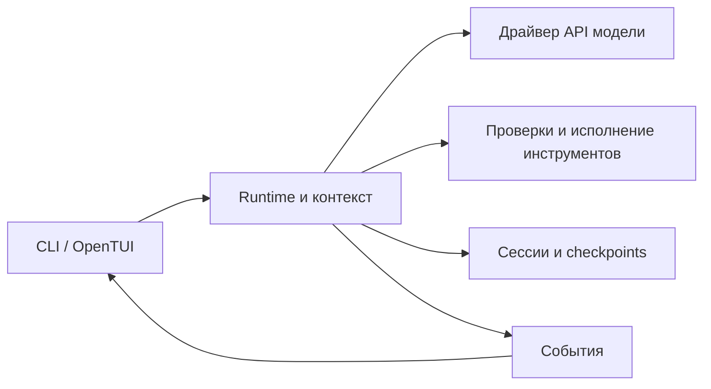

# Архитектура ChiselCode

[Документация](README.md) · [Разработка](development.md) · [Публичный SDK](extensions/README.md)

CLI и OpenTUI используют общий runtime. Он собирает контекст, обращается к выбранной модели, проверяет инструменты и сохраняет результат. Интерфейс отображает состояние и передаёт действия через эти же проверки.

## Карта системы

| Область | Основной контракт |
| --- | --- |
| Цикл запроса, контекст, разрешения и инструменты | [Core runtime](architecture/runtime.md) |
| Сервисы моделей, профили и драйверы | [Провайдеры](architecture/providers.md) · [Потоковые ответы](architecture/provider-streams.md) |
| Выбор модели в интерфейсе | [Состояние и сохранение](architecture/model-selection.md) |
| Запуск и выбор проекта | [Допуск путей, главная, история и контекст запроса](architecture/project-startup.md) |
| Программно подключённые расширения | [Внутренний API](architecture/linked-extensions.md) |
| Внешние ESM-пакеты | [Загрузка и доверие](architecture/external-extensions.md) · [Установка и версии](architecture/extension-packages.md) |
| Представления и настройки расширений | [UI contributions](architecture/ui-contributions.md) · [Настройки](architecture/extension-settings.md) · [Карточки чата](architecture/extension-chat.md) |
| Темы и движение | [Темы](architecture/themes.md) · [Анимации](architecture/interface-motion.md) |
| Сводки инструментов | [Действия в чате](architecture/tool-actions.md) |
| Настройки MCP и навыков | [Встраивание в Settings](architecture/settings-tools.md) |
| Установка внешних навыков | [Источники, snapshot и публикация](architecture/skill-installation.md) |
| Web | [Поисковые сервисы](architecture/web-search.md) · [Сетевые границы runtime](architecture/runtime.md#native-web) |
| Анализ кода | [LSP](architecture/lsp.md) |
| Рабочие копии | [Менеджер](architecture/worktree-manager.md) |
| Помощники и процессы | [Помощники](architecture/subagents.md) · [Фоновые задачи](architecture/background-tasks.md) |
| Обновление CLI | [Завершение, замена и перезапуск](architecture/self-update.md) |
| Экспериментальный Desktop | [Граница app-server](architecture/desktop.md) |

## Основные контракты

### Путь запроса

`AgentRuntime` связывает контекст, драйвер, события и хранилище. [Полная последовательность](architecture/runtime.md#путь-запроса).

### Plan / Build

Режим ограничивает доступные эффекты инструментов и проверяется при исполнении. [Контракт](architecture/runtime.md#plan--build).

### Политика подтверждений

Разрешения проверяются до действия и повторно при исполнении. [Приоритеты и границы](architecture/runtime.md#политика-подтверждений).

### MCP через существующий runtime

MCP-вызов проходит обычные разрешения, отмену и запись результата. [Контракт](architecture/runtime.md#mcp-через-существующий-runtime).

### Native Web

Сетевое разрешение не отменяет проверку адреса, редиректа и размера ответа. [HTTP и инструменты](architecture/runtime.md#native-web).

### Три вида состояния

История, выполняемый запрос и представление интерфейса имеют разные сроки жизни. [Устройство состояния](architecture/runtime.md#три-вида-состояния).

### Контекст

К модели отправляется проекция инструкций, истории и инструментов с учётом её реального окна. [Сборка и сжатие](architecture/runtime.md#контекст).

### Исполнение инструментов

Подготовка, разрешение, блокировки, исполнение и сохранение разделены. [Executor и scheduler](architecture/runtime.md#исполнение-инструментов).

### Editing

Редактирование использует наблюдавшуюся версию файла и атомарную запись. [Инварианты изменения](architecture/runtime.md#editing).

### Архитектурные инварианты

[Границы безопасности и владения](architecture/runtime.md#архитектурные-инварианты) действуют независимо от клиента.

### Evaluation

[Runtime evals](architecture/runtime.md#evaluation) проверяют наблюдаемое поведение; порядок запуска описан в [разработке](development.md#agent-evaluation).

### Границы расширений

[Внутренние расширения](architecture/linked-extensions.md) и [публичные пакеты](architecture/external-extensions.md) используют общие проверки исполнения, но разные контракты подключения.

Отображение внутренних contributions описано в [контракте чата](architecture/linked-extensions.md#отображение-в-чате).

### Главная и вкладки терминала

Ввод и состояние беседы принадлежат её контроллеру. [Интерфейс и движение](architecture/interface-motion.md) · [Дизайн панели](design/sidebar.md).

### Провайдеры

[Definition, driver и profile](architecture/providers.md) отделяют метаданные сервиса, протокол и настройки пользователя.

Инварианты, проверка manifest и совместимость форматов находятся в [контракте провайдеров](architecture/providers.md).

### Анализ кода и настройки

[LSP service](architecture/lsp.md) связывает серверы, разрешения, диагностику и интерфейс настройки.

### Запросы модели и побочные вопросы

Запрос текста не выдаёт доступ к инструментам. [Порт модели и отдельная очередь](architecture/linked-extensions.md#запросы-модели-и-побочные-вопросы).

### Сервис рабочих копий

Core управляет разрешениями Git, реестром, блокировками и проверкой состояния копии. [Контракт менеджера](architecture/worktree-manager.md).

### Формат сессий и совместимость

История и checkpoints хранятся независимо от UI. [Перенос данных](provider-migration.md) · [Форматы провайдеров и сессий](architecture/providers.md#persistence-и-compatibility).

### Помощники

[Дочерний runtime](architecture/subagents.md) сохраняет владельца, разрешения, отмену и учёт расхода.

### Фоновые задачи

[Владение процессами](architecture/background-tasks.md) связывает запуск, перевод в фон, завершение и восстановление.

### UI contributions

[Контракт представлений](architecture/ui-contributions.md) определяет владельца, revision и допустимые действия.

### Темы интерфейса

[Контракт палитры](architecture/themes.md) общий для встроенных и внешних тем.

### Пакеты расширений

[Транзакции установки](architecture/extension-packages.md) сохраняют точное доверие, версии и восстановление.

### Самообновление

[Обновление CLI](architecture/self-update.md) завершает сохранение данных до замены программы.

## План и реализация запуска

[План запуска и выбора проекта](contributors/plans/project-startup.md) сохраняет исходные требования. [Принятое решение](architecture/project-startup.md) описывает текущие исходники `Unreleased`, включая главную без проекта, единый допуск, владельцев операций и readonly историю.

[План контекста агента и Markdown](contributors/plans/agent-environment.md) задаёт критерии проверки identity, временного UI-снимка и переносов. Проверка payload не заменяет ручной прогон живых моделей.
