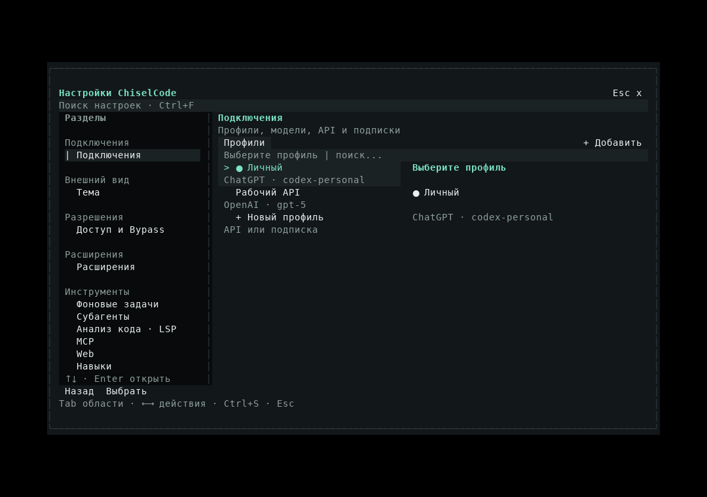
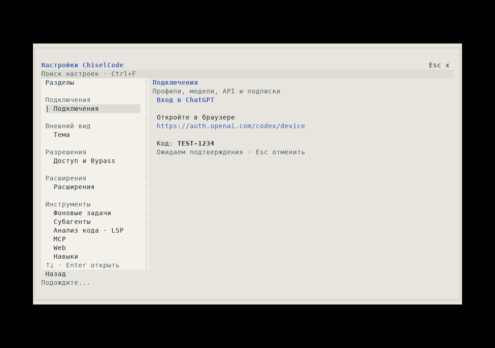
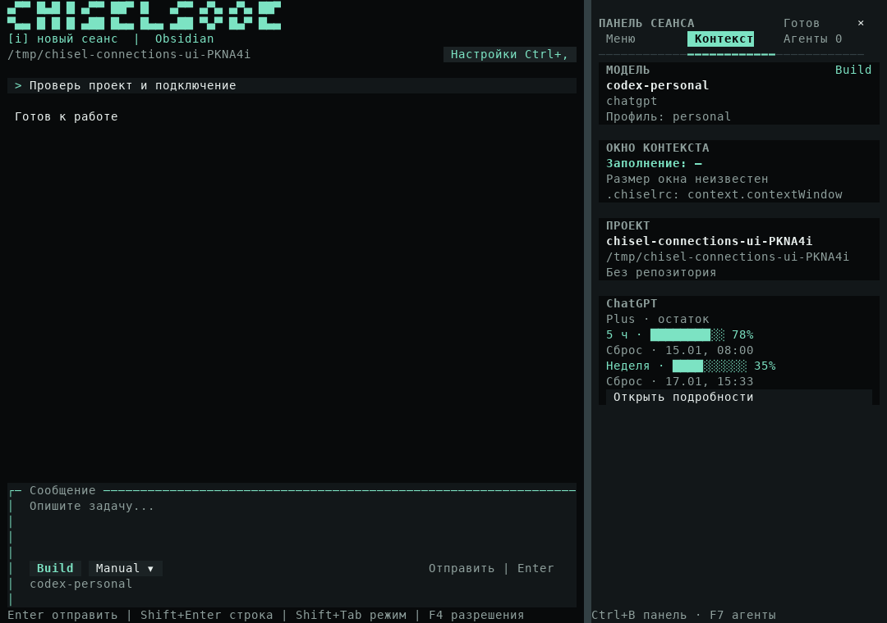

# Подписка ChatGPT как стандартное расширение

[Архитектура](../architecture.md) · [Провайдеры](providers.md) · [Внутренние расширения](linked-extensions.md) · [Подключение подписки](../providers.md#подписка-chatgpt)

## Решение

В текущих исходниках `builtin.chatgpt` входит в стандартную композицию. Расширение владеет входом, токенами, адаптером Responses, каталогом моделей и кешем лимитов. Ядро агента получает обычный `ProviderAdapter`; настройки используют общий `ProviderConnection`. Проверок конкретного provider ID в runtime и форме подключения нет.

`ChiselExtension.providers` — необязательные application contributions внутреннего linked-контракта: `definition`, `create(context)`, `connection`. Их регистрирует `registerExtensionProviders` при построении каталога, до открытия проекта. `ProviderRegistry` сохраняет source `{type: "extension", extensionId}`, проверяет определения и конфликты драйверов. Один application instance используется каталогом, входом и workspace UI. Создание каталога не читает токены и не выполняет сетевые запросы.

Это дополнение внутреннего контракта. Внешний ESM SDK не получил загрузку исполняемых провайдеров: у внешних пакетов сохраняются прежние trust/lifecycle и ограничения. SDK v1 дополнен только проекцией выбранной модели и видимостью UI snapshots.

## Вход и профили

`ProviderDefinition.auth.type` опционален: отсутствие означает прежний API-ключ; `subscription` выбирает `ProviderConnection`. Контракт предоставляет `status(profileId)`, `connect({profileId, signal, challenge})` и `disconnect(profileId)`. Challenge содержит адрес, одноразовый код и deadline. UI показывает эти данные, позволяет отменить ожидание и применяет результат только своей живой операции.

ChatGPT использует device authorization через `auth.openai.com`: получение кода, bounded polling до 15 минут и обмен authorization code с verifier. Access token, refresh token, account ID и срок действия сохраняются в `CredentialStore` под `subscription:chatgpt:<profileId>`. В config остаются provider/profile IDs, название и модель. `OPENAI_API_KEY` не участвует во входе по подписке.

Refresh начинается перед запросом, если до истечения access token осталось меньше минуты. Отдельная межпроцессная блокировка профиля охватывает повторное чтение, обмен и запись, сохраняя ротацию refresh token. Отключение удаляет локальный вход этого профиля; оно не отменяет подписку в OpenAI. Данные другого профиля остаются независимыми.

Адрес API фиксирован, redirects запрещены. Subscription token не отправляется на `baseUrl` пользователя. Сеть использует общий `enterpriseFetch`, proxy и CA приложения. JSON и SSE frames ограничены по размеру; ошибки HTTP не включают тела ответов с credentials.

## Поток ответов

Адаптер запрашивает каталог `/codex/models`, затем отправляет `/codex/responses` с `stream: true` и `store: false`. История преобразуется в сообщения, `function_call` и `function_call_output`; `call_id` и namespaced aliases инструментов сохраняются. Все вызовы проверяются до публикации исполняемых `tool_call`.

`response.completed` / `response.done` завершают ход только с подтверждённым `status: completed`. Обрыв, incomplete response, неверные аргументы и отказ остаются ошибками. Входные токены включают cache ровно один раз. Тариф API не применяется к расходу подписки.

Параметр `max_output_tokens` в Codex backend не отправляется. Ограничения вспомогательных model requests по времени и объёму по-прежнему обеспечивает их core service. Подключение подписки не добавляет обычный OpenAI Responses driver для произвольных API.

## Лимиты в боковой панели

Расширение регистрирует `context_section` и отдельный details view с conversation scope. `UiBinding.read.ownerSummary().modelSelection` содержит только `provider`, `profileId`, `model`. Credentials и изменяемое состояние беседы через этот порт не выдаются. Для workspace scope проекция отсутствует.

Доменная подписка расширения получает `/wham/usage` с периодом до одного запроса в минуту на профиль; response headers обновляют доступные значения после генерации. Snapshot и page читают только кеш, без сети или filesystem. При смене владельца или закрытии подписки отменяется её фоновое ожидание и удаляются таймеры.

Показываются оставшиеся проценты и время сброса для окон, которые вернул сервис. Неизвестные данные не заменяются полным лимитом; ошибка обновления помечает сохранённые значения как устаревшие. Это лимиты Codex-доступа подписки, а не счётчик всех сообщений сайта ChatGPT.

`UiSnapshot.visible: false` убирает contribution из общей проекции, сохраняя её subscription. При другом provider/profile или отключённом аккаунте блок подписки скрыт. Для авторов SDK доступны additive capabilities `ui.modelSelection` и `ui.visibility`; API version остаётся 1.

## Проверки и кадры

`chatgpt.test.ts` проверяет device flow, отмену, разделение аккаунтов, refresh, защиту endpoint, terminal stream и лимиты. `chatgpt-runtime.test.ts` выполняет вход через локальный HTTP fixture, шифрование credentials и запись настоящего файла через `AgentRuntime`. OpenTUI-сценарии проверяют вход, выбор модели, профили, подтверждения, sidebar и размеры терминала.

[Узкое окно 32×10](../assets/connections/obsidian-profiles-32x10.png) · [Окно 80×24](../assets/connections/obsidian-profiles-80x24.png). Кадры получены настоящим OpenTUI renderer; данные аккаунта и коды в них тестовые. Локальные fixtures не подтверждают доступ конкретной платной подписки к сервису OpenAI.
