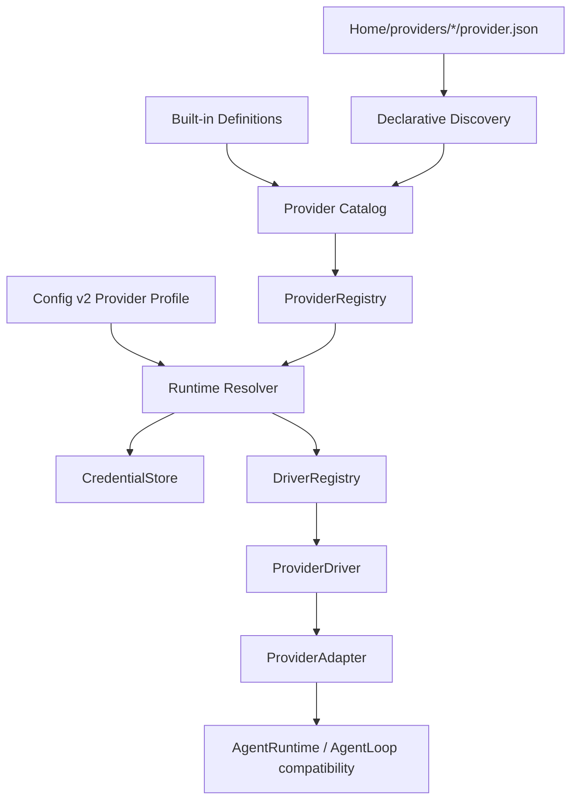

# Контракты провайдеров и протоколов

[Карта архитектуры](../architecture.md) · [Подключение сервиса](../providers.md) · [Потоковые ответы](provider-streams.md) · [История миграции](../contributors/reports/provider-migration.md)

Provider != Protocol != User Configuration.

**Provider Profile → Provider Definition → Protocol Driver → Provider Adapter → AgentLoop/AgentRuntime**. AgentLoop — прежний compatibility API над runtime v2, а не отдельная provider factory.

| Понятие | Ответственность |
| --- | --- |
| ProviderDefinition | Metadata сервиса без secret: ID, label, driverId, auth env names, endpoint policy/default, model, capabilities, driverOptions, optional exact-model pricing |
| Protocol Driver | Wire protocol, SDK, streaming/tools translation, usage/cache normalization и typed errors; driverOptions validation |
| ProviderProfile | Настройки одного аккаунта: providerId, apiKeyRef, label, baseUrl, defaultModel |
| ProviderAdapter | Runtime объект выбранного definition/profile/credential; providerId и обязательный streamChat, optional methods |
| ProviderRegistry | Definitions и source, duplicate/driver validation, lookup/list/search; не сканирует filesystem |
| DriverRegistry | Implementations по открытому driverId; один driver обслуживает много definitions |
| Provider Catalog | Built-ins + custom discovery, diagnostics и отключение всех duplicate custom IDs |

Resolver: profile lookup (selectProfile) → definition → transient/env/store credential → endpoint normalization → driver → adapter. App не импортирует SDK, env vars или конкретные constructors. Definition endpoint/default model — source of truth; global model другого provider не применяется.

Protocol drivers нормализуют TokenUsage.contextInputTokens: Anthropic input+cache, OpenAI prompt_tokens уже содержит cache. Core не проверяет provider ID. ProviderError расширен generic status/retryable categories; context_overflow/cancelled/transport/refusal сохранены для существующего Core Runtime v2. CostEstimate имеет optional USD, unknown pricing не free.

Данные SSE проверяются на границе драйвера в `providers/stream-validation.ts`: тип SDK не подтверждает структуру JSON совместимого сервиса. Схемы проверяют потребляемые поля до накопления текста, usage и tool calls; дополнительные метаданные допускаются. Core получает прежние `StreamEvent`. [Контракт потоковых событий и обработка ошибок](provider-streams.md).

## Инварианты provider слоя

- AgentLoop/AgentRuntime знают только ProviderAdapter, ProviderRequest и StreamEvent; не Registry/Definition/Profile storage или SDK.
- UI/CLI получают каталог через ProviderRegistry; нет закрытой provider validation или отдельного label/default/env каталога.
- SDK imports и wire semantics находятся только в drivers.
- Persistent config/session identities — open strings, providerId/profileId; Session читается без установленного provider.
- Один driver обслуживает множество definitions; новое определение на существующем protocol не меняет generic layers.
- Profile владеет user config, CredentialStore — secrets, Definition — metadata.

## Manifest trust boundary

Discovery читает только immediate directories/provider.json, ограничивает size 256 KiB, отклоняет symlinks/junctions, namespaces/collisions/unknown drivers/invalid options/secret fields. Folder и manifest ID независимы, ID не filesystem path. Broken package не ломает built-ins. Discovery линейно читает packages; registry list упорядочен детерминированно. Нет credential lookup, SDK client creation, network или JS execution при startup.

Executable custom drivers не реализованы: file exists != trusted code. Будущая поддержка потребует digest/trust approval и typed worker IPC; child process сам по себе не sandbox. Сегодня protocol drivers только bundled source.

## Persistence и compatibility

Config v2 мигрирует v1 в памяти и делает config.v1.backup.json при первом реальном save. Session v3 мигрирует v2 только при чтении/сохранении отдельного файла; index v2 — rebuildable cache. Credentials не мигрируют. [Migration notes](../provider-migration.md) описывают записи, backups и старый CLI.

Deprecated constructors в providers/openai.ts, anthropic.ts, agentrouter.ts и URL helpers остаются thin wrappers для старого API. ProviderKind/Schema — deprecated open-string aliases, не enum. Non-enumerable legacy config accessors и session.provider не сохраняются на диск. Runtime использует новые contracts; удаление wrappers не требуется для добавления providers.

## Драйверы и AgentRouter

`openai-chat` использует Chat Completions, streaming, ordered tool calls и reasoning deltas. OpenAI Responses API не реализован. includeUsage включает stream_options.include_usage по умолчанию, чтобы получать фактический input usage и у совместимых шлюзов. Если сервер отклоняет именно этот параметр с 400, driver повторяет запрос без него и использует оценку. tokenLimitFallback допускает один повтор при 400 о max_completion_tokens с max_tokens; official OpenAI выключает его, gateways включают. Эти повторы выполняются до принятия запроса сервером. AgentRouter — definition поверх generic OpenAI driver, без собственного wire adapter.

`anthropic-messages` использует Messages API, tool translation, streaming и optional native token count. authMode=api-key использует x-api-key; bearer — Authorization. adaptiveThinking и nativeTokenCounting явно задаются options/capabilities. Совместимые шлюзы не получают adaptive thinking автоматически.

Начиная с CLI 0.6.37 оба драйвера проверяют структуру входящих событий. OpenAI usage без `choices`, пустые `choices` и завершающий `finish_reason` без `delta` обрабатываются без сбоя; частичный usage дополняет уже полученные счётчики. Повреждённые данные возвращают `transport` с названием протокола и проблемного поля. Инструменты такого ответа не выполняются. Настоящие API-ошибки сохраняют причину сервиса. [Форматы, границы совместимости и проверки](provider-streams.md).

В текущих исходниках OpenAI-запросы без инструментов не содержат `tools`, а текстовые сообщения ассистента — `tool_calls`. Если сообщение содержит и результаты инструментов, и текст пользователя, сначала передаются все `role: tool`, затем текст. Содержимое ошибок инструментов сохраняется. Ответ HTTP 400 с телом только `data: [DONE]` остаётся `bad_request`: шлюз отклонил запрос без объяснения. Клиент сообщает об этом явно и не повторяет запрос с произвольно изменёнными параметрами. Изменение вошло в [CLI 0.6.40](../contributors/reports/release-0.6.40.md); [разбор разговора](../contributors/reports/provider-client-diagnostics.md) отделяет подтверждённые ошибки клиента от неизвестной причины отказа шлюза.

## Возможности и проверка соединения

Definition.capabilities: modelListing, tokenCounting(native/unsupported), usageReporting(stream/final/unknown), toolCalling, thinking. Все built-ins перечисляют модели и поддерживают tool calling; Anthropic-compatible не заявляет thinking. Native token counting — у official Anthropic; остальные unsupported. Usage Anthropic — final, OpenAI-compatible — stream. Model capabilities сообщают известные contextWindow/maxInputTokens/maxOutputTokens. Метаданные API имеют приоритет над встроенным каталогом models.dev; неизвестное окно не выдумывается. Параметры deployment за шлюзом могут отличаться от опубликованных пределов исходной модели.

Health: checkConnection → listModels → unsupported. Последнее не означает failure. modelListing=false позволяет ручной выбор модели без /models. «Проверить подключение» не гарантирует tool compatibility или успешную генерацию; проверьте коротким запросом. `chisel doctor` проверяет локальную настройку без API-запросов.

## Добавить встроенный сервис

Для встроенного сервиса на существующем protocol: создайте ProviderDefinition в definitions/, зарегистрируйте в definitions/index.ts, добавьте contract/runtime test и обновите эту справку. Label, env vars, endpoint, default model, capabilities и options принадлежат definition. Не меняйте run-prompt, core, UI, config/session schemas или CLI validation. Для пользовательского сервиса достаточно [provider.json](../custom-providers.md), без rebuild.

## Добавить протокольный драйвер

Реализуйте ProviderDriver(id, optional validateDefinition, create(context)) в drivers/, зарегистрируйте в createDriverRegistry, добавьте conformance tests и документацию. Adapter обязан иметь providerId и streamChat(request); listModels/countTokens/checkConnection/getCapabilities optional. Driver владеет SDK, request/response translation, cancellation и error normalization; не хранит пользовательский config. Проверьте text, multiple tools, malformed arguments, termination, refusal, usage, limits, abort и errors. После регистрации driver доступен и пользовательским manifests. Home/providers не загружает executable drivers.

## Стоимость

CostEstimate содержит optional usd и source(provider/estimated/unknown). Unknown pricing не считается $0. Сохранены ориентировочные rates старой 0.6.0 только для точных official Anthropic claude-opus-5 (5/25 USD за миллион input/output) и claude-sonnet-5 (2/10); это estimated, не billing API. Неизвестные модели и остальные providers показывают unknown. Эти оценки не учитывают все cache discounts и изменения тарифов.

Legacy totalCost хранит известный subtotal для compatibility. Когда цена хотя бы части запросов неизвестна, UI/JSON/evals не выдают subtotal за полный total. Старые ненулевые totals остаются estimated; legacy zero не становится доказательством бесплатного запроса.
