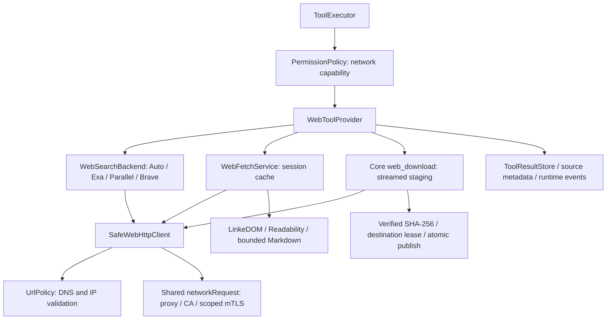

# Цикл запроса и исполнение инструментов

[Карта архитектуры](../architecture.md) · [Разработка](../development.md) · [Безопасность](../security.md)

Контракты основного runtime: запрос модели, состояния, контекст, инструменты и ограничения доступа.

## Путь запроса

```mermaid
flowchart TD
  UI[CLI / TUI] --> Run[app/run-prompt]
  Run --> Runtime[AgentRuntime]
  Runtime --> Context[ContextManager]
  Context --> Frame[ContextFrame: instructions + summary + recent protocol units + schemas]
  Frame --> Turn[TurnRunner / ProviderAdapter]
  Turn --> Events[RuntimeEventBus]
  Events --> Session[Durable transcript / runtime state / checkpoints]
  Events --> UI
  Events --> Eval[Eval trace recorder]
  Runtime --> Scheduler[ToolScheduler]
  Scheduler --> Executor[ToolExecutor]
  Executor --> Mode[AgentMode: tool effect check]
  Mode --> Prepare[Handler prepare]
  Prepare --> AfterPrepare[tool.afterPrepare veto]
  AfterPrepare --> Permission[PermissionPolicy / ApprovalResolver]
  Permission --> BeforeExecute[tool.beforeExecute veto]
  BeforeExecute --> Execute[Core rechecks / lease / Handler execute]
  Execute --> Editing[EditingService: preflight / revisions / commit / rollback]
  Execute --> Sandbox[SandboxExecutor]
  Execute --> Artifact[ToolResultStore]
```



`src/app/run-prompt.ts` собирает зависимости, конфигурацию и сохранение. `AgentRuntime` управляет переходами turn, а `TurnRunner` нормализует provider stream. `src/core/agent-loop.ts`, `src/tools/registry.ts` и `src/commands/run.ts` оставлены как адаптеры старого API; business logic инструментов находится в handlers, executor и editing service.

`TuiWorkspace` владеет отдельным `TuiTabExecution` каждой вкладки: active run, очередь, AbortController и approval resolver. Follow-up сохраняет снимок модели, workflow и permissions и запускается после предыдущего запроса этой вкладки. Фоновые подтверждения переживают переключение экрана; Ctrl+C отменяет только выбранную вкладку. Первый сохранённый checkpoint закрепляет session ID за владельцем, чтобы открытие истории не создало второй запуск той же сессии.

В одном процессе `WorkspaceCoordinator` синхронизирует tools по каноническим путям workspace, общего Git root и ресурсов действия. Чтения разделяют доступ; изменение удерживает исключительный доступ до окончания execute и rollback. Ожидание approval происходит без блокировки. EditingService повторно проверяет ревизии файлов под блокировкой; process/git actions с устаревшим состоянием после подготовки возвращают `STALE_WORKSPACE`. Отмена ожидания освобождает очередь и не отменяет владельца workspace.

## Plan / Build

`src/runtime/agent-mode.ts` определяет режимы, инструкции и политику допустимых effects. Plan показывает модели только инструменты `effect=read` и `effect=external_read`. Executor повторно проверяет режим до parse/prepare/approval, в том числе для неизвестных модели вызовов и pending approvals. Build сохраняет существующую PermissionPolicy. Инструкции режима добавляются при сборке каждого контекста, включая emergency compaction.

`session.mode` хранит выбранный режим; `session.runtime.turnMode` фиксирует режим запроса. В TUI `agentMode` принадлежит контроллеру вкладки, `runningMode` показывает выполняющийся запрос. Очередь захватывает режим при отправке. Переключение UI не меняет runtime текущего запроса. Сохранение выбора после idle использует metadata update под тем же lock, что checkpoints; полный transcript не перезаписывается устаревшей копией. Подробнее о решениях и источниках: [режимы агента](../agent-modes.md).

## Политика подтверждений

Порядок подтверждений задаётся отдельно через `ApprovalMode`: `default`, `acceptEdits`, `dontAsk`, `bypassPermissions`. `session.approvalMode` хранит выбор следующего запроса, `runtime.turnApprovalMode` — снимок текущего. TUI и очередь захватывают его вместе с workflow; `run-prompt` передаёт в runtime и executor. `setExecutionModes` сохраняет обе настройки атомарно без замены истории. Старые `ask/auto` преобразуются в `default/acceptEdits`. [Пользовательская инструкция](../permissions.md).

`PermissionPolicy` решает `allow/ask/deny` после проверки ограничений Plan и подготовки действия. Accept edits автоматически разрешает effect `workspace_write`; `process`, `git_write`, `library_write` и внешние изменения проверяются отдельно. Dont ask отклоняет действия, требующие подтверждения. Все режимы сохраняют явные запреты, ограничения путей и проверки актуальности файлов.

Доступность Bypass хранится только в пользовательском config и проверяется runtime перед началом запроса, каждым действием и исполнением подготовленного действия. Её отключение возвращает выбравшие Bypass вкладки и очередь в Manual и отзывает доступ для следующих действий активного запроса. Записи Settings сериализуются с темой и sidebar; UI не исполняет инструменты; разрешения выдаёт PermissionPolicy через approval resolver. Для Web отдельное явное подтверждение может разрешить поиск или один домен на время текущей сессии.

## MCP через существующий runtime

`ToolSpec` хранит structured `source` (`local`, `skill`, `mcp`, `web`), effect и при необходимости `workspaceAccess`. MCP source сохраняет server ID, оригинальное имя, title, annotations и классификацию. `McpToolProvider` представляет ровно один сервер; `ToolCatalog.replaceProvider` атомарно публикует его snapshot. Вызовы выполняются тем же `ToolExecutor`, PermissionPolicy, scheduler, approvals, checkpoints и ArtifactStore, что локальные tools.

```mermaid
flowchart TD
  Catalog[ToolCatalog] --> Local[LocalToolProvider]
  Catalog --> Skill[SkillsToolProvider]
  Catalog --> MCP[McpToolProvider: один сервер]
  MCP --> Manager[McpConnectionManager]
  Manager --> SDK[McpConnection / официальный SDK]
  SDK --> Stdio[Stdio]
  SDK --> HTTP[Streamable HTTP]
  Manager --> Trust[ConfigStore / fingerprint trust]
  SDK --> Secrets[CredentialStorage / redactor / authentication]
  Manager --> UI[/mcp / CLI doctor]
```

Manager разделяет lifecycle соединения и cancellation каждого вызова. В TUI manager общий для вкладок одного проекта: отмена ожидания одной вкладки не обрывает инициализацию для остальных. Состояния explicit (`connecting`, `connected`, `authentication_required`, `reconnecting`, `error`, `disabled`, `disconnected`), budget reconnect ограничен и не повторяет tool calls. Потерянное изменение возвращает `executionUnknown`; новый catalog snapshot проверяется по fingerprint перед вызовом уже подготовленного handler. SDK получает точный discovery snapshot через `toolDefinition`, исключая скрытый повтор операции при ошибке согласования параметров. Повторяющиеся имена tools исключаются целиком, чтобы неоднозначная схема не меняла классификацию действия.

`McpRuntimeBinding` подключает providers и `discover_mcp_tools` к обычному каталогу. Turn selection ограничивает число MCP-схем до 32 и 96 KiB, учитывает prompt, pinned/explicit/recent tools; Plan filtering выполняется до выбора. Провайдеры модели получают детерминированные допустимые wire aliases; session/runtime сохраняют канонические `server.tool`, поэтому ограничения OpenAI/Anthropic на имена не разрушают namespaces.

Транспорт разрешает secret/env references, отделяет stderr от MCP stdout и нормализует SDK errors/results. Redactor применяется до events, результатов, artifacts и checkpoints. Progress — временное runtime event, не сообщения transcript. Capabilities resources/prompts/tasks сохраняются в connection info; `McpAuthentication` допускает официальный SDK OAuth provider. Автоматические sampling/elicitation не включены, неподдержанный `input_required` не становится фиктивным завершением. [Workflow, модель доверия и ограничения](../mcp.md).

## Native Web

`WebToolProvider` регистрирует `web_search` и `web_fetch` через общий ToolCatalog. Их effect — `external_read`, permission — `network`, workspaceAccess — `none`. Поэтому Plan разрешает их, read scheduler запускает параллельно, а ожидание сети не удерживает workspace lock. AgentRuntime и UI не содержат HTTP-кода. [Решение о квотах, миграции и маршрутизации поиска](web-search.md).

Встроенный `web_download` того же provider имеет effect `workspace_write`: PermissionPolicy пересекает сетевое разрешение Fetch с разрешением записи, Plan/readonly не получают handler. SafeWebHttpClient передаёт поток в core sink с backpressure; общий deadline включает не более трёх попыток и Retry-After. Каталоги Desktop/Downloads разрешаются через Windows Known Folder API, Foundation или XDG, а не по предположению модели. Сеть пишет в закрытый staging canonical Home без изменений проекта. Локальная копия у назначения создаётся, проверяется и очищается под destination lease и межпроцессным lock: hard link без перезаписи либо rename с повторной проверкой revision. Копирование между томами не требует межтомного rename. Сеть не удерживает workspace/Git lease; обычный shell сохраняет свою защиту. [Скачивание файлов и ограничения](../downloads.md).

`ExaSearchBackend` и `ParallelSearchBackend` используют общий `HostedMcpSearchClient`: официальный SDK/Streamable HTTP начинает с поддерживаемого этими фиксированными endpoints `initialize` (legacy negotiation), без неподдерживаемого `server/discover`, и вызывает только фиксированный search tool через SafeWebHttpClient. SDK не может сменить endpoint, выполнить иной tool или получить автоматический sampling/elicitation. Адаптеры отдельно валидируют payload и нормализуют title/URL/domain/snippet; schema сервера и protocol envelopes не попадают в каталог модели. Parallel использует только `web_search`, страницы читает native fetch.

`AutoSearchBackend` — обычный WebSearchBackend с фиксированной цепочкой Exa → Parallel или Brave → Exa → Parallel при наличии ключа. В tool preview объявлены все кандидаты. PermissionPolicy выдаёт capability только для перечисленных и разрешённых hosts, повторно проверяя deny перед соединением. Роутер использует эти destinations, делит единый timeout между попытками и пробует каждый сервис не более одного раза при quota/outage/HTTP 401 или неверном результате/отсутствующей search capability. Для последнего RuntimeError содержит доверенную локальную phase; никакие повреждённые данные не становятся evidence. Deny, HTTP 403, SSRF, смена protocol endpoint и отмена не вызывают failover. В пределах lifetime provider последний успешно ответивший backend получает приоритет; eligibility пересчитывается по capability для каждого вызова. При его сбое оставшиеся разрешённые backends снова доступны, без постоянной блокировки сервиса и скрытого replay. Result сохраняет реальный provider и routing.attempted; успешный пустой результат не меняет сервис. Явный provider не использует этот роутер.

`ToolSpec.guidance` содержит только доверенные инструкции native-инструмента. `ToolCatalog.instructionsForTurn` включает их для фактически выбранных tools и исключает MCP/skill content. Runtime получает инструкции через общий extension point RuntimeTools, до token budgeting/compaction; tool schemas и transcript не содержат guidance. Отключение Web убирает его инструкции при следующем выборе каталога. Общие правила недоверенных внешних данных действуют постоянно.

`src/network` отделяет пользовательские proxy/CA/mTLS от runtime и UI. `networkRequest` разделяет TLS и credentials proxy/origin; `enterpriseFetch` предоставляет SDK streaming HTTP с отменой и повторным выбором identity при redirect. Прямые SDK-запросы используют native Bun fetch с явным отключением proxy; отдельный Node transport разделяет TLS proxy/origin. Это сохраняет native lifecycle потоков там, где разделение proxy TLS не требуется. LLM drivers и HTTP MCP используют общий интерфейс, а SafeWebHttpClient дополнительно проверяет DNS и туннелирует CONNECT к публичному IP с byte/decompression/redirect limits. [Настройка сети](../network.md).



Network permission по умолчанию разрешает public search/fetch; явные Ask/Deny сохраняются, project config только ограничивает пользовательские права. Deny и отключение Web проверяются до Allow, tool/domain/session grants и Bypass. Capability выдаётся executor после успешной policy-проверки либо approval и проверяет каждое соединение, включая redirects и чтение из кеша. Allow не заменяет отдельную URL/DNS/SSRF boundary. Явный deny и отключение Web отзывают доступ даже после подтверждения. При Ask подтверждения параллельных calls сериализуются; после первой выдачи session grant ожидающий call повторно проверяет policy. Grants хранятся только в памяти процесса, scope включает workspace и session ID.

URL policy допускает публичные HTTP/HTTPS на портах 80/443 без credentials. Проверяются все DNS answers; transport соединяется с выбранным проверенным IP, а Host/SNI и TLS certificate validation используют исходный hostname. Это устраняет повторный DNS lookup между проверкой и соединением. Каждый redirect повторяет проверку; другое доменное имя требует действующего разрешения. HTTP client ограничивает response headers, connection/total timeout, redirects, compressed/decompressed bytes и cancellation. Отдельного Web limiter нет: счётчики tool calls, HTTP exchanges за ход/минуту, интервалы стартов и квота параллельности удалены. Общий read scheduler инструментов сохранён. Совместимая preprocess-миграция убирает только старые `maxRequestsPerTurn`/`maxConcurrent` в user/project config, сохраняя остальные строгие проверки.

Exa, Parallel и Brave находятся за интерфейсом WebSearchBackend и используют фиксированные endpoints. Exa и Parallel согласуют MCP без API-ключа; Brave не передаёт ключ при redirects или другим backends в Авто. CredentialStorage сохраняет ссылку; SecretRedactor убирает известный ключ до events, artifacts и checkpoints. Fetch не требует поискового ключа.

Extraction строит ограниченный DOM, удаляет UI noise и сохраняет headings, списки, таблицы и code blocks. LinkeDOM даёт небольшой DOM parser, Mozilla Readability помогает страницам без main/article; собственный Markdown serializer сохраняет технические примеры без browser runtime. Cache хранит только извлечённые документы, aliases canonical URLs, TTL и ограниченный LRU. Сессия сохраняет source metadata в invocation result details, без отдельного поискового индекса. Generic result references сохраняют происхождение «открыт»/«search hint»; compactor переносит наблюдавшиеся URLs и artifact URIs в importantReferences, включая модельное summary, с явной меткой недоверенных данных.

Tool results помечены `contentTrust: untrusted_external`. Закрытый artifact store сохраняет эту метку в sidecar; `read_tool_result` повторяет короткий reference framing для любого диапазона, включая повторный offload. Источники и предупреждение остаются данными tool protocol и не становятся system/developer instructions. Model instructions требуют проверять важные snippets через fetch и ссылаться на открытый final URL. Детерминированные fixture evals проверяют протокол и политику; устойчивость конкретной модели к prompt injection требует отдельного live eval.

## Три вида состояния

| Сущность | Содержимое | Поведение при compaction |
| --- | --- | --- |
| `session.messages` | Полный durable transcript, включая calls/results | Не удаляется и не переписывается |
| `session.context.activeCheckpoint` | Structured summary, индекс границы, время и оценка tokens | Обновляется; модель получает summary и недавний хвост |
| `session.runtime` | Turn state, invocations, observed file revisions, loop guard | Сохраняется при checkpoint и resume |

Project sessions используют `schemaVersion: 3`, открытые providerId/profileId. Lazy migration v2 сохраняет transcript и дополняет runtime/context без записи при чтении. При загрузке граница checkpoint проверяется по длине истории, при сборке context — по атомарным protocol units.

## Контекст

ContextManager считает system, instructions, summary, сообщения и tool schemas. Budget рассчитывается после подсчёта: output ограничен возможностями модели и свободным местом после buffer, без общего предела 4096 или четверти окна. Известный отдельный предел input также соблюдается. Ручные ограничения не увеличивают реальные пределы модели.

Drivers читают лимиты через настроенное подключение: OpenAI-compatible `/models`, Anthropic model metadata. Ошибка получения метаданных не блокирует запрос; резервные параметры точных ID находятся в `src/providers/model-limits.json` со ссылкой на [models.dev](https://models.dev/api.json) и датой обновления. Неизвестные ID не получают лимиты по похожему имени. Для OpenAI неизвестный output не отправляется; Anthropic требует явный предел, полученный из API, каталога или config.

`context_updated` передаёт снимок текущей проекции в session и UI до вызова модели и после ответа. Официальный Anthropic использует count-tokens API. При его недоступности и у остальных adapters применяется оценка UTF-8 bytes / 3; измеренный provider input калибрует последующие изменения истории. Кэш учитывается один раз по семантике протокола. Hidden reasoning/output usage не прибавляется как будто этот текст хранится в истории. После compaction новая проекция считается заново; при локальном подсчёте отношение наблюдаемого размера к локальной оценке переносится на новую проекцию. Cumulative session usage остаётся отдельно. UI отмечает оценку знаком `~` и не показывает процент при неизвестном окне.

Compaction работает на атомарных units: assistant с несколькими tool calls и все соответствующие tool results составляют один unit. Pending unit и новейший unit сохраняются целиком. Последний пользовательский запрос закрепляется дословно, даже если перед ним и после него было много вызовов инструментов. Если обязательный контекст уже превышает budget, runtime возвращает `CONTEXT_BUDGET_EXCEEDED`. При включённом autoCompact provider overflow допускает одну emergency compaction и один retry на run, только если размер запроса действительно уменьшился.

Summary содержит goal, user constraints, architecture, decisions, completed work, changed files, verification, failed attempts, open problems, references и next action. Production composition roots передают ContextManager модельный summarizer: тот же adapter/model получает предыдущее summary и старый префикс истории как данные, без tools. Логи и payloads ограничиваются preview со ссылками на artifacts; пользовательские инструкции не обрезаются. Ответ должен быть полным JSON по схеме. Verification берётся из наблюдавшихся tool results, changed files дополняются фактическим undoStack. При неизвестном окне, отказе, обрезанном или некорректном ответе используется детерминированное извлечение фактов с сохранением пользовательских сообщений целиком.

Compaction сначала строит кандидат checkpoint и считает полный запрос до/после. Только уменьшение контекста допускает замену activeCheckpoint; отмена не заменяет его. Durable transcript не изменяется. События started/completed/failed управляют временной карточкой, а успешные `context.compactions` сохраняют позицию, токены, точность, источник и время для replay. Эти UI-поля не попадают в ChatMessage. `context_summary_usage` учитывает вспомогательный запрос один раз отдельно от ответа агента.

Постоянного file tree в system нет. `InstructionResolver` читает корневые `CLAUDE.md`, `AGENTS.md`, `CHISEL.md`; native `CHISEL.md` имеет приоритет при конфликте. Инструкции являются контекстом, permissions исполняются отдельно. Directory-scoped resolution остаётся расширением следующего этапа.

Большие outputs сохраняются в закрытый session artifact store. В model-visible result остаётся короткий preview, `tool-result://UUID` и указание на `read_tool_result`. Reader принимает только artifact URI и диапазон строк; workspace boundary не расширяется. Полные diffs остаются отдельными UI-полями.

## Исполнение инструментов

`ToolCatalog` хранит definitions и selection API. `LocalToolProvider` и `SkillsToolProvider` поставляют handlers; новый provider не требует изменения AgentRuntime. Handler принимает schema-validated input, строит plan без mutation, затем выполняет его после policy/approval. Approval interaction находится исключительно в executor / approval resolver.

Invocation проходит `queued → prepared → awaiting_approval/running → succeeded/failed/denied/cancelled`. Pending approval не превращается в provider result и не удаляет assistant message. Уже выполненные calls сохраняются; resume исполняет только незавершённые. Deny становится коротким error tool result, после которого модель может продолжить.

Успешный duplicate call ID с тем же canonical input возвращает сохранённый результат. ID с другим input даёт `PROTOCOL_ERROR_DUPLICATE_CALL_ID`. Invocation, сохранённый как running до аварии, не переигрывается автоматически: возвращается `INTERRUPTED_INVOCATION`, поскольку исход mutation мог быть неизвестен.

Полностью read-only batch исполняется максимум четырьмя workers. Mixed batch идёт последовательно в provider order; результаты сохраняют исходный порядок при любом порядке завершения. AbortSignal проходит до handlers и shell. Cancelled calls получают явное состояние и result. Host executor завершает дерево процессов и сообщает `sandboxed=false`; permission policy не является OS sandbox.

После трёх одинаковых failures без runtime workspace change следующий вызов получает `REPEATED_CALL_DETECTED`. Это сигнал сменить стратегию, а не автоматическая остановка всего агента. Grep использует rg, а при его отсутствии — встроенный поиск; traversal исключает ignored/symlink paths и ограничивает объём.

## Editing

Read записывает canonical path → SHA-256 / size. Эти observations переживают resume. Write/edit/delete существующего файла требуют свежего read; изменение после read или approval обнаруживается повторной проверкой перед commit.

`apply_patch` поддерживает Add/Update/Delete, Move to, несколько hunks и файлов. Все paths, revisions, hunks и конечные contents проверяются до первой mutation. Commit готовит sibling temporary files, сохраняет mode и заменяет файлы через rename. При сбое уже применённые операции откатываются. Concurrent change, мешающий rollback, явно перечисляется в `PATCH_PARTIAL_FAILURE.details.rollbackFailed`. Полную filesystem transaction и защиту от всех OS-level TOCTOU races этот host implementation не обещает.

EditingService возвращает semantic model message, structured diffs, changes и новые revisions. Session сохраняет прежний undoStack; editing не зависит от его формата. Managed skill files используют тот же batch commit в отдельной, явно разрешённой области хранения. Для skill update plan также фиксируется до approval; project read-before-write не распространяется на этот явный managed-library update.

## Архитектурные инварианты

1. AgentRuntime не обращается к filesystem напрямую.
2. Tool handlers не показывают UI approvals.
3. Compaction не уничтожает durable transcript.
4. UI-specific diffs не отправляются provider.
5. Workspace-changing tool invocations проходят permission policy.
6. Структурированные файловые mutations проходят EditingService; shell и Git исполняются через собственные process contracts после policy.
7. Model-visible output может отличаться от raw artifact.
8. Permission policy не считается sandbox.
9. Provider wire quirks и SDK errors локализованы в drivers; TurnRunner принимает generic stream.
10. Изменения agent behavior должны сопровождаться conformance tests и измеримыми eval cases.

## Evaluation

`bun test` проверяет deterministic mechanics без платной модели. `evals/` создаёт изолированную копию fixture, выполняет setup, запускает настоящий AgentRuntime и оценивает команды, filesystem, forbidden diff paths и observable trajectory. JSON и Markdown reports сохраняют отдельные success/failure/infra_error/safety_violation, trace, tokens, tool/turn counts, compaction, artifacts и timings. Baseline comparisons требуют одинаковых task/trial/model/provider/fixture hash/settings.

Scripted provider измеряет механическую корректность, а не intelligence модели. Live suite запускается вручную или workflow_dispatch с точным model ID и credentials; runtime-only scripted cases помечены `mockOnly`. PR CI использует только conformance и deterministic evals. Текущий baseline старого runtime — `evals/baselines/runtime-v1-mock.json`. Comparative adapters Claude Code/OpenCode, model rubric grading и дорогие scheduled benchmarks не входят в P0.

## Формат сессий и совместимость

`requestTimings` сохраняет optional `error: {code?, message}` для причины неудачного запроса. Сообщение проходит прежнюю редакцию секретов до записи; оно восстанавливается в чате вне provider messages. SchemaVersion остаётся 3; старая запись без причины читается без выдуманной диагностики.

Сессия сохраняет режим работы `mode` и порядок подтверждений `approvalMode`; runtime хранит отдельные снимки выполняющегося запроса. Вкладки и очередь сохраняют собственные значения. Метаданные меняются под общей блокировкой без перезаписи истории. Для старой сессии без approvalMode значение по умолчанию определяется конфигурацией проекта. Подробнее: [разрешения](../permissions.md).

Сессия проекта сохраняет schemaVersion=3, providerId (произвольная строка), profileId и model. Сохраняются полная переписка, runtime/context, summary/checkpoint, undo и структурированные diff интерфейса. Формат v2 с provider мигрирует в памяти в providerId и `${provider}-default`; slash пространства имён заменяется дефисом в старом ID профиля. При чтении файл не переписывается. Следующие checkpoint/save/rename атомарно сохраняют v3. Отдельная резервная копия сессии автоматически не создаётся; резервная копия конфигурации описана в [переносе настроек](../provider-migration.md).

Неизвестный или удалённый провайдер не мешает чтению истории и summary. Новый запрос получает контролируемую ошибку недоступности; нужен явный выбор доступного профиля. Отсутствующий профиль также требует выбора. Индекс сессий schemaVersion=2 — восстанавливаемый кэш: старый или повреждённый индекс строится из файлов без их перезаписи. Прежний реестр проектов schemaVersion=1 не меняется. Для старых вызовов сохраняется неперсистентный совместимый alias provider; сохранённая идентичность не зависит от enum.
