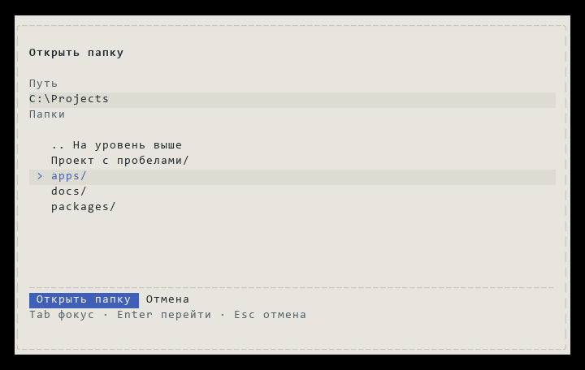
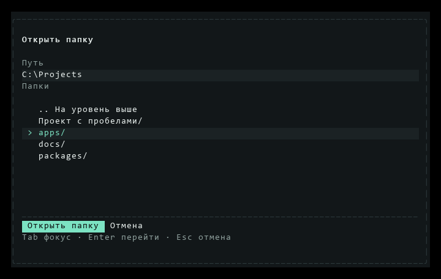
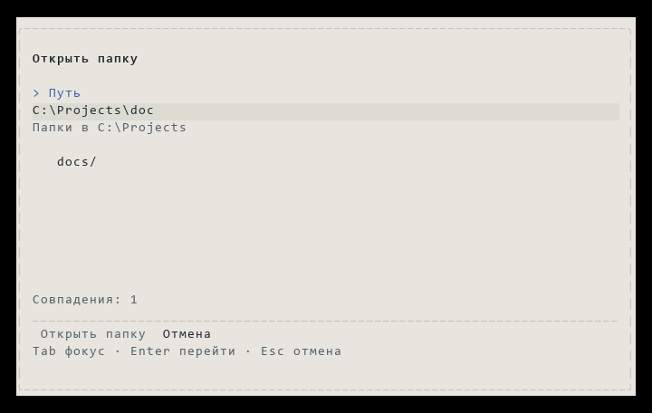

# Выбор папки: настоящий OpenTUI

[Документация](../../README.md) · [Выбрать проект](../../getting-started.md#2-выберите-проект) · [Устройство запуска](../../architecture/project-startup.md)

Кадры получены нативным OpenTUI 0.5.12 на React. Демонстрационные пути заданы fixture; PNG построены из фактических `captureSpans`, без перерисовки интерфейса. Изменения опубликованы в [CLI 0.6.50](../../contributors/reports/release-0.6.50.md).

Окно содержит путь, папки и отдельные действия. Выделение строки видно по фону и маркеру `>`; основная кнопка залита акцентом. На малом экране строка «Действия: …» сохраняет доступ ко всем операциям через стрелки. Недавних проектов, дат, повторных путей и правой панели нет.

## Светлая тема



## Тёмная тема



## Размеры и исходные кадры

При вводе неполного пути список показывает совпадения без Enter:



| Размер | Paper | Obsidian |
| --- | --- | --- |
| 120×40 | [PNG](paper-120x40.png) · [TXT](paper-120x40.txt) · [JSON](paper-120x40.json) | [PNG](obsidian-120x40.png) · [TXT](obsidian-120x40.txt) · [JSON](obsidian-120x40.json) |
| 80×24 | [PNG](paper-80x24.png) · [TXT](paper-80x24.txt) · [JSON](paper-80x24.json) | [PNG](obsidian-80x24.png) · [TXT](obsidian-80x24.txt) · [JSON](obsidian-80x24.json) |
| 60×15 | [PNG](paper-60x15.png) · [TXT](paper-60x15.txt) · [JSON](paper-60x15.json) | [PNG](obsidian-60x15.png) · [TXT](obsidian-60x15.txt) · [JSON](obsidian-60x15.json) |
| 32×10 | [PNG](paper-32x10.png) · [TXT](paper-32x10.txt) · [JSON](paper-32x10.json) | [PNG](obsidian-32x10.png) · [TXT](obsidian-32x10.txt) · [JSON](obsidian-32x10.json) |

## Воспроизвести

В PowerShell из корня репозитория:

```powershell
$env:CHISEL_PROJECT_CAPTURES = "docs/assets/folder-picker"
bun test tests/unit/opentui-projects.test.tsx
python scripts/render-terminal-captures.py docs/assets/folder-picker
Remove-Item Env:CHISEL_PROJECT_CAPTURES
```

Для экспортера нужен Pillow. Компонентные проверки используют настоящий renderer и управляемые ответы навигации: размеры, ввод, фокус, запоздалые ответы, редкие совпадения, отмену и защиту от повторного открытия. `project-navigation.test.ts` отдельно читает настоящий filesystem, а `project-startup.test.ts` запускает приложение, перезапускает его и отправляет реальный запрос локальному HTTP-провайдеру. [Порядок проверок](../../contributors/testing.md).
