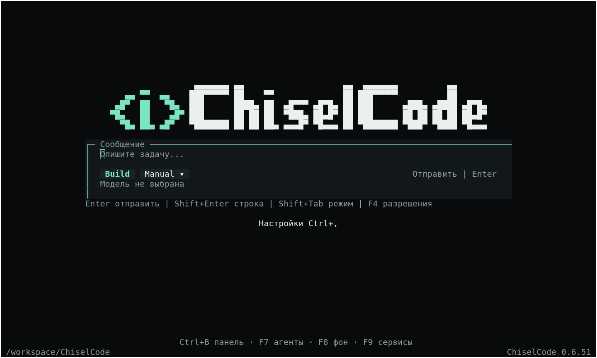
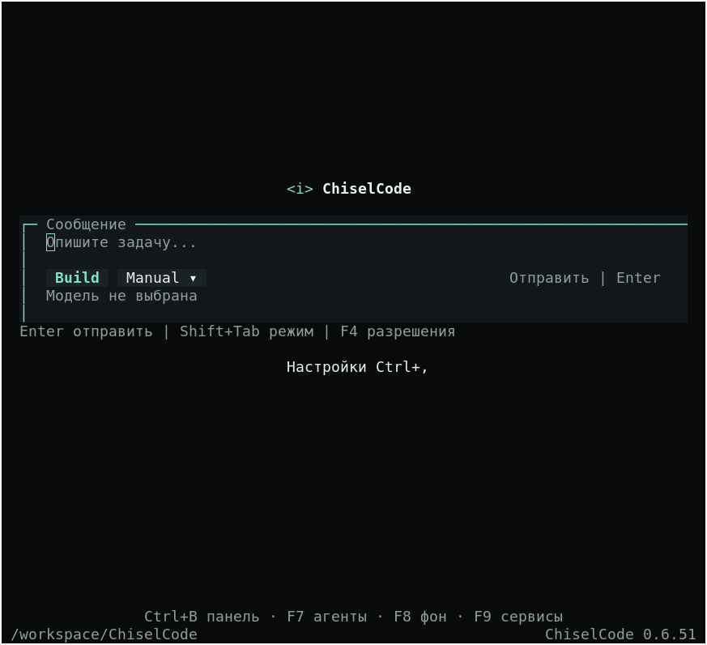
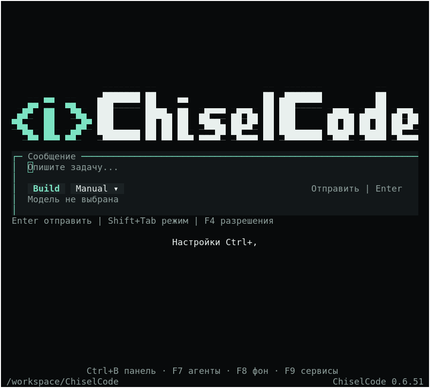

# Логотип главной в Linux-терминале

[Проверка терминального интерфейса](../../opentui-compatibility.md) · [Интерактивный режим](../../interactive.md)

Проверка 2026-11-10: Linux x64, Debian 13, xterm 398, DejaVu Sans Mono 13,
Bun 1.4.4, OpenTUI 0.5.12, тема Obsidian. Исходное состояние — `7944af0`.
Это кадры настоящего OpenTUI из X11-окна xterm, а не реконструкция из текстового snapshot.
В Xfce Terminal 1.1.4 / VTE 0.80.1 с тем же шрифтом исходные швы не воспроизвелись.
Windows, macOS и другие шрифты локально не проверялись.

## До и после

Все три кадра сняты из одного окна xterm на 120×36 без изменения шрифта,
масштаба и палитры. Размер кадра — 1324×796, ячейка — 11×22 пикселя.
Логотип занимает 76×5 ячеек, начинается в колонке 22, строке 8 (от нуля).

До исправления:


Промежуточная проверка: фон добавлен только к `█`. Швы сплошных блоков исчезли,
но остались стыки с `▀` и `▄`:



После исправления:


`█` сохраняется, но получает одинаковые foreground и background. Для `▀` и `▄`
фон получает цвет штриха, противоположный полублок вырезает пустую половину
цветом фона экрана. Пробелы остаются фоном экрана. Исходный Coder Mini,
граница акцентного цвета в колонке 15 и размеры не изменены.
Сглаживание внешних краёв глифов по-прежнему зависит от терминала и шрифта.

Сравнение PNG без масштабирования: проверены все пиксели ячеек `█` и по два
пикселя в центре каждой колонки на стыке строк, где обе соседние половины
должны иметь цвет штриха. Цвет взят из середины сплошного штриха каждого кадра.

| Вариант | Неоднородные пиксели `█`, из 27 346 | Нарушенные стыки строк, из 102 |
| --- | ---: | ---: |
| До | 2340 | 102 |
| Только фон `█` | 0 | 43 |
| После | 0 | 0 |

Native renderer tests дополнительно сравнивают обе половины каждой ячейки
с исходным артом во всех встроенных темах, включая светлую. Проверяется фон
сплошных блоков, инверсия полублоков, размеры и центрирование.

## Сужение окна

То же окно с тем же размером шрифта сужено до 79×36. Появляется исходная
однострочная подпись `<i> ChiselCode`; её изображение совпало с исходным.



При расширении до 80×36 возвращается крупный логотип, центрированный с
отступом в две колонки:



Автотест также проходит границы 80↔79 колонок и 18↔17 строк с непустым
черновиком: подпись меняется, ввод и фокус сохраняются.

## Воспроизведение

Запустите главную через `bun run dev --launcher` в xterm с указанным шрифтом.
Если нет настроенного подключения, ту же главную без API можно открыть
временным preview рядом с исходниками (JSX использует React binding проекта):

```tsx
/** @jsxImportSource @opentui/react */
import { createCliRenderer } from "@opentui/core";
import { createRoot } from "@opentui/react";
import { OpenTuiSpike } from "./src/ui/opentui-spike.js";
import { TuiWorkspace } from "./src/ui/tui-workspace.js";

const workspace = new TuiWorkspace(process.cwd());
const renderer = await createCliRenderer({ exitOnCtrlC: false, exitSignals: [] });
const root = createRoot(renderer);
const shutdown = () => {
  root.unmount();
  renderer.destroy();
  workspace.dispose();
};
process.once("SIGTERM", shutdown);
root.render(<OpenTuiSpike workspace={workspace} onExit={shutdown} />);
```

Кадры выше сняты с таким preview, скомпилированным через `bun build --compile`.
Единственное дополнение временного запуска — запись координат `welcome-logo`
для проверки пикселей. Для сравнения передайте исходную и исправленную сборки
в одно окно xterm, затем измените его размер, сохраняя размер шрифта.
