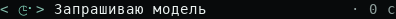

# Кадры искры активного запроса

[Отчёт и проверки](../../contributors/reports/request-activity.md) · [Документация](../../README.md)

## Текущие исходники

Запрос «Сделай лендинг для студии дизайна» в OpenTUI 0.5.12. Локальный endpoint передаёт события рассуждения, вызова и ответа. Временный проект читается в штатном runtime, после подтверждения создаётся `index.html` и выполняется команда.




Команды из корня репозитория:

```bash
CHISEL_DESIGN_CAPTURES=dist/activity-captures bun tests/fixtures/tui-ui-design.ts
CHISEL_DESIGN_THEME=paper CHISEL_DESIGN_CAPTURES=dist/activity-captures bun tests/fixtures/tui-ui-design.ts
python scripts/crop-terminal-status.py dist/activity-captures dist/activity-status obsidian-journey-
python scripts/crop-terminal-status.py dist/activity-captures dist/activity-status paper-journey-
python scripts/render-terminal-animation.py dist/activity-status obsidian-journey- dist/obsidian-stages.gif
python scripts/render-terminal-animation.py dist/activity-status paper-journey- dist/paper-stages.gif
```

## CLI 0.6.41

Снято 25 октября 2026 года на Linux/Bun 1.4.4, OpenTUI 0.5.12. Это настоящий `runOpenTuiAgent`, SDK и native `captureSpans`; локальный endpoint задаёт последовательность действий, инструменты действительно читают, ищут, записывают файл и запускают shell после подтверждения. Пользовательских данных нет.

`obsidian-reading` и `paper-editing` сохраняют полный viewport 120×36 в JSON, TXT и PNG. `*-journey-00..21.json` — точные вырезки native области `request-status` шириной 44 клетки. `sourceRegion` указывает исходное имя кадра и координаты; цвета, текст и `capturedAtMs` сохранены. GIF собраны из этих JSON с интервалами capture, ограниченными существующим экспортёром до 30–1000 мс. Шрифт PNG/GIF принадлежит экспортёру; физический терминал использует свой шрифт.

Для экспорта нужны Python, Pillow, DejaVu Sans Mono/Sans и Noto Sans CJK. Для Braille используется Sans: в Mono этих глифов нет. Повторный экспорт сохранённых строк выполняется без запуска приложения:

```bash
python scripts/render-terminal-animation.py docs/assets/request-activity obsidian-journey- dist/obsidian-spark.gif
python scripts/render-terminal-animation.py docs/assets/request-activity paper-journey- dist/paper-spark.gif
```
