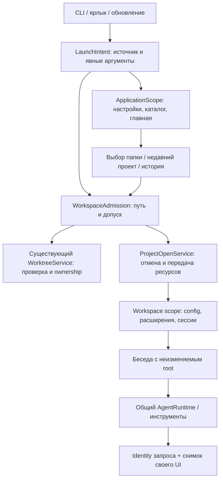

# План: запуск, выбор проекта и контекст приложения

[Материалы для участников](../README.md) · [Архитектура](../../architecture.md) · [Первый запуск](../../getting-started.md) · [Рабочие копии](../../worktrees.md)

Статус: план реализации от 28 октября 2026 года. Основание — исходники `a870a4a674f24c75374b1c22cd9f2d95cab9cfaa` и проверка поведения CLI 0.6.43. Описанное ниже ещё не реализовано. Текущее поведение и доступные команды остаются в пользовательских руководствах; этот документ задаёт целевую архитектуру, порядок изменений и критерии проверки.

## 1. Проблема и границы задачи

Windows-ярлык запускает EXE без явного проекта после установки в ChiselCode Home. CLI подставляет `process.cwd()` в значение `--cwd`; TUI сразу считает эту папку проектом. В результате агент получает служебные данные приложения в качестве рабочего окружения. В пользовательском тесте справочный вопрос о версии, модели и UI привёл к девяти чтениям файлов и ответу через 58,4 с; источниками оказались журнал обновлений и индекс сессий.

Нужно разделить три понятия: расположение программы, пользовательские данные приложения и рабочую папку задачи. Главная должна открываться без проекта. Все пути открытия проекта должны проходить единый допуск, а агент — получать достоверные сведения о своём запросе и видимости интерфейса.

Работа относится к CLI/OpenTUI и общему ядру ChiselCode. Новый клиент Desktop, смена UI-фреймворка, перенос пользовательского Home и отдельный менеджер хранилищ в задачу не входят. Выпуск требует отдельного поручения; опубликованный 0.6.43 сохраняется.

### Что подтверждено исходниками

| Участок | Текущее поведение и следствие |
| --- | --- |
| [CLI](../../../src/cli.ts) | `--cwd` имеет default `process.cwd()`; происхождение папки теряется до принятия решения о запуске. `startTui` может открыть хранилище сессий ещё до выбора проекта. |
| [Windows installer](../../../installer/chiselcode.nsi) | Ярлыки запускают EXE без аргументов; последний `SetOutPath` указывает на установку. |
| [Главная и вкладки](../../../src/ui/tui-workspace.ts) | Главная создаётся как `TuiController` с обязательным `projectPath` и исполнением. |
| [Сборка приложения](../../../src/ui/opentui-agent.tsx) | При запуске загружаются проектная конфигурация, команды и workspace scope. Settings, история и updater получают папку через текущий controller. |
| [Черновики](../../../src/ui/terminal-drafts.ts) | Ключ привязан к root/session, текст сохраняется через `CredentialStore`, metadata — атомарно под lock. |
| [Реестр проектов](../../../src/sessions/project-store.ts) | Уже хранит canonical identity, название и время открытия; новый параллельный реестр не нужен. |
| [Worktrees](../../../src/worktrees/service.ts) | Управляемые копии расположены в `ChiselHome/worktrees`; проверка ownership и use leases уже существует. |
| [WorkspacePolicy](../../../src/security/workspace-policy.ts) | Проверяет границы проекта и ignore patterns; выбор служебной папки проектом отдельно не классифицирует. |
| [Контекст модели](../../../src/core/prompt.ts) | Передаются ОС, cwd, оболочка, дата и Git. Версия приложения и identity обслуживающей запрос модели отдельными полями не представлены. |
| [Перезапуск обновления](../../../installer/update.nsh) | Валидный `RestartCwd` сохраняется через `--cwd`, иначе EXE запускается без проекта. |

## 2. Обязательные инварианты

1. ChiselCode Home и служебные папки не становятся обычным проектом при старте, выборе папки, `/cwd`, восстановлении или прямом вызове runtime.
2. Состояние «проект не выбран» действительно не содержит workspace. Пустая строка, Home, домашняя папка пользователя и временная папка не используются как подставной root.
3. Проектная конфигурация, `AGENTS.md`, workspace-расширения, MCP/LSP, проектные locks и хранилище беседы открываются после допуска проекта. Глобальные данные приложения имеют собственный жизненный цикл.
4. Папка без Git является полноценным проектом. Разработка самого ChiselCode в обычном checkout разрешена.
5. У проверенного managed worktree есть узкий допуск к его дереву, без доступа к остальным служебным данным Home.
6. Выполняющийся запрос, очередь, помощник и процесс сохраняют захваченные root, режимы и модель независимо от выбора в другой вкладке.
7. Выбор папки не отправляет задачу, не меняет разрешения и не выполняет восстановленные инструменты.
8. Существующие сессии и защищённые черновики сохраняются. Перепривязка старой истории к другой папке автоматически не выполняется.
9. Без выбранного проекта работают настройки приложения, выбор модели, просмотр библиотеки навыков и история доступных проектов; модель и проектные инструменты не запускаются.
10. Ошибки открытия имеют владельца и видимое место в UI; служебная лента под вводом не появляется.

## 3. Компоненты и зависимости

`ApplicationScope` создаётся один раз на экземпляр приложения. Он владеет глобальной конфигурацией, каталогом провайдеров, обновлением, темой/motion, доступом к пользовательской библиотеке, реестру проектов и главному черновику. Для него не нужен фиктивный `WorkspaceExtensionScope`.

Отсутствие проекта запрещает inference и выполнение агентских инструментов. Чтение каталога моделей и явно запрошенные проверки подключения остаются операциями приложения под обычной сетевой политикой; они не активируют проект.

`WorkspaceAdmission` — общий внутренний сервис допуска. Он принимает намерение и ApplicationPaths, выдаёт проверенный workspace descriptor или типизированный отказ. UI-строка, сохранённый JSON и поле `kind: managed` не являются доказательством допуска. Проверяемые descriptors не подделываются через model tool input.

`ProjectOpenService` связывает допуск с открытием scope. Он не содержит renderer, собственный executor, Git-реализацию или новое хранилище сессий. UI вызывает этот сервис; CLI и прямые runtime-entrypoints используют тот же допуск до проектных побочных действий.

`HomeDraftController` владеет текстом, курсором, моделью, режимами, выбором навыков и уведомлениями главной. Его project selection — отдельное объединение `none | ready(WorkspaceRef)`. Текущая операция открытия и её ошибка хранятся отдельно: неуспешная смена не уничтожает уже выбранный проект.

`TuiController` беседы продолжает требовать конкретный проект. `Session.projectPath` остаётся обязательным: null не протягивается в существующие сессии, checkpoints, executor, LSP и публичные SDK. Переход от главной к беседе создаёт или открывает project-bound controller после успешного допуска.

## 4. Правила запуска

Происхождение пути сохраняется отдельно от его значения: явный `--cwd`, текущая папка терминала, ярлык, восстановление обновления, выбор в UI, verified worktree. Invocation cwd захватывается один раз до смены каталогов. Commander default не должен превращать неявную папку в якобы явный выбор пользователя.

| Намерение | Результат |
| --- | --- |
| Явный `--cwd <папка>` | Проверить и открыть эту папку. Ошибка не заменяется другим проектом. |
| `chisel` из допустимой папки терминала | Открыть именно invocation cwd. Git не обязателен. |
| Ярлык / меню «Пуск» / запуск после установки | Открыть главную без проекта и показать недавние проекты. |
| Старый ярлык без нового аргумента, cwd служебный | Распознать служебную папку и открыть выбор проекта. |
| `chisel "задача"` из служебной папки | Отказать до запроса модели, указать `--cwd`. Не выбирать другой каталог автоматически. |
| Headless или JSON без допустимого проекта | Ненулевой exit code и структурированная ошибка с действием исправления; выбор папки интерактивно не запускается. |
| `--resume` в CLI | Разрешать ID только в допущенном проекте; при отсутствии проекта требовать `--cwd`, без поиска чужих бесед. |
| Выбор беседы в UI | Проверить исходную папку этой беседы, затем открыть; недоступная папка оставляет просмотр истории. |
| Возврат после обновления | Восстановить прежний root и ID после проверки; отсутствие root означает главную без проекта. |

Новые ярлыки передают служебный аргумент `--launcher` для интерактивного запуска. Он обозначает источник запуска и не даёт разрешений. Явный валидный `--cwd` имеет приоритет над этим признаком; сочетание `--launcher` с одноразовой задачей без явного cwd отклоняется. Аргумент обрабатывается приложением, без попыток угадать родительский процесс, PowerShell, Explorer или название терминала.

Прямой запуск portable EXE без аргумента launcher следует правилам invocation cwd. Надёжно отличить любой двойной клик от запуска из терминала без явного признака нельзя. Для portable-сценария выбор проекта вызывается через `--launcher`; подтверждённая папка установки в любом случае не становится обычным проектом.

`setup`, `--version`, список провайдеров, проверка обновления и другие операции приложения работают без проекта. Для MCP, Web и расширений различается цель операции: глобальные настройки доступны в ApplicationScope, проектные требуют WorkspaceRef. Это определяется контрактом команды, а не случайным cwd.

Существующий `/cwd <путь>` сохраняет поддержку файла с выбором его родительской папки и относительных путей. При выбранном проекте относительный путь отсчитывается от него; на главной без проекта — от явно показанной папки навигации picker. CLI `--cwd` по-прежнему означает каталог и разрешается относительно invocation cwd. `/cwd` без аргументов открывает тот же picker, что кнопка выбора проекта.

## 5. ApplicationPaths и допуск папки

Пути собираются из существующих функций расположения данных: ChiselCode Home, каталоги конфигурации/credentials и пакетов, принадлежащие приложению cache/downloads/logs и подтверждённая установленная копия программы. Не блокируются целиком `%LOCALAPPDATA%`, `$HOME`, `/usr/local/bin` или родительские папки общего назначения.

Расположение установленной программы определяется с учётом существующей проверки packaged binary. `dirname(process.execPath)` при запуске через Bun/Node не означает каталог ChiselCode. Имя папки или `package.json.name == chiselcode` также не делает checkout служебным.

Допуск выполняет следующие действия:

1. Разрешить путь по правилам его источника, проверить тип и существование.
2. Получить canonical path и файловую identity существующими средствами. Учитывать Windows case, junctions, symlinks, UNC и разделители; сравнивать компоненты пути, чтобы `App` и `App2` не смешивались.
3. Проверить пересечение со служебными областями. Обычный проект внутри них отклоняется. Для managed worktree передать проверку существующему сервису.
4. После допуска вернуть immutable WorkspaceRef с canonical root, видом и источником выбора. Недавний проект и session metadata сами по себе не выдают этот допуск.
5. При изменении identity/symlink до открытия scope отменить открытие. Проверки фактических файлов и freshness остаются в WorkspacePolicy/EditingService.

Если выбран более широкий проект, содержащий служебные данные приложения в подкаталоге, native файловые инструменты, поиск, инструкции и обход проекта исключают эти области. Доступ приложения к своей библиотеке и настройкам идёт через отдельные штатные сервисы. Это ограничение structured tools и выбора root; host shell, внешние MCP/LSP-процессы и доверенный native JS работают с правами процесса. Файловая изоляция таких процессов не появляется от фильтра WorkspacePolicy; сохраняются действующие разрешения и границы доверия.

Для managed worktree проверяются registry, каноническая Git identity, принадлежность записи и ownership marker. Прямой `--cwd` на зарегистрированную копию также проходит проверку. Папка с похожим именем, отсутствующая запись, подмена пути или повреждённый ownership не получают исключение. Допуск удерживается до передачи scope; используется существующая схема use lease, без второго независимого registry lock и повторного вложенного acquire. Закрытие scope освобождает lease после остановки его сервисов.

Предварительная проверка worktree не создаёт новый проект и не исполняет Git hooks. Необходимые служебные locks/leases остаются узкими операциями приложения. Неуспешный допуск не загружает проектную конфигурацию и инструкции, не создаёт проектную сессию и не обращается к модели.

Ошибки различают отсутствие выбора, недоступность каталога, служебный путь и неподтверждённую рабочую копию. В CLI они дают явное действие с `--cwd`; в picker — пояснение рядом с путём. Ошибка не становится обычным сообщением модели.

## 6. Открытие проекта и жизненный цикл

Открытие — отменяемая операция с уникальным request ID и captured owner, а не набор несвязанных обработчиков кнопок:

1. Сохранить предыдущий committed selection и черновик; показать статус проверки.
2. Допустить путь. Не менять глобальный cwd процесса ради UI.
3. Подготовить проектную конфигурацию, нужный workspace scope и существующее хранилище. LSP сохраняет lazy-start, MCP — обычные trust/network permissions.
4. Проверить, что request ID и owner по-прежнему актуальны.
5. Одним commit состояния передать WorkspaceRef главной либо открыть существующую беседу. После успеха обновить `lastOpenedAt` существующего реестра.
6. При отмене или ошибке освободить только ресурсы этой операции и вернуть предыдущий выбор. Общий scope другой вкладки не закрывать.

Быстрый выбор A → B отменяет A; поздний ответ A не меняет проект, фокус, уведомление или draft B. Тайм-аут проверки UNC/медленного диска завершает ожидание UI, но не объявляет системный I/O фактически остановленным: поздние результаты игнорируются, полученные ресурсы освобождаются.

Набор roots для `releaseUnusedScopes` состоит из реальных bindings главной, бесед и выполняющихся открытий. Главная без проекта не удерживает последний scope. Закрытие вкладки сохраняет существующий порядок остановки LSP/MCP/процессов и освобождения worktree admission.

Смена проекта на главной относится к будущей задаче. Уже работающие вкладки, очередь, approvals, side queries и помощники сохраняют исходных владельцев и root. Выбор проекта не применяет новые права к выполняющейся операции. Возврат на главную не создаёт проект заново.

## 7. Контракты UI/UX

Проектирование опирается на [скилл OpenTUI](https://github.com/msmps/opentui-skill): React, layout, keyboard/focus, animation и testing. API сверяется с установленными `@opentui/core` / `@opentui/react` 0.5.12 и типами проекта. Новый `@opentui/keymap` и смена версии фреймворка для этой задачи не требуются. Существующие palette, motion policy, renderer и система уведомлений используются повторно.

### Главная без проекта

Основной акцент — кнопка «Открыть папку». Ниже расположен компактный список недавних проектов: имя, различимый путь и время открытия. Строка «Проект не выбран» видна рядом с областью задачи. «Без репозитория» показывается только для реально выбранной папки без Git.

Модель, профиль, Plan/Build и разрешения можно выбрать заранее; это настройки будущей задачи. Композер позволяет подготовить текст. Первая отправка без проекта открывает picker с пояснением «Выберите папку для этой задачи»; выбор папки возвращает текст и фокус в композер. Запрос отправляется следующим явным действием пользователя. Enter, закрывающий picker, не должен одновременно отправить сообщение.

Контекстная панель без проекта не показывает старый Git, LSP и статистику чужой беседы. Настройки, библиотека навыков, обновления и сведения о версии приложения доступны без запуска модели. Не создаётся пустая вкладка разговора или запись «проект Home».

### Picker папки

Один компонент обслуживает старт, кнопку, `/cwd` и смену проекта. Есть поле полного пути, навигация по каталогам и недавние проекты. Папка навигации явно показана и не считается рабочим проектом до открытия. Её начальное значение — доступная пользовательская папка/последний родитель выбора, используемая только для навигации.

Поддерживаются вставка пути с пробелами и кириллицей, файловые ссылки, корни дисков и UNC. Каталоги перечисляются ограниченными порциями с отменой; содержимое файлов, `.chiselrc` и `AGENTS.md` при навигации не читается. Сетевые ресурсы автоматически не обнаруживаются. Служебная папка получает понятную причину отказа, допустимая managed copy — подпись исходного проекта.

Недавние проекты берутся из существующего реестра. Выделение хранится по identity, а не номеру строки. Недоступность проверяется лениво для выбранного пути; приложение не обходит все старые репозитории при запуске. Повреждённая/пропавшая запись не удаляется автоматически.

Известные service-root записи показываются в архивной группе истории, а не как обычные недавние проекты. Классификация использует уже сохранённые canonical metadata; обнаруженный при открытии alias служебного пути переводит запись в эту группу без удаления данных. Cached metadata не заменяет проверку перед исполнением.

| Состояние | Представление и действие |
| --- | --- |
| Недавних проектов нет | Короткое пояснение и основная кнопка выбора папки. |
| Идёт проверка | Статус возле пути и действие отмены; черновик доступен после возврата. |
| Путь недоступен | Сохранить введённый путь, показать причину и возможность повторить/изменить. |
| Выбран служебный каталог | Объяснить назначение каталога; предложить рабочую папку. |
| Открытие прошло | Показать project chip с путём и вернуть фокус композеру. |
| Операция отменена | Вернуть исходный экран, курсор и предыдущий selection. |

### Фокус, адаптация и движение

Tab/Shift+Tab перемещают фокус между полем пути, списком и кнопками; стрелки/PageUp/PageDown управляют списком, Enter выполняет действие текущего control. Esc закрывает вложенный уровень, затем picker. В нём Ctrl+C отменяет открытие этого владельца, не останавливая работу других вкладок. Приоритет approvals и модальных окон сохраняется; глобальные shortcuts не перехватывают печать и вставку.

Для входа достаточно видимой кнопки и `/cwd`; новые глобальные сочетания не вводятся. Смена проекта в меню использует тот же action. Путь сокращается только в отображении строки; полный путь доступен в деталях/копировании и всегда используется в операции.

При 120×40 список и детали находятся рядом; при 80×24 — компактная вертикальная композиция; при 40×12 — один основной control с прокручиваемым содержимым и коротким footer. Отдельно проверяется 24×8: стабильное компактное сообщение о размере и сохранность черновика. Размеры задаются в клетках терминала, прокрутка остаётся штатной ScrollBox.

Фокус выделяется средствами действующей темы; цвет дополняется текстом/маркером. Статусы привязаны к реальному I/O. Переходы используют существующий MotionPolicy; в reduced отсутствует периодическое движение. Анимация не меняет ширину строки пути, позицию каретки, порядок списка и не перерисовывает весь редактор на каждом tick. Ошибки на главной показываются существующим owned dialog, ошибки конкретного поля — внутри picker.

При реализации нужны кадры настоящего OpenTUI для пустого старта, недавних проектов, отказа служебного пути и успешного выбора на трёх размерах. Диаграмма в этом плане описывает архитектуру; кадрами работающего UI она не является.

### Глобальные Settings и библиотека

Settings получают явную цель `user` либо `project(WorkspaceRef)`. На главной доступны глобальные настройки; проектные разделы объясняют необходимость выбрать папку. Создание user target не выдаёт workspace write capability. Проектные операции MCP/расширений не запускаются с подставным root; явные глобальные действия остаются под собственной политикой доверия и разрешений.

Библиотека навыков читает пользовательский каталог через штатный сервис. Просмотр и подготовка задачи доступны без проекта; закрепление принадлежит конкретному draft/беседе. Если действие библиотеки подготавливает задачу агенту, её запуск проходит тот же выбор проекта. Workspace contributions и внешние project-модули активируются после допуска; стартовая главная работает на встроенных компонентах и глобальных предпочтениях.

## 8. Черновики, история и существующие данные

Не добавляется второй реестр проектов. Используются SessionProjectRegistry, существующая canonical identity и атомарная запись под lock. Для migrated service-root записей меняется доступность исполнения, а не физическое расположение истории.

Главный черновик без проекта получает отдельный тип identity: application draft UUID вместо root. Текст сохраняется через текущий CredentialStore, metadata — через существующие bounded/atomic helpers. Привязанные project/session drafts читаются по прежним ключам; миграция не теряет старые записи.

Для нескольких экземпляров приложения UUID различаются. Восстановление старого черновика не перезаписывает черновик живого экземпляра. Сохранение использует revision/ownership; конфликт сохраняет оба текста, вместо безусловной общей записи под одним ключом `home`. Имена, абсолютные пути и содержимое пользовательских черновиков не включаются в CI-cache.

Новый текст публикуется через отдельную revision-specific reference в CredentialStore и атомарное переключение metadata после проверки ожидаемой revision. Отказ публикации metadata не перезаписывает payload предыдущего черновика. Очистка неопубликованной reference проверяет фактическое состояние публикации; неизвестный результат не является разрешением удалить данные.

При выборе проекта уже набранный текст главной сохраняется. Сохранённый draft проекта автоматически восстанавливается только в пустой неизменённый композер. Асинхронное восстановление проверяет owner, revision и selection generation; новый ввод пользователя не затирается. Отказ сохранения остаётся видимым и не выдаётся за успешную запись.

Старые разговоры, ошибочно привязанные к ChiselHome, доступны в отдельной группе истории с подписью служебного источника. Просмотр читает app-owned history и не открывает её root для агента. У неё нет запуска инструментов, undo, повторного исполнения pending calls и автоматического продолжения.

Для такого просмотра используется readonly presentation без AgentRuntime/executor. Project-bound controller с подставным или недопущенным root для архива не создаётся.

Для продолжения такой работы пользователь выбирает настоящий проект и начинает новую беседу. При необходимости он явно переносит выбранный текст/итог. Старые абсолютные пути, approvals, undo и tool calls не становятся полномочиями новой беседы. Автоматическое переписывание `projectPath` или удаление сессий не выполняется.

История пропавшего обычного проекта тоже доступна для просмотра. Повторное открытие проверяет исходный root; выбор другой папки не перепривязывает существующую сессию. Удаление записи из списка недавних и удаление истории остаются разными явными действиями.

## 9. Информация, которую получает агент

Информация приложения собирается из фактического runtime, с разделением стабильного identity запроса и наблюдаемого UI:

| Данные | Источник и срок жизни |
| --- | --- |
| Приложение, VERSION, тип `terminal/opentui` | Запущенный процесс и версия сборки; не update.log и не другой executable. |
| Модель, provider ID и profile ID | CapturedModelConfiguration обслуживающего запроса, а не индекс истории. |
| Plan/Build и approval mode | Захваченные режимы конкретного запроса. |
| Root, вид workspace и источник выбора | WorkspaceRef этой беседы. |
| Модель для следующего запроса | Отдельный UI selection; не подменяет модель работающего запроса. |
| Видимость беседы, route и target фокуса | Снимок принадлежащего запросу OpenTUI-view с `observedAt`; неизвестные поля явно помечены. |
| Состояние при headless | `ui.available: false`; фокус и экран не выдумываются. |

Стабильные поля входят в системный контекст с ограниченными schema-полями и без дублирования каталога инструментов. UI-снимок собирается один раз на попытку и проходит существующий механизм ephemeral request context: один снимок используется при подсчёте токенов и отправке, не попадает в summary/checkpoint как постоянный факт. Для этой задачи новый инструмент чтения всех внутренних данных приложения не нужен.

Если пользователь перешёл в другую беседу, snapshot сообщает `ownerVisible: false` и фокус вне владельца. Название, проект, содержимое, черновик и ID чужой вкладки не передаются. Активное окно ОС, глобальная клавиатура и координаты мыши остаются неизвестными. Терминальный OpenTUI не описывается как DOM.

Данные получаются через application-owned port. Расширение или model tool input не может подменить VERSION, workspace admission или captured model. Пользовательские строки и metadata передаются как ограниченные данные, не инструкции. API-ключи, содержимое credentials, endpoint с секретами и история чужих бесед в snapshot не включаются.

Инструкция агенту объясняет источник этих сведений и их время: при ответе о собственной среде используются они, при отсутствии наблюдения — явное ограничение. Чтение update.log и индексов для угадывания текущего запроса не требуется. Проверяется прирост размера контекста; фиксированное обещание времени ответа живой модели не задаётся.

## 10. Обновление и установщики

Start Menu/Desktop shortcuts и запуск с завершающей страницы NSIS передают `--launcher`. Корректность не зависит от унаследованного WorkingDirectory. Старые ярлыки покрываются проверкой служебного invocation cwd в CLI.

Снимок перезапуска имеет две формы: verified project с optional session ID либо launcher без root. Вызов обновления с главной без проекта не вызывает `resolve(undefined)` и не передаёт Home как `/CHISEL_CWD`. В NSIS ветка без `RestartCwd` запускает `--launcher`.

Для реального проекта сохраняются существующие parent PID, ожидание завершения/cleanup, argv quoting и обработка корня диска/завершающего backslash. Session ID передаётся только вместе с соответствующим проектом. Если папка исчезла к перезапуску, UI показывает причину и историю, не запускает разговор в другом root.

Установка обновления, сохранение бесед и остановка процессов остаются в действующем [контракте updater](../../architecture/self-update.md). Расположение пользовательских навыков и сессий в Home этим планом не меняется.

## 11. Порядок реализации и точки готовности

| Этап | Изменения | Условие завершения |
| --- | --- | --- |
| 1. Пути и намерение | ApplicationPaths, LaunchIntent, WorkspaceAdmission; сохранить происхождение cwd до default. | Табличные случаи CLI, служебных путей и managed copies проходят; до отказа нет model request и проектных побочных действий. |
| 2. Главная без проекта | HomeDraftController и разделение application/workspace scope; существующие controllers бесед сохраняют обязательный root. | Приложение запускается без проекта и без ключа; доступны глобальные настройки; project scopes не открываются. |
| 3. Открытие и UX | ProjectOpenService, picker, недавние проекты, `/cwd`, owned ошибки и возврат фокуса. | Быстрые выборы, отмена, отсутствие Git и сохранение ввода проверены настоящим renderer; показаны реальные кадры. |
| 4. Данные и восстановление | Application draft identity, прежние drafts, readonly service-root history и original-root resume. | Старые данные читаются, конфликты не теряют текст, история не получает права другой папки. |
| 5. Identity и UI context | Captured runtime identity и owner-scoped ephemeral UI snapshot. | Тест №8 получает данные без файловых инструментов; смена модели и вкладки не подменяет факты запроса. |
| 6. Windows launcher/update | Реальные ярлыки, finish-page launch, две формы restart intent. | Native Windows подтверждает args/cwd/cleanup; production compiled UI проходит пустой старт и возврат в проект. |
| 7. Документация и выпуск | Обновить руководства, архитектуру, примеры и Unreleased по фактически реализованному поведению. | Docs check, подходящие installed/compiled smoke и обязательный CI зелёные на release source; выпуск только по поручению. |

Это последовательные части одного изменения с интеграцией на каждом этапе. Перевод дефолтного старта на новую главную выполняется после готовности допуска, scope-разделения, черновиков и UX; промежуточное состояние с dummy root не публикуется. Этапы не вводят экспериментальный runtime flag, обходящий проверки.

### Карта затрагиваемых участков

| Участок | Ответственность изменения |
| --- | --- |
| `src/cli.ts`, `src/app/run-prompt.ts`, `run-command.ts`, `run-slash-command.ts` | Классификация намерения/команды, общий допуск до проектной работы; единая понятная ошибка. |
| Планируемые `src/projects/launch.ts`, `paths.ts`, `admission.ts`, `opening.ts` | Небольшие внутренние модули, использующие существующие path/worktree/store APIs; без собственной Git/storage/runtime реализации. |
| `src/ui/tui-workspace.ts`, `tui-controller.ts`, `opentui-agent.tsx` | Отделить home draft, scopes, UI actions, project opening и владельцев async-операций. |
| `src/ui/terminal-drafts.ts`, `src/sessions/project-store.ts` | Новая identity черновика и представление старой истории с сохранением существующих данных. |
| `src/security/workspace-policy.ts`, `src/worktrees/service.ts`, `src/extensions/host.ts` | Проверенные roots, исключения private paths и передача существующего ownership/admission. |
| `src/core/prompt.ts`, `src/app/model-runtime.ts`, runtime context seam | Подтверждённая identity запроса и свежий owner-scoped UI snapshot. |
| `installer/chiselcode.nsi`, `installer/update.nsh`, существующие updater helpers | Launch intent для ярлыков и восстановление реального проекта. |
| `docs/getting-started.md`, `interactive.md`, `cli.md`, `sessions.md`, `installation.md`, `security.md`, `keybindings.md` | Описать выпущенные правила запуска, выбора проекта и ограничений. |

## 12. Проверки и критерии приёмки

### Логика и реальные файловые границы

- Явный/неявный cwd, launcher, direct runtime, TTY/headless/JSON, `setup`, `--version`, `--resume`, отсутствующий root; сохраняется нормальный запуск из терминала.
- Обычная папка без Git, checkout ChiselCode, путь с пробелами/кириллицей, file-parent у `/cwd`, относительный путь и различие похожих префиксов.
- Windows case, UNC, drive root, junctions, symlinks и подмена canonical identity. Реальные platform-specific случаи выполняются на соответствующей ОС.
- Home и private children отклоняются; workspace над Home не открывает private файлы через native поиск/чтение. Проверенный managed worktree работает, неподтверждённый и повреждённый не получают допуск.
- До выбора/при отказе счётчики показывают отсутствие загрузки project config/инструкций, активации project extensions, MCP/LSP, project session и обращения к модели. Глобальные действия приложения остаются доступны.
- Настоящий Git и existing registry/use leases: remove блокируется открытой копией, отмена освобождает свой lease и не закрывает чужой scope.

### Главная и OpenTUI

- Настоящий renderer: 40×12, 80×24, 120×40 и компактный fallback 24×8; поиск, мышь, paste, прокрутка, полный путь, resize.
- Enter открытия не отправляет задачу. Esc/Ctrl+C принадлежат picker; approval и фокус поля имеют приоритет над глобальными handlers.
- Выбор A → B с задержанным ответом A, закрытие picker, смена вкладки и unmount не меняют нового владельца. Два одновременно открытых проекта и выполняющийся запрос сохраняют свои roots.
- Черновик, курсор, выделение и модель переживают выбор/отмену; задержанное восстановление не затирает ввод. Конкурентные экземпляры сохраняют оба текста.
- Отказ проверок и сохранения виден в owned UI, сообщения не попадают под ввод и в модельную историю.
- Full/reduced motion, отсутствие лишнего animation clock после unmount и стабильность ввода.

### Контекст агента и история

- Controlled provider проверяет фактическую VERSION, captured model/profile/modes и отсутствие вызовов файловых инструментов в сценарии №8. Отдельный ручной прогон живых моделей проверяет качество ответа; транспортный mock этого не доказывает.
- Смена модели для следующей задачи не меняет identity текущего запроса; переход в чужую вкладку даёт только owner visibility без её данных.
- Один UI snapshot используется для подсчёта/проекции/отправки; auto/emergency compaction и resume не сохраняют его как актуальный факт. Headless явно не имеет UI snapshot.
- Старые service-root сессии открываются readonly, без undo/повтора pending tools и без изменения файлов истории. Исходный missing project не заменяется выбранной папкой.

### Windows и поставка

- Реальные `.lnk`: проверить TargetPath, Arguments и WorkingDirectory, исполнить ярлык с контрольным приёмником argv/cwd. Это проверяет hand-off; отдельный smoke compiled production bootstrap/OpenTUI проверяет состояние без проекта.
- Покрыть Start Menu, Desktop, запуск после установки, старый ярлык, пути с пробелами/кириллицей и перезапуск с project/no-project.
- Сохранить действующую проверку реальной замены executable, ожидания прежнего процесса, cleanup и корня диска из `windows-update.ts`.
- Существующие installed/compiled smoke расширить новым стартовым сценарием без дублирования полного набора в каждом формате. Полный source выполняется один раз на Linux; затронутые файлы путей/процессов и TUI — на Windows/macOS.
- Перед выпуском — Native validation на точном source, проверка документации и реальные кадры OpenTUI. Ручное поведение физических терминалов и неподдержанные сценарии указываются отдельно.

Новые логические проверки допуска входят в быстрый профиль. Renderer, процессы, реальные Git/ярлыки и transport fixtures остаются в соответствующих интеграционных/native наборах; CI-step сначала сверяется с существующим покрытием.

## 13. Решения и отклонённые подходы

Выбраны: отдельный application scope, общий допуск проекта, независимая главная, сохранение project-bound controllers, существующие registry/draft/runtime/worktree механизмы и owner-scoped информация агенту.

Не используются автоматическая подстановка Documents/домашнего каталога, молчаливое открытие последнего проекта, временный root для главной, определение launcher по имени родительского процесса, blanket-запрет всех worktrees внутри Home, массовая перепривязка истории и чтение логов для угадывания текущей модели.

Эти решения устраняют источник ошибочного root, сохраняют терминальный рабочий цикл и делают выбор проекта видимым. Пользовательский интерфейс и внутренние сервисы получают одинаковую проверенную привязку, а сохранённые данные не становятся разрешением на исполнение.
