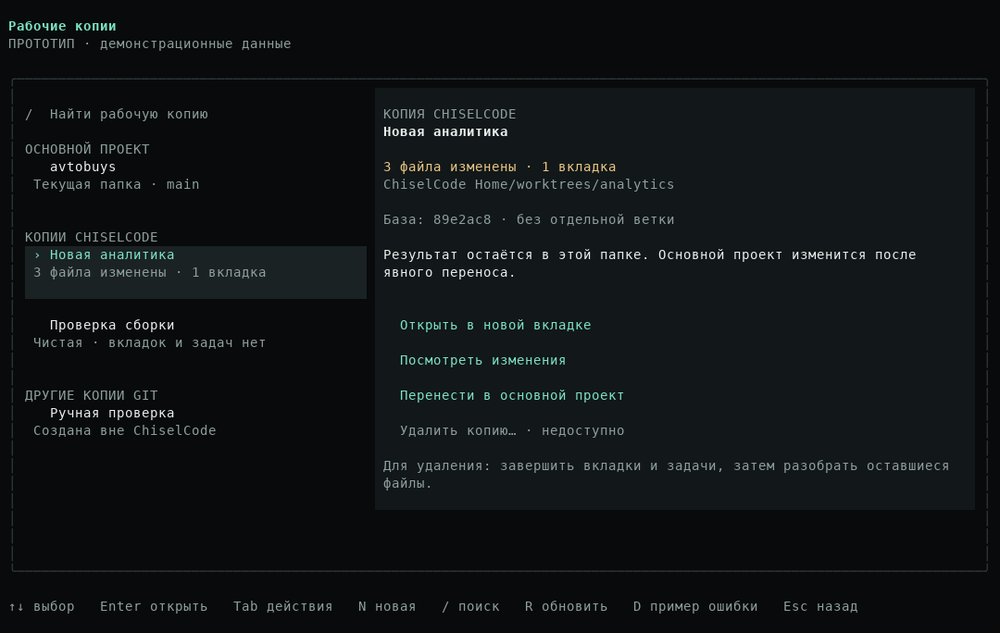
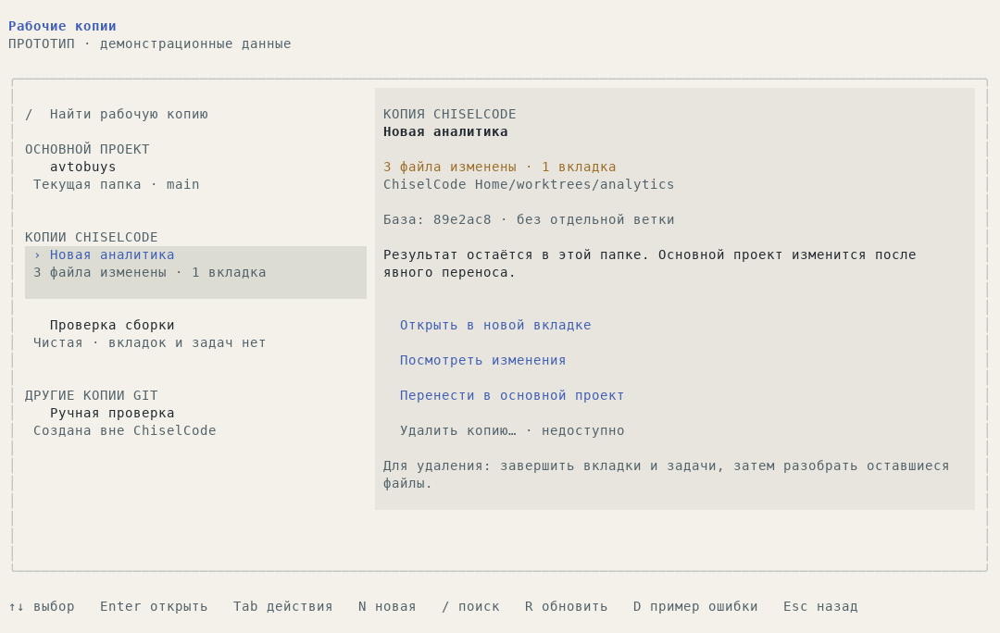
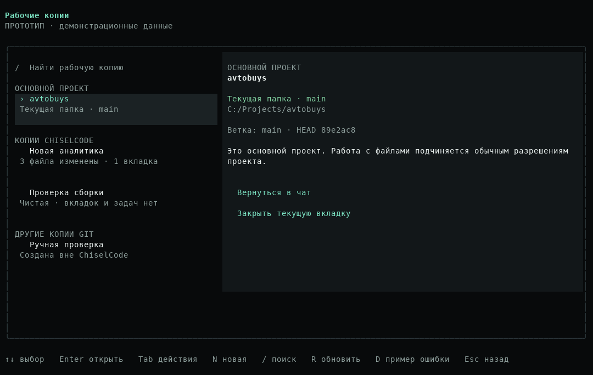
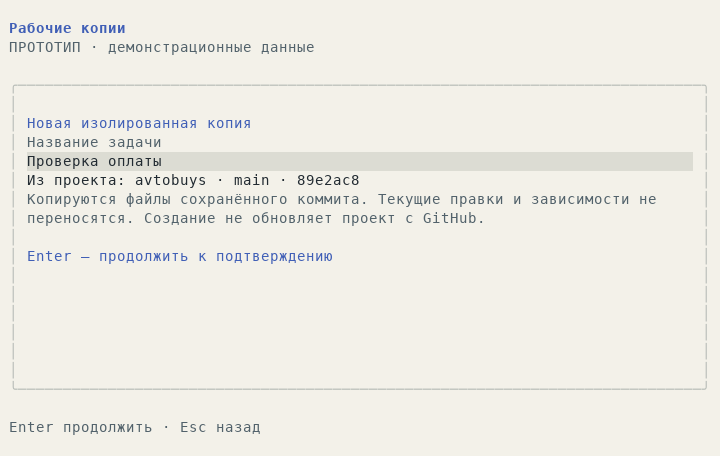
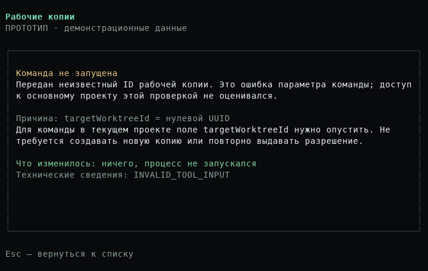
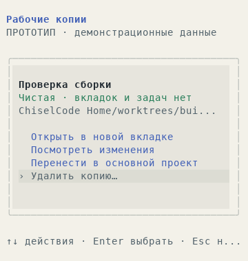

# Предложение: графическое управление рабочими копиями

[Материалы для участников](../README.md) · [Разбор исходной сессии](../reports/worktree-session-review.md) · [Текущие команды](../../worktrees.md)

Статус: реализовано и опубликовано в [CLI 0.6.40](../reports/release-0.6.40.md). Ниже сохранены план и демонстрационные кадры от 24 октября 2026 года (`de9a4cf`); актуальные сценарии описаны в [руководстве](../../worktrees.md), реализация и проверки — в [отчёте](../reports/worktree-manager-0.6.40.md). Прототип не импортируется в приложение. Desktop не входит в выпуск CLI.

## Что пользователь должен понимать

Менеджер отвечает на пять вопросов: где я работаю, зачем нужна отдельная копия, что в ней изменилось, как вернуть результат и как закончить работу. UUID, внутренний реестр и Git leases не должны быть обязательными знаниями пользователя.

Рабочая копия — отдельная папка для независимой задачи. Создание копии не скачивает последнюю версию GitHub, не переносит текущие незакоммиченные файлы и не делает обычный проект «доступным для записи». Для обновления основного проекта отдельная копия не нужна.

Главное изменение модели интерфейса: **основной проект, владение копией и разрешения на работу с файлами — разные сущности**. В исходной сессии агент и пользователь потеряли это различие из-за общей метки «Внешняя (только просмотр)».

## Вход в меню

- `/worktree` без аргументов в интерактивном режиме открывает менеджер; в одноразовом CLI сохраняется текстовый/JSON-список.
- В существующем правом меню появляется пункт «Рабочие копии» в группе «Проект». Он доступен и через мышь, и через действующий порядок клавиатурного фокуса.
- Название текущей копии в панели контекста открывает ту же карточку. Для обычного проекта показывается «Основной проект», а не «Внешняя».
- Существующие `/worktree create/list/status/diff/open/apply/remove` сохраняются для автоматизации и опытных пользователей. UUID можно копировать из подробностей; вручную вводить его в меню не требуется.

Не вводим ещё одну обязательную глобальную F-клавишу и не возвращаем `/help`. Горячие клавиши на главной сохраняются. Открытие менеджера не отправляет запрос модели, не создаёт пользовательское сообщение и не очищает черновик чата.

## Главный экран

На широком терминале слева список, справа сведения и действия выбранной строки. Одна внешняя рамка, спокойные поверхности, чёткие названия, свободная строка между группами. Встроенные темы и `themePalette` задают цвета; отдельная палитра для менеджера не нужна.

Группы имеют фиксированный смысл:

| Группа | Что здесь находится | Основное действие |
| --- | --- | --- |
| Основной проект | Исходная папка, относительно которой созданы управляемые копии | Вернуться в её разговор или открыть разговор по проекту |
| Копии ChiselCode | Копии с проверенным владением в реестре | Открыть, посмотреть результат, перенести, удалить при допустимом состоянии |
| Другие копии Git | Копии, найденные Git, которыми менеджер не владеет | Посмотреть сведения и скопировать путь |

Основной проект показывается один раз, отдельно от остальных внешних копий. Для каждой строки достаточно названия, признака текущей папки и короткого состояния: «3 файла изменены», «Открыта в 2 вкладках», «Используется задачей», «Нужна проверка». Текст остаётся понятен без цвета. UUID и полный SHA скрыты в раскрываемых технических сведениях.

Карточка справа показывает путь, исходный проект, базу, текущий HEAD, изменения и пользователей папки. Путь можно раскрыть и скопировать целиком; сокращение строки не меняет фактический путь операции. При отсутствии данных показывается «Не проверено», а не нули и не «Чистая».





## Карточка основного проекта

Текст: «Это основной проект. Работа с файлами подчиняется обычным разрешениям проекта». Это объяснение области прав, а не обещание наличия разрешения или успешного доступа ОС.

Действия: «Вернуться в чат», «Закрыть текущую вкладку», «Создать отдельную копию». Если разговора по исходной папке нет, приложение открывает его по проверенному origin, сохраняя admission lease до привязки scope. При нескольких разговорах предлагается выбрать нужный, а не закрывать все.

Кнопки «Удалить основной проект» в менеджере копий нет. Удаление/повторное клонирование пользовательского проекта — другая операция с отдельным предметом поручения. Менеджер не должен заставлять пользователя создавать worktree ради обычной работы с файлами.



## Создание копии

1. «Новая копия» открывает форму с названием задачи и явным исходным проектом.
2. По умолчанию берётся текущий сохранённый коммит этого проекта. Выбор другой локальной ссылки находится в дополнительных параметрах. Удалённый fetch не происходит скрыто.
3. Если в origin есть изменения, форма сообщает их количество и объясняет: они останутся в origin и не попадут в копию. Создание от committed base остаётся доступным, когда это допускает текущий backend.
4. Перед подтверждением видны название, исходная папка, выбранная база, место создания и отсутствие автоматической установки зависимостей. Подтверждение проходит обычный ToolExecutor/ApprovalGate.
5. После успеха доступны «Открыть в новой вкладке» и «Остаться здесь». Открытие не меняет корень уже работающего разговора.

Если в Git ещё нет коммита, это отдельное объяснимое состояние: «Для изолированной копии нужен первый коммит. Можно продолжать работу в основном проекте». Меню не предлагает автоматически закоммитить все файлы.



## Просмотр и перенос результата

Карточка управляемой копии содержит «Посмотреть изменения» и «Перенести в основной проект». Показываются реальные staged/unstaged/untracked/ignored/conflict counts и отдельный признак новых коммитов относительно известной базы.

Предпросмотр использует штатные карточки diff. В шапке всегда видны **источник и назначение**. Пользователь может выбрать поддерживаемые файлы; выбранный набор проверяется целиком. Новый коммит, рабочие правки и допустимые новые файлы входят в результат по текущему контракту `WorktreeService`, а не только в `git diff HEAD`.

Кнопка продолжения открывает существующее подтверждение. Между просмотром и записью backend повторно проверяет revision, пути, HEAD/index и содержимое. Конфликт не маскируется зелёной кнопкой: показываются затронутые файлы, причина и действие «Обновить сравнение». Нет автоматического force, stash или overwrite. Неподдерживаемые файлы имеют конкретную причину.

После переноса: «Перенесено N файлов в основной проект. Копия сохранена». Действия: «Открыть основной проект», «Остаться в копии». Не обещаем, что копия стала чистой или теперь может удаляться.

## Закрытие и удаление

| Действие | Последствие |
| --- | --- |
| Закрыть менеджер | Возврат в текущий чат с прежним черновиком |
| Закрыть вкладку | Закрывается выбранный разговор; файлы копии сохраняются |
| Вернуться в основной проект | Выбирается или открывается разговор по origin; копия сохраняется |
| Удалить копию | Удаляется конкретная управляемая папка после проверки и разрешения |

При закрытии вкладки с работающей задачей используется действующий lifecycle отмены и cleanup. Интерфейс прямо пишет «Остановить задачу и закрыть вкладку», если это фактический эффект; не обещает продолжение процесса после закрытия. Спокойная вкладка закрывается обычным действием без дополнительного подтверждения удаления.

Удаление доступно только для своей копии при подходящем состоянии. Если оно заблокировано, рядом остаётся причина и полезное действие:

| Причина | Что показать |
| --- | --- |
| Открытые вкладки | Список разговоров и переход к ним |
| Работающий помощник/процесс | Ссылка в действующее окно агента или фоновой задачи |
| Изменённые/new/ignored файлы | Количество по категориям и просмотр списка; `node_modules` и кэш не исчезают из проверки |
| Нужна проверка владельца или регистрации | Диагностика идентичности и путь, без предложения принудительного удаления |

Финальное подтверждение показывает название и полный путь папки, факт сохранения основного проекта и сохранённую ссылку на commit-result, если она нужна. По умолчанию выбран безопасный возврат. Реальная проверка повторяется перед удалением. Нет сценария «очистить всё, чтобы кнопка стала доступной».

## Ошибки и восстановление понимания

Ошибку команды нужно объяснять в области её возникновения. Для нулевого `targetWorktreeId`: «Команда не запущена: указан неизвестный ID копии. Для текущего проекта этот параметр нужно опустить». Отдельно: «Эта проверка не определяла права записи основного проекта».

Не следует предлагать создавать/регистрировать копию или повторять Bypass для ошибки аргумента. При настоящем mismatch идентичности остаётся `WORKTREE_RECOVERY_REQUIRED` с проверкой Git/реестра; неизвестный ID и повреждённый реестр не должны иметь одно неразличимое объяснение.



Пустое состояние, загрузка, не-Git папка, отсутствие Git, отсутствие первого коммита, частично недоступный список и устаревшее сравнение проектируются отдельно. При сбое refresh сохраняется последний снимок с меткой «Данные устарели», а не выводится «Копий нет». «Повторить» повторяет чтение, не mutation.

## Клавиатура, мышь и размеры

Внутри менеджера ↑/↓ выбирают строку, Enter открывает карточку или выполняет выбранное безопасное действие, Tab/Shift+Tab переключают зоны. N открывает создание, `/` — поиск, R обновляет снимок. Эти буквы не перехватываются в текстовом поле. Esc закрывает вложенный экран, затем менеджер; в форме черновик сохраняется при возврате.

Production использует существующие `useUiKeyboard`, `useOverlayInputOwner` и захват mouse/input revision. Событие, открывшее экран, не должно подтверждать действие в новом экране. Открытое окно разрешения имеет приоритет; вставка, удерживаемый Enter, drag и выделение текста не запускают кнопку. Подтверждение не привязано к одному случайному нажатию в списке.

| Размер | Компоновка |
| --- | --- |
| От 100 колонок и 28 строк | Список и карточка рядом, footer с текущими действиями |
| 60–99 колонок или небольшой height | Список → отдельная карточка; основные кнопки видимы сразу |
| 32–59 колонок | Один экран за раз, короткий заголовок, сведения прокручиваются отдельно от основных действий |
| Меньше 32 колонок или 12 строк | Компактное сообщение и гарантированное действие возврата; mutation не подтверждается в обрезанном окне |

Фокус, выбранный ID, поиск и черновик формы переживают resize. Выбранная строка автоматически остаётся видимой при навигации и фильтрации; действия не прячутся под длинным описанием. Обновление списка удерживает выбранный ID, а не индекс строки. Если запись исчезла, карточка сообщает это и не подставляет другую папку под прежнюю кнопку.



## Данные и интеграция

Backend остаётся единственным источником прав на создание, перенос и удаление. UI не собирает команды shell, не восстанавливает пути по UUID и не копирует алгоритм переноса файлов.

1. `WorktreeDescriptor` получает явный `kind: origin | managed | external` и область ограничений управления. Старое `readOnly` сохраняется для совместимости до миграции потребителей; новый UI и описание для модели не трактуют его как filesystem permission.
2. Доступность каждого действия передаётся отдельно: `available`, `requiresApproval`, либо `blocked` с кодом причины и данными для перехода. Это подсказка UI, не grant; финальный backend всё проверяет повторно.
3. `base/head` и признак commit-result отображаются только при подтверждённых исходных данных. Для external с отсутствующей `base` условие `head !== base` не означает новый результат.
4. Снимок связывается с repository/workspace identity и revision. Capability и внутренние планы не сериализуются в UI DTO. View/session metadata остаётся данными отображения.
5. Менеджер читает состояние через узкий application port к текущему workspace service. Мутации выполняет штатный command/tool path с реальными policy, grants и lifecycle; открытие origin/managed вкладки использует проверенный core admission.
6. Строка `/worktree` перехватывается как UI-действие только без аргументов в интерактивной оболочке. CLI JSON, старые subcommands и SDK сохраняют прежний контракт.

Опорные места: [расширение worktrees](../../../src/extensions/builtins/worktrees.ts), [сервис](../../../src/worktrees/service.ts), [выполнение команд](../../../src/app/run-command.ts), [создание вкладки](../../../src/ui/opentui-agent.tsx), [правое меню](../../../src/ui/opentui-spike.tsx), [input ownership](../../../src/ui/overlay-input.ts).

## Порядок внедрения

| Этап | Результат | Условие завершения |
| --- | --- | --- |
| P0. Исправить смысл и диагностику | Разделены origin/managed/external и область `readOnly`; nil/unknown ID отличается от identity mismatch; нет ложного commit-result | Реальный обычный проект остаётся доступен штатным инструментам по своей policy; ошибочный ID не запускает процесс и не направляется молча в другой root |
| P1. Менеджер просмотра | Пункт меню, `/worktree`, список, карточка, поиск, переход в origin/копию, закрытие вкладки | Реальные workspace scopes, стабильные ID и draft; нет запроса модели и скрытого создания копии |
| P1. Полный рабочий сценарий | Формы создания, штатный diff/apply, причины блокировки и безопасное remove | Пройдён цикл create → open → edit → preview → apply → close → remove, включая отказ и stale |
| P2. Полировка и доступность | Resize, мышь, Paper/тёмные темы, loading/empty/error, подписи и справка | Проверены целевые размеры, фокус/ввод/selection и понятность действий; нет смены назначения при refresh |

Сначала P0: новое красивое окно поверх ошибочного смысла `readOnly` повторит тот же тупик. Отдельный мастер клонирования/замены проекта с GitHub не включается скрыто в работу над менеджером копий.

## Проверки перед внедрением

- Runtime: nil и произвольный неизвестный ID; настоящий identity mismatch; обычный origin с shell/file tools; чужой owner; удаление external; live writer/unknown cleanup; игнорируемые файлы; retention коммитов; конфликт и изменение после preview.
- Git: LF/CRLF и `core.autocrlf` под реальной Windows, расхождение Git-инструмента и shell; наблюдения о чистоте имеют источник и время.
- OpenTUI: keyboard/mouse, одна активация на событие, ввод/вставка, несколько вкладок одного root, возврат в origin после перезапуска, resize во время формы и проверки разрешения, 120×36/100×30/80×24/40×20/24×8.
- Поставка: существующий source runtime/реальный TUI fixture дополняются новыми assertions; быстрый профиль остаётся без renderer и процессов. Для финального продуктового изменения — проверки качества и подходящие installed/compiled smoke, платформы отмечаются отдельно.
- UX-проверка: пользователь без UUID находит текущую папку, создаёт копию, возвращает изменения, закрывает вкладку и объясняет, какие файлы останутся. Наблюдение пользователей ещё не проводилось; текущие выводы основаны на одной полной сессии и коде.

## Что можно посмотреть сейчас

[Интерактивный прототип](../../../scripts/worktree-menu-prototype.tsx) использует настоящие OpenTUI React renderables и встроенные темы. Он показывает демонстрационные данные, не вызывает Git, сеть или инструменты проекта. Создание/перенос/удаление в нём — экраны предложения, а не реализованный backend.

```bash
bun scripts/worktree-menu-prototype.tsx
bun scripts/worktree-menu-prototype.tsx --paper
bun scripts/worktree-menu-prototype.tsx --capture /tmp/chisel-worktree-menu-captures
python scripts/render-terminal-captures.py /tmp/chisel-worktree-menu-captures
```

На Windows вместо `/tmp/...` укажите отдельный временный каталог. Скрипт экспорта PNG использует Pillow и пути шрифтов среды Linux; для воспроизведения на другой ОС нужны соответствующие локальные пути. PNG в этом предложении экспортированы из реальных `captureSpans` JSON; исходные JSON/TXT хранятся рядом с выбранными кадрами.

Прототип проверен на Linux x64/Bun 1.4.4: две темы, 16 кадров на 120×36, 80×24, 40×20 и 24×8; переходы клавиатурой, поиск без совпадений, ввод и сохранение названия, возврат/resize. Отдельные TypeScript и Biome проверки прошли. Нативный renderer подтверждает компоновку и эти взаимодействия в тестовой среде; физические терминалы, мышь и продуктовый backend этим результатом не покрыты.

Применён [навык OpenTUI](https://github.com/msmps/opentui-skill), установленный командой пользователя через `npx skills add`. Использованы React, layout, keyboard, input и testing references. API сверялся с установленным OpenTUI 0.5.12: например, для немедленного обновления поля нужен `onInput`; одного `onChange` для живого поиска недостаточно.
