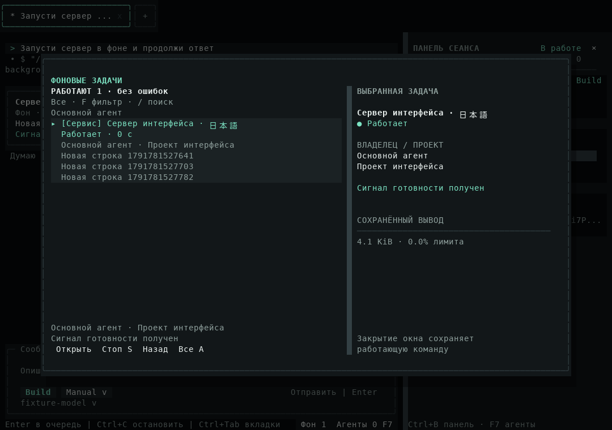
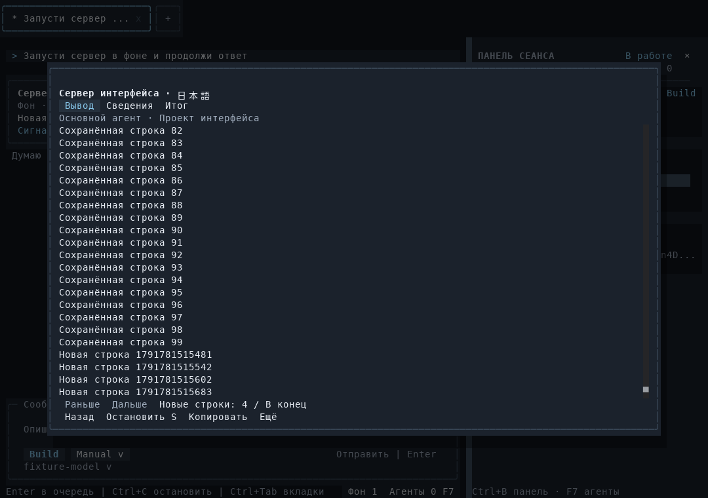

# Проверка Background Tasks

[Материалы участников](../README.md) · [Пользовательская справка](../../background-tasks.md) · [Внутренний контракт](../../architecture/background-tasks.md)

## Статус

Изменения сделаны прямо в `main`, без новой ветки, development worktree, PR, push или релиза. Исходная база: `926d67e`, package 0.6.22, OpenTUI 0.5.12. Новая функция не входит в опубликованный v0.6.22. Изменение UI по поручению владельца: кнопка в «Меню» открывает отдельное нативное окно; исходные три вкладки боковой панели сохранены.

Этот отчёт отделяет локальные результаты от межплатформенного acceptance. Roadmap не помечен completed/released: Windows/macOS и удалённый CI текущего изменения не запускались. Новые production process/junction/installed/compiled проверки добавлены в существующую матрицу трёх ОС.

## Реальные сценарии

- `background-process.test.ts`: stdin EOF и exit 7, output pipes после leader exit, один process instance при detach, split secrets/OSC/UTF-8, атомарная передача local/durable resources, реальный symlink/junction, TERM-игнорирующий потомок и Linux detached orphan с честным unknown.
- `background-runtime.ts`: default contributions и executor запускают batch, service с обычным потомком и потоковым выводом, дедуплицируют принятие, сохраняют exit/output; очередь 8 и overflow; foreground promotion со spawn count 1, прежним deadline и безопасным старым abort. Owned P2.1 copy начинается от committed base; origin file tools продолжаются, common Git/shell и apply/remove получают busy; последующий apply сохраняет HEAD/index/unrelated dirty bytes. Два независимых проекта работают параллельно; закрытие одной настоящей вкладки останавливает её процесс и сохраняет сервер другой. Fault adapter ломает запись running после настоящего spawn: процесс останавливается, результат показывает failed, ресурсы освобождаются после cleanup. Отдельный сбой terminal checkpoint настоящего завершённого процесса сохраняет fence до explicit recovery по private cleanup proof; два recovery-вызова получают одну revision.
- `subagents-runtime.ts`: настоящий parent → два coding child model/tool loops через controlled HTTP adapter, реальные Git/files/stores; каждый child запускает bounded batch в своей копии. Root сохраняет child attribution, реальные outcomes и accounting; child terminal ждёт cleanup, copy apply после него проходит обычные конфликты.
- `tui-background.ts`: ordinary `runOpenTuiAgent`, реальная service-команда и native renderer. Busy main продолжает model request; `/tasks`, окно/логи/локальный поиск/resize/selected stop не создают model requests. Ctrl+C при чтении не отменяет main, закрытие viewer не stop. Пауза follow оставляет старые строки на месте и показывает новые; настоящий mouse action «В фон» сохраняет карточку и один запуск. HTTP adapters контролируемые, процесс и UI настоящие.
- `background-crash.ts`: реальный отдельный процесс приложения завершается SIGKILL; ordinary CLI читает Session и сохранённый вывод. Команда не повторяется; исходный PID не подключается и не убивается, durable resources остаются занятыми, recovery без private proof отклоняется.
- `background-cli.ts`: ordinary package и compiled CLI запускают реальную команду exit 7 в пути с кириллицей и двойными пробелами, читают retained output/status после resume без replay/model; Plan отклоняет start. `command-packaging.ts` проверяет installed bundle и compiled native TUI через тот же backend.

## Проверки и пределы доказательства

Локальная платформа — Linux x64, Bun 1.4.2, OpenTUI 0.5.12; проверки завершены 12.10.2026.

| Проверка | Фактический результат |
| --- | --- |
| `bun run typecheck` | Успешно |
| `bun test` | 1133 passed, 1 skipped, 0 failed; 130 файлов, 10298 assertions |
| Финальные process/background/child/worktree/UI regressions | 35 passed, 415 assertions; настоящие процессы, Git, stores, persistence fault и recovery |
| Нативные состояния / список / listeners | 8 passed, 233 assertions; максимум 64 смонтированных task rows, resize listeners не растут после 12 повторных открытий |
| Production TUI captures | 8 успешных прогонов: четыре темы × Unicode/ASCII; отдельно настоящий mouse promotion |
| `bun run lint` | Без ошибок; 165 warnings, 14 infos |
| `bun run eval --category all` | 14 из 14 сценариев успешно |
| `bun run build`, `bun run compile` | Успешно |
| `command-packaging.ts` | Успешно: installed npm, compiled native TUI, прежние LSP/worktrees/subagents/`/btw` |
| Bundle и compiled `background-cli.ts` | Успешно: exit 7, retained output/resume, отсутствие replay/model, Plan refusal, сохранение пробелов команды |

Пропущен существующий тест обмена Unicode через системный clipboard: среда не предоставляет desktop clipboard. После полного набора отдельно проверены два последних исправления: остановка при ошибке сохранения сразу после spawn и сохранение пробелов в `/tasks start`. Предупреждения React `act` относятся к тестовым потоковым кадрам; `MaxListenersExceededWarning` в финальных процессных/TUI прогонах не обнаружен. Lint сохраняет предупреждения `noNonNullAssertion` и существующие диагностические замечания; это не проверка с нулём warnings.

Intentional daemon escape и ограничения ОС не объявляются универсально очищенными; unknown сохраняет recovery block. Linux использует process group и subreaper; для macOS/Windows требуется удалённая проверка обычных descendants, быстрого выхода leader и packaged helper. CPU/RAM quotas, PTY/stdin, daemon/reconnect, auto restart и HTTP readiness probe не реализованы. Локальный Linux не заменяет проверки Windows/macOS. Recovery metadata не является доказательством отсутствия descendants и не разрешает kill восстановленного PID. После crash или неизвестного escape без подтверждения исходного backend автоматического снятия fencing и универсальной кнопки освобождения нет.

## Кадры интерфейса

Кадры получены production `runOpenTuiAgent` через `captureCharFrame` и `captureSpans`; PNG экспортированы из фактических spans скриптом `scripts/render-terminal-captures.py`. Browser/imagegen mockups не используются. Матрица: 160×50, 120×40, 80×24, 40×12, 24×8; темы Obsidian/Graphite/Ember/Paper, Unicode и ASCII, длинное русское название с wide characters.

[Полная матрица TXT / JSON / PNG](../../assets/background-tasks/README.md) содержит 114 кадров, по три файла на кадр. `ordinary-tui` показывает настоящий production process flow; `state-projection` отдельно проверяет отображение running/queued/approval/failed/cleanup_unknown и предел mounted rows на контролируемых DTO. Он не доказывает запуск 256 процессов.

Вручную просмотрены PNG списка Obsidian, логов Graphite с паузой follow, состояния cleanup_unknown в Ember и маленького Paper 24×8: текст и действия доступны, footer не перекрывает body. Дополнительные тесты проверяют open/stop/back на каждом размере.





## Воспроизведение

```bash
bun run typecheck
bun test
bun run lint
bun run eval --category all
bun run build
bun run compile
bun tests/fixtures/command-packaging.ts
bun tests/fixtures/background-cli.ts ./dist/chisel
CHISEL_CAPTURE_DIR=/absolute/captures CHISEL_CAPTURE_UNICODE=1 bun tests/fixtures/tui-background.ts
CHISEL_CAPTURE_DIR=/absolute/captures CHISEL_CAPTURE_PROMOTION=1 bun tests/fixtures/tui-background.ts
CHISEL_BACKGROUND_STATE_CAPTURES=/absolute/captures bun test tests/unit/opentui-background.test.tsx
python3 scripts/render-terminal-captures.py /absolute/captures
```

Тематическая справка и архитектура возвращаются к оглавлению; interactive/configuration/permissions/sessions/worktrees/subagents/CLI содержат короткие ссылки на workflow и ограничения. Новая функция описана как unreleased, существующие release availability не переписаны.
