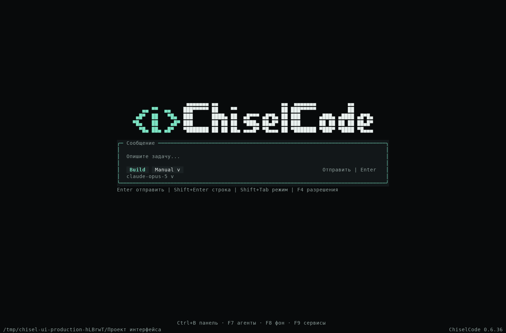
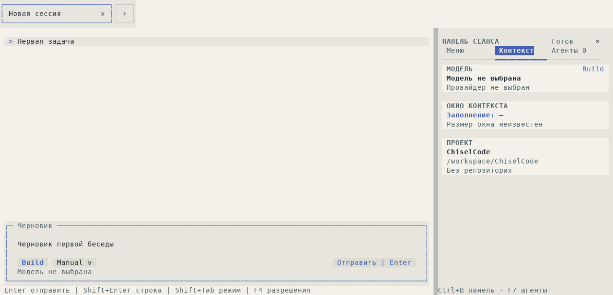

# Чистая главная, горячие клавиши и автоматическая панель

[Материалы участников](../README.md) · [Интерактивный режим](../../interactive.md) · [Клавиши](../../keybindings.md) · [Дизайн панели](../../design/sidebar.md)

Изменение подготовлено для CLI 0.6.36. Работа выполнена в `main`; исходный HEAD — `52392c5`. Результаты публикации и проверки файлов будут добавлены после завершения Release workflow.

## Изменение

Общая строка ввода больше не проецирует `status` contributions в кнопки «Фон», LSP, «Агенты» и «Ещё». Это одно изменение для главной и всех бесед, без фильтрации текста по названиям. Источники, счётчики, ошибки, revision и действия доступны через компактное окно F9 и **Меню → Состояние сервисов**. Внешние пакеты сохраняют свой SDK и прежние действия.

F7 открывает дерево помощников, F8 — существующий owned navigation `/tasks`, F9 — список сервисов. F8 использует ту же subscription/action revision и `ExtensionUiBinding`, что меню; горячая клавиша не очищает черновик и не создаёт model/tool запрос. Подтверждения, настройки, побочные ответы и другие активные окна сохраняют приоритет ввода.

Причина отсутствия правой панели была в глобальном `sidebarMode`: закрытие переносилось между экранами и записывалось в настройки. Теперь видимость принадлежит текущему `OpenTuiScreen`. При каждом входе в беседу снова действует Auto, без перехвата ввода; на главной панель скрыта до явного открытия. Выбранный раздел и данные беседы сохраняют прежнего владельца. С ширины 120 колонок панель размещается справа; на узком терминале явное Ctrl+B/F7 открывает drawer/fullscreen, сохраняя чат видимым при обычном входе.

Старое `ui.sidebarMode` совместимо читается и удаляется при сохранении. Тема, accent, будущие поля, профили и credentials сохраняются. Тип legacy input оставлен с пометкой deprecated; настройка больше не используется приложением.

## Настоящие кадры

Все восемь кадров, их TXT/JSON и происхождение: [галерея](../../assets/clean-navigation/README.md). PNG — экспорт native spans, без дорисовки интерфейса.

## Проверки

- Linux, Bun 1.4.3: 62 pass в шести файлах layout/config/navigation/sidebar; 15 pass в шести файлах owner bindings, вкладок, подтверждений, side query, subagents, composition и production navigation. Дополнительные assertions изоляции F8/F9 в settings/side query прошли в 10 тестах двух файлов.
- Быстрый профиль: 360 pass, 0 fail. Typecheck и lint прошли; существующие предупреждения не отключались.
- Обычный `runOpenTuiAgent` в Obsidian и Paper: чистая главная, F9, меню, внешние подробности, нормальный approval, реальная запись файла, checkpoint и disposal. Отдельно прошли ordinary background fixture с F8 во время busy main и F9 со счётчиком активной команды; внешний loader с сохранением черновика/фокуса и выполнением штатного инструмента.
- Собран CLI/SDK и compiled UI harness обычного приложения; проверены native slots, F9, навигация, approval, файл и checkpoint.

Первый локальный запуск LSP config остановился из-за отсутствующих закреплённых test dependencies; после подготовки `typescript-language-server@6.0.1` и `typescript@6.0.3` файл прошёл целиком. Две новые проверки первоначально обращались к ID диалога без суффикса `-popup`; ID исправлены. Внешний fixture использовал неверное имя mock-клавиши `escape`; заменено на штатное `ESCAPE` и добавлено ожидание закрытия окна. Assertions не пропускались, production timeout не менялся.

Результаты итоговой CI фиксируются после её завершения. Локальные native кадры и compiled harness проверены на Linux; Windows/macOS не выдаются за локально проверенные платформы.
