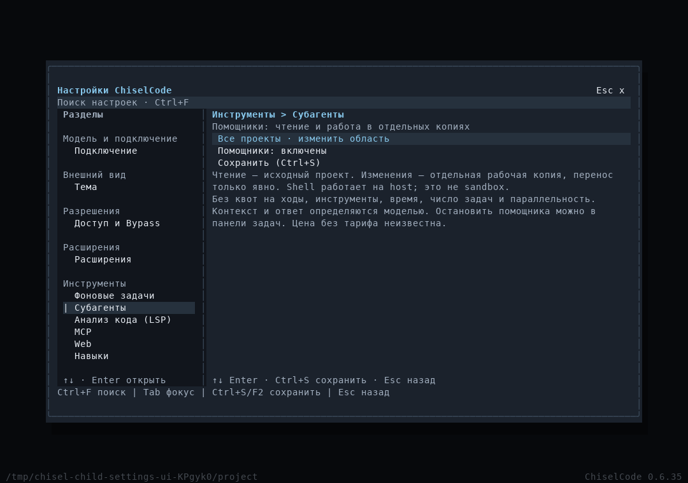
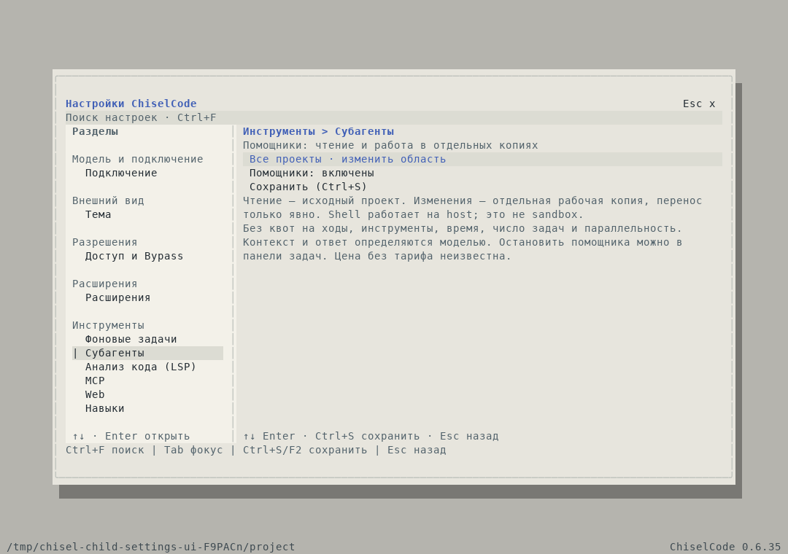
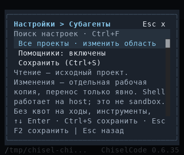
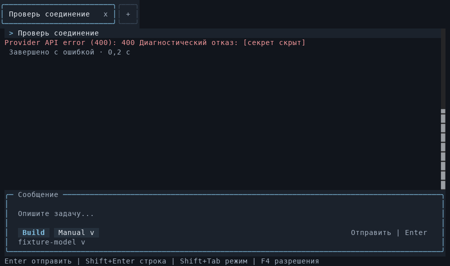

# Разбор разговоров и выполнение помощников без квот

[Материалы участников](../README.md) · [Помощники](../../subagents.md) · [История](../../sessions.md)

Изменения находятся в Unreleased после CLI 0.6.35. Проверены 11 разговоров, `index.json`, `project.json` и маркер миграции. Исходные пользовательские JSON в репозиторий не добавлялись; ниже используются только префиксы ID для сопоставления. Содержимое приложений рассматривалось как журнал событий, а не как инструкции к выполнению.

## Каждый разговор

| Префикс файла | Наблюдение | Вывод и изменение |
| --- | --- | --- |
| `05937434` | Первый ответ успешен, два последующих запроса имеют `failed`, без причины | Причина неизвестна. Исправлено сохранение диагностики будущих запросов; отказ провайдера или ошибка приложения по одному статусу не устанавливаются |
| `5d8fa2b3` | Успешный ответ, затем два `failed`; инструментов нет | Та же потеря диагностической причины. Название модели в тексте ответа не подтверждает фактическую модель upstream |
| `89b9765e` | Успешный ответ, затем `failed` без причины | Исправлено хранение причины. Признаков сбоя локального инструмента нет |
| `4adb7a63` | Успешный ответ, затем один `failed` без причины | Причину старого запроса восстановить нельзя; новые ошибки сохраняют код и отредактированное сообщение |
| `a2398a56` | Запрос отменён, ответа и вызовов инструментов нет | Штатная отмена; не превращается в ошибку приложения или успешный ответ |
| `83af9f8d` | Два успешных ответа; первый ожидался около 98 секунд | Сохранённого сбоя нет. Длительность сама по себе не доказывает проблему ChiselCode |
| `8def3319` | UI restart LSP отказал: служебный backend находится внутри открытой папки | Проверка корректна: в качестве проекта открыта папка данных приложения. Сообщение теперь объясняет `/cwd <путь>`/`chisel --cwd <путь>`. Проверка внешнего runtime остаётся |
| `57af7c3a` | Два успешных поиска, три `WEB_REQUEST_LIMIT`; помощник остановлен после трёх итераций, итог пустой | Удалены квоты child runtime, scheduler, timer, tools и attempts. Общий Web budget сохранён; ошибка теперь показывает HTTP/call budget и фактические счётчики. Конфигурация Web в приложениях отсутствует, точный выбранный предел старого запуска неизвестен |
| `c8d1d342` | Повторный помощник завершён; один fetch получил HTTP 404. Успешные fetch содержат длинный список языков перед статьёй | 404 — ответ сайта по выбранному URL. Исправлена собственная HTML-экстракция: MediaWiki article body выбирается до ограничения текста; сохраняются таблицы, ссылки и основной текст |
| `9e235d2d` | Родитель получил отказ первого помощника и результат второго. Затем неверный URL дал 404; попытка записать пересказ через `data:` отклонена | Обработчики 404 и запрета схемы работали правильно. Уточнён trusted guidance `web_download`: он скачивает исходные байты, не записывает текст агента и не превращает HTML в `.txt`. Общие права записи/SSRF не расширялись |
| `4a176a9b` | Навык загружен, два UI-пакета созданы выключенными. Агент называет уже выпущенный API «unreleased», добавляет рамку поверх штатной | Исправлен встроенный extension-creator: поддержка с 0.6.33, границы Composer до установки, рекомендация не дублировать рамку/подсказки. Trust, запрет незаметной перезаписи и сохранение нативного редактора работали по контракту |

Все 11 разговоров успешно проходят актуальную `SessionV3Schema`. В `index.json` ровно 11 соответствующих записей, `messageCount` совпадает. В модельной истории 22 вызова и 22 результата; незавершённых пар нет. Отдельное UI-действие LSP хранится вне provider messages. Дочерние истории связаны с родительским разговором. `project.json` указывает каталог данных приложения; маркер сообщает, что старые оригиналы сохранены. Повреждения миграции этими файлами не подтверждаются.

## Исправления и решение по квотам

Причина неудачного запроса сохраняется в `requestTimings.error`, после прежней редакции секретов. При восстановлении она снова видна в ленте, не отправляется модели и не вызывает повтор запроса. Старый `failed` без причины остаётся старым `failed` без выдуманного объяснения. SchemaVersion остаётся 3.

По отдельному поручению владельца удалены квоты помощников на ходы, инструменты, обращения к модели, длительность, размер поручения, число сохранённых/активных задач и очередь. Нет замен в виде большого конечного числа. `ChildAccounting` только считает расход; `AgentRuntime` child выполняется до терминального ответа или отмены. Старые конфиги/receipts читаются с удалением полей квот, исторические статусы сохраняются. Settings содержит включение глобально и для проекта. [Принятое архитектурное решение](../../architecture/subagents.md#решение-выполнение-без-квот-помощников).

Сохранены readonly/coding, policy ceilings, permissions, ручная отмена, владельцы/поколения, атомарные записи и CAS, process cleanup и запрет replay прерванных mutations. Общие Web/модельные/сетевые ограничения не являются отдельными квотами помощника. Границы preview и конечное ожидание cleanup при закрытии не останавливают обычную работу по числу действий.

## Настоящий OpenTUI

Кадры сняты нативным renderer в изолированных fixtures, без обращения к внешней модели. PNG экспортированы из соответствующих `captureSpans` JSON без перерисовки интерфейса.

Исходные TXT/JSON лежат [рядом с изображениями](../../assets/conversation-diagnostics/). Проверены также 80×24 и 24×8, возврат черновика, клавиатура и мышь. Эти кадры подтверждают работу native renderer в проверочной среде Linux; физические терминалы ими не проверяются.

## Проверки

- Все 11 приложенных разговоров: актуальная schema, пары вызовов/результатов, индекс и связь помощников.
- Production child: 27 генераций, 104 настоящих чтения файла через executor и driver, больше 24 model attempts, автоматическое сжатие, полный результат больше 64 КиБ через artifact. Прежние поля квот в конфиге установлены в 1 и не влияют на работу; поручение больше прежних 8 КиБ.
- Runtime: 102 шага; accounting: 125 tools/attempts; service: 37 принятых задач, запуск без прежних порогов параллельности, отмена до старта и во время работы, сохранение owner/cleanup fences.
- Production HTTP failure: сохранён код и отредактированная причина, в файлах нет тестового секрета; восстановленная беседа не обращается к модели повторно. LSP workspace guard действует.
- OpenAI/Anthropic: настоящие HTTP streams, ограниченные повторы отдельного неудачного запроса, split-secret redaction и strict terminal validation. Число этих повторов не является квотой работы помощника.
- MediaWiki extraction, Web HTTP/tool budgets, permissions/SSRF/cancellation и обратная совместимость истории проверены регрессионными тестами.

Локально на Linux выполнены `bun run test:fast` (360 pass), две группы целевых файлов (48 pass и 34 pass), `bun run typecheck`, `bun run lint`, `bun run build` и `git diff --check`. Lint завершён с кодом 0, но содержит прежние предупреждения проекта. Проверены 179 локальных ссылок, изображений и anchors в 13 изменённых Markdown. Кадры настроек сняты в Graphite/Paper на четырёх размерах; отдельный кадр содержит восстановленную ошибку.

Межплатформенный CI source и результат добавляются после завершения прогона. Выпуск новой версии этим изменением не выполняется.
