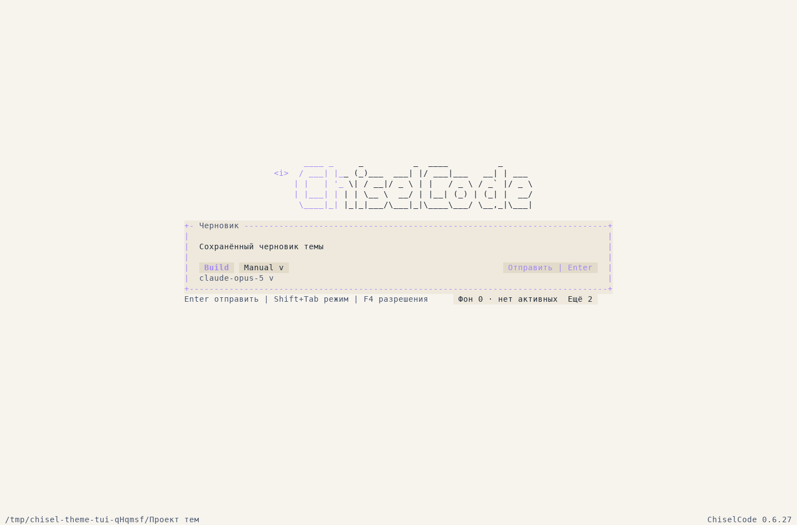

# Пакеты расширений: реализация и проверки

[Contributor index](../README.md) · [Пользовательское руководство](../../extensions.md) · [Контракт сервиса](../../architecture/extension-packages.md) · [Loader/SDK report](external-extension-loader.md)

Изменения находятся непосредственно в main; новых development branches/worktrees/PR нет. Для выпуска подготовлен 0.6.27, опубликованный 0.6.26 неизменен. Final source/CI/release сведения будут записаны после фактических проверок и публикации.

## Реализованное поведение

Общий PackageManagementService, bounded folder/streaming STORE/DEFLATE ZIP ingestion, immutable managed versions, separate exact trust, schema 1→2 migration, per-id CAS, journals/commit receipts/reservations/recovery. Production CLI: inspect/install/update/enable/disable/versions/rollback/remove/recover; прежний approve/Home-only loader/recovery flag сохранены.

Application version leases защищают installed/runtime bytes до shutdown/подтверждённого выхода. Crash use остаётся unknown. Owner markers вне hash, selected/active/unknown versions не стираются; legacy manual folders сохраняются. SDK v1, approved EffectPlan, UI/themes/accent и user state installer не меняет.

## Проверено на Linux

- Folder и STORE/DEFLATE ZIP дают одинаковый digest. Paths/case collisions/link attributes/CRC/metadata/encryption/truncation отклоняются без escape.
- Untrusted install disabled, factory не исполняется; source после install удалён. Exact update/rollback работают, denied/stale update сохраняет prior.
- Два отдельных приложения держат v1/v2: remove deferred, graceful process exit допускает cleanup, SIGKILL оставляет unknown lease и bytes.
- Реальные SIGKILL на published и registry_committed: первый не создаёт selection/trust, второй восстанавливает committed outcome без replay. Проверка включает прежний 30-секундный stale storage lock.
- Standalone TS author использует packed public declarations вне checkout; ordinary CLI install/approve/next-startup read tool, ZIP update, rollback, disable/enable/remove работают без internal source import.
- Ordinary runOpenTuiAgent: настоящие light/dark previews, draft/focus/theme/accent сохранены; update действует после restart, rollback возвращает тему, disable/remove дают fallback без изменения desired preference.

Полная suite: **1193 pass, 3 platform skips, 0 fail**, 11092 assertions, 144 files. Это Linux run, не доказательство Windows/macOS. Typecheck/build/compile прошли; lint завершился без ошибок (276 warnings, 50 infos). Все 14 eval-сценариев успешны.

Installed npm и compiled executable выполнили новый extension-packages-cli fixture: внешний author с публичными declarations, actual folder/ZIP, trust, ordinary SDK file tool, update/rollback/disable/remove после удаления source. Общий command-packaging smoke прошёл для CLI/TUI, /btw, LSP, worktrees, subagents, background processes, UI и тем. Existing external SDK CLI regression также прошёл: real read/write/Plan, model/child/background/worktrees, modified asset refusal, raw exit и recovery.

Один завершающий прогон был прерван изменением helper module во время тестов; его результаты исключены. Приведённые 1193 pass относятся к повтору на неизменных исходниках. После последнего fd-open hardening выполнен targeted package/loader regression; CI проверит окончательный commit целиком.

Platform CI нового source пока не объявлен успешным. Windows/macOS local запуск не выполнялся.

## Native кадры

56 комплектов TXT captureCharFrame / JSON captureSpans / PNG находятся в [docs/assets/extension-packages](../../assets/extension-packages). PNG построены из настоящих spans скриптом render-terminal-captures.py; browser/imagegen не использовались. Матрица включает 160×50/120×40/80×24/40×12/24×8, light/dark, Unicode/ASCII, details/approval, source failure, update до/после restart, rollback, disable/remove/fallback. Draft/focus и desired theme/accent проверяются assertions. Выбранные wide/small PNG просмотрены вручную; не заявляется ручной просмотр каждого файла.

[Тёмный каталог](../../assets/extension-packages/ascii/north-catalog-160x50.png) · [Светлый каталог 24×8](../../assets/extension-packages/unicode/linen-catalog-24x8.png) · [Настоящее разрешение SDK write](../../assets/extension-packages/ui-obsidian-ascii/external-approval-120x40.png) · [Details 24×8](../../assets/extension-packages/ui-obsidian-ascii/external-details-24x8.png).

## Документация и ограничения

Пользовательский маршрут отделён от author package/SDK API. Добавлены отдельные package lifecycle и architecture contracts. Quickstart использует SDK 0.6.26+ для themes; chat.register возвращает void, DTO возвращает render.

Нет Memory, marketplace/network installer, dependency scripts, full Settings → Extensions или hot unload/sandbox. Synchronous trusted JS может завершить/заблокировать приложение. Unknown crash use сохраняется и требует проверки, не unsafe PID cleanup.
