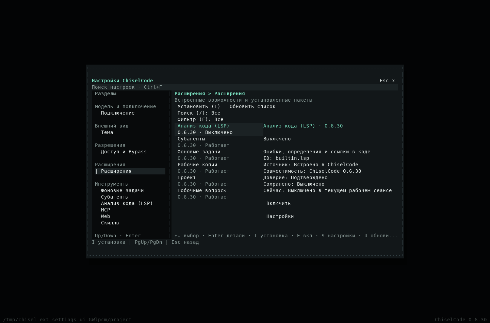
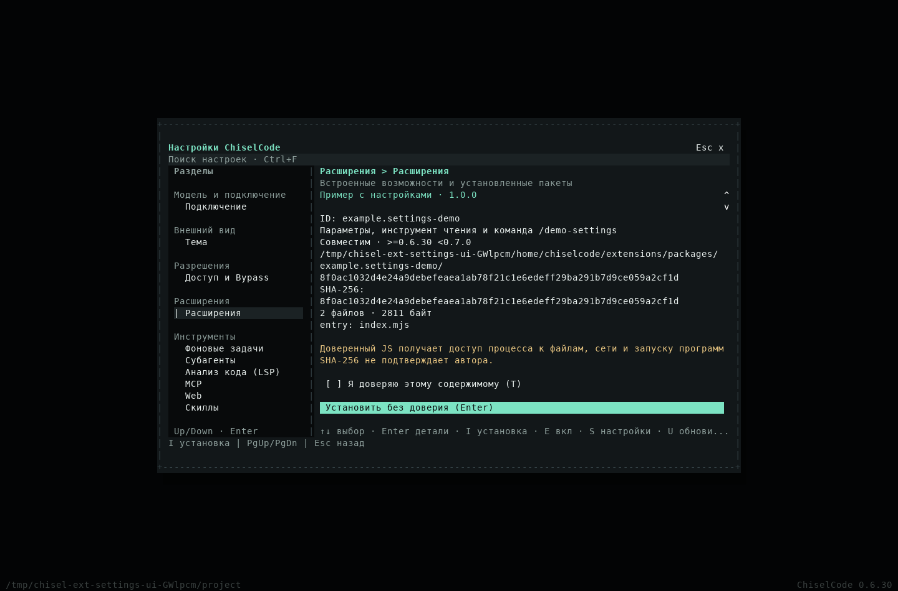
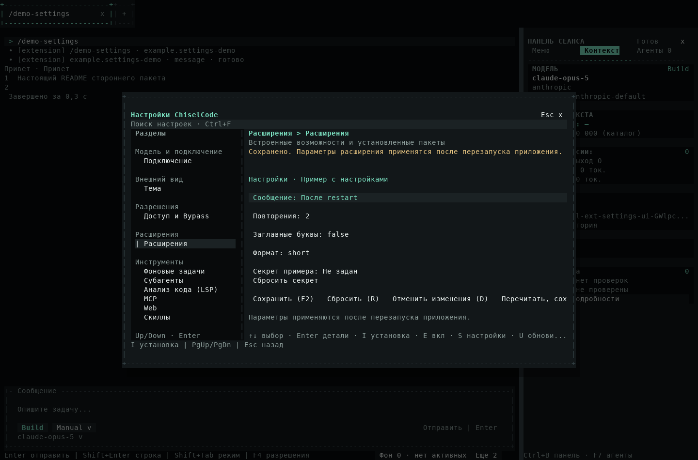

# Настройки расширений: реализация и проверки

[Материалы для участников](../README.md) · [Пользовательское руководство](../../extensions.md) · [Архитектура](../../architecture/extension-settings.md)

Работа начата 14.10.2026 в main ChiselCode `e232e80` / 0.6.29 и Desktop `9671bea` / 0.1.0-beta.3 с engine 0.6.29. Ветки, development worktrees и PR не создавались. Подготовлены CLI 0.6.30 и Desktop 0.1.0-beta.4; до публикации core сохранён настоящий Desktop engine.lock.json. Release выполняется по [desktop-sync](../desktop-sync.md).

## Реализация

Общий service владеет каталогом, review/candidate lifecycle и DTO. PackageManagementService, registry и loader P3.2 остаются единственным installer/trust/version path. Формы builtins используют реальные stores; external schema/validation/storage и SDK snapshot принадлежат core. Renderer использует browser SDK и narrow preload, а native chooser выдаёт одноразовый путь для core prepare. Старый engine сообщает недоступность capability. Hot reload/unload и автоматического restart нет.

## Локальные сценарии

`tests/unit/extension-management.test.ts` проверяет настоящий сторонний ESM с параметрами, tool и командой: пассивность folder/ZIP review, отмену/отказ доверия, exact digest/revision, повторный commit, loaded/desired state, настройки/секреты, unknown keys/reset, stale review, повреждение, несовместимость, project restriction, activation failure, update/rollback, used versions, disable/remove и сохранение данных. Проверки public adapter проходят strict DTO и core project ceilings.

`tests/fixtures/tui-extensions-settings.ts` запускает production `runOpenTuiAgent` и настоящий OpenTUI renderer. Четыре отдельных процесса подтверждают restart: установка без trust, explicit trust, реальный tool/command без модели, изменение параметров, ZIP update, проверяемый rollback, disable/remove. Черновик сохраняется при навигации и restart. Проверены ASCII Obsidian и Unicode Paper; native кадры 160×50, 80×24, 40×16 и 24×8. Тот же сценарий включён в compiled fixture и native CI. Фоновая проверка обновлений отделена от счётчика model/package requests.

Desktop `extensions.spec.ts` проходит тот же пакет через настоящие Electron, preload, browser SDK и compiled candidate engine. OS picker выбирается на native test boundary; одноразовый path grant, core verification, trust и mutation не подменяются. Проверены обе темы, compact 920×700, видимый фокус, builtins формы, settings secret DTO, реальные restart и durable session/draft, folder/ZIP, incompatible/broken input, update/rollback, disable и deferred removal. HTTP model fixture не получает запросов в этом сценарии. Общий GUI regression сохраняет model/tool loop, approve/deny/cancel/history.

Source GUI использовал candidate из текущих core исходников с локальными правками, version 0.6.30/protocol 1.1/SDK 1.1.0, через отдельный `CHISEL_DESKTOP_CANDIDATE_LOCK`. Это не опубликованный 0.6.29 из release lock. Production packaged handshake сохраняется; release GUI/payload необходимо повторить после update:engine на настоящий core release.

## Кадры

TXT/JSON/PNG: [Obsidian](../../assets/extension-settings/catalog-160x50.txt), [Paper](../../assets/extension-settings-paper/catalog-160x50.png), [узкий экран](../../assets/extension-settings/catalog-24x8.png). PNG экспортированы из `captureSpans`, без подмены содержания макетом. Electron screenshots и отдельный отчёт находятся в Desktop документации.

Локально прошли typecheck, lint (без ошибок; существующие warnings сохранены), 1198 tests / 3 platform skips, все deterministic evals, build, installed/compiled command/runtime/UI smoke, compiled desktop adapter, новые source/compiled Settings lifecycle и проверка Markdown ссылок/anchors. Ранний общий прогон обнаружил повторную вставку уже восстановленного draft в старом theme fixture; fixture исправлен без удаления проверки, итоговый общий прогон успешен. Native release-source CI фиксируется после завершения. Linux проверяется локально; Windows/macOS считаются проверенными только после соответствующих native jobs. Публикация пары выпусков ещё не заявляется этим предварительным отчётом.

Промежуточный Windows quality на `ef2a76a` завершил 1198 tests, но составной SDK test с восемью настоящими командами превысил стандартные 5 секунд. Cleanup после timeout удалил папку ещё завершающегося execution lease. Для этого теста задан общий бюджет 20 секунд; проверки approvals/Plan/schema/stale/checkpoints и runtime deadlines сохранены. Новые source/compiled Settings UI steps перенесены перед общим набором, чтобы native UI failures обнаруживались раньше. Первый Windows Auto LSP на `00771f4` получил HTTP 500 при загрузке Lua backend; все три Auto LSP jobs следующего source прошли. Эти промежуточные runs не используются вместо окончательной успешной матрицы.
