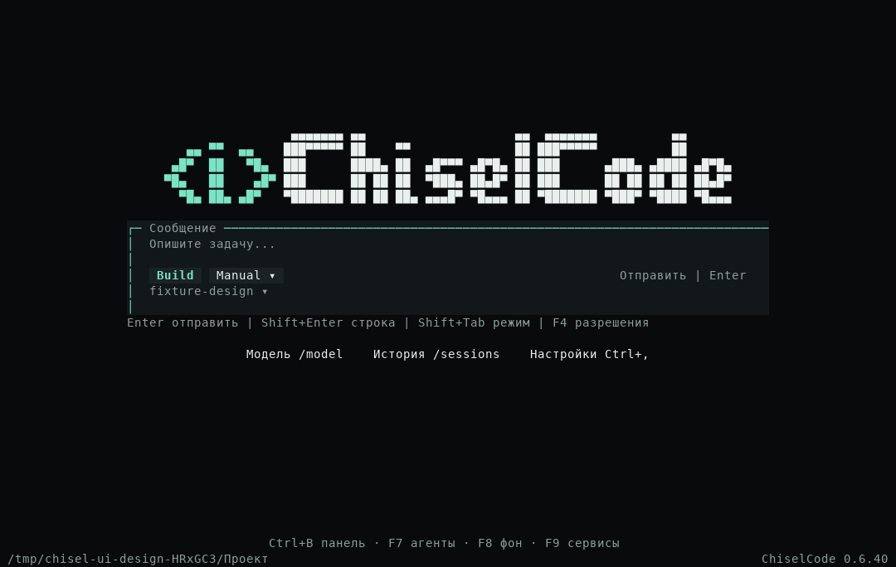
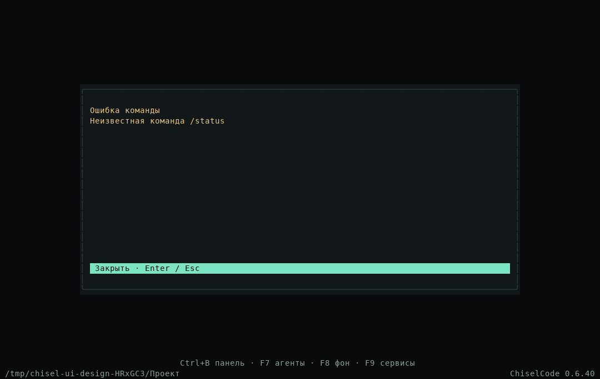
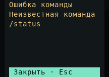
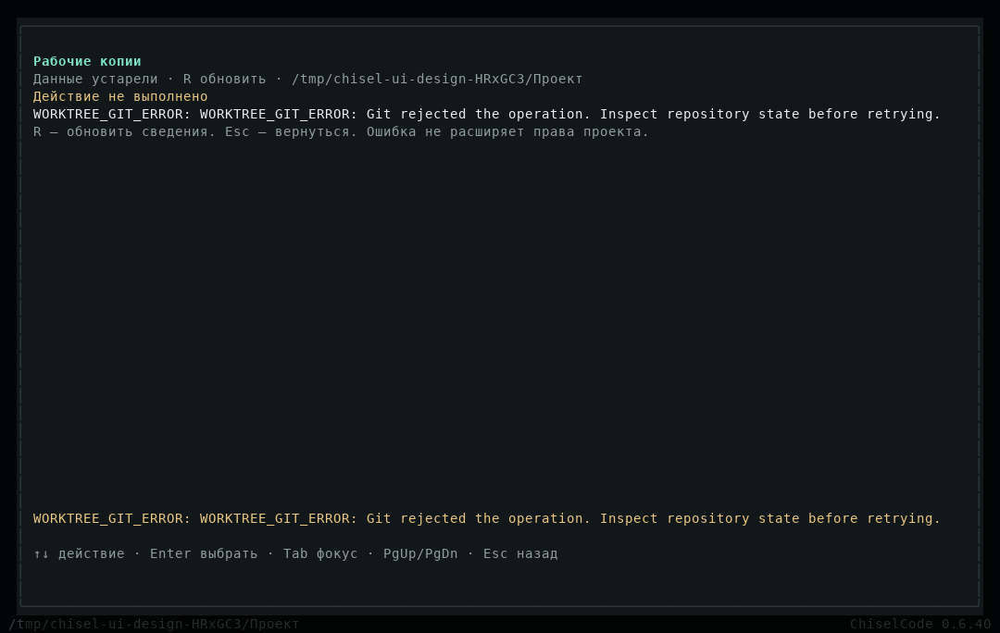

# Команды без служебной ленты на главной

[Материалы участников](../README.md) · [Команды и ввод](../../interactive.md) · [Архитектура](../../architecture/interface-motion.md#команды-на-главной) · [Исходные кадры](../../assets/home-commands/README.md)

Изменение подготовлено в текущих исходниках после CLI 0.6.40 и находится в Unreleased. Предыдущий выпуск и результаты его проверок сохраняют своё состояние.

## Что изменилось

Главная раньше показывала до шести строк transcript под вводом. Туда попадали неизвестные команды, ошибки аргументов и путей, а также notices расширений. Этот блок удалён из Home целиком. Контроллер главной отбрасывает успешные служебные уведомления, а ошибки и предупреждения из `append` и `appendNotice` направляет в отдельное сообщение с прокруткой; разговоры сохраняют прежний transcript. После закрытия сообщение освобождается и не появляется под вводом.

`/status` и `/doctor` удалены из slash registry, автодополнения и application dispatch. Удалены их formatter и DTO дашборда; совместимых обработчиков нет. Папка показана внизу главной, модель и подключение доступны в Settings, статусы сервисов — по F9. Отдельная CLI-команда `chisel doctor` сохраняет проверку локальной настройки.

`/cwd` без аргументов готовит `/cwd ` и ставит курсор после пробела. Открытие графического `/worktree` не создаёт сообщений в главной. Ошибка его текстовых аргументов использует общий диалог; ошибка загрузки менеджера остаётся внутри менеджера. Реальные create/open/diff/apply/remove, approval, защита dirty paths и операции в разговорах сохранены.

## Ввод и владение

Сообщение закрывается Enter, Esc, Ctrl+C или мышью. Длинный текст прокручивается; закрытие возвращает native редактор. Вставка и нажатия не уходят в поле за окном, Ctrl+C не запускает отмену другой работы. Captured owner содержит conversation, generation и ID сообщения. Устаревшее закрытие не удаляет более новый результат, смена проекта очищает feedback. Approval и уже открытые окна имеют приоритет.

## Настоящие кадры OpenTUI

После неизвестных команд, ошибок пути и закрытия менеджера:

Удалённая команда отклоняется без запроса модели:

Проверка `/worktree` в тестовой папке без Git: текст находится внутри менеджера и исчезает после его закрытия.

## Проверки

Локально на Linux/Bun 1.4.4 прошли быстрый профиль (441 pass), целевые UI/контроллер/команды (32 pass), typecheck, lint и build. Lint: 401 предупреждение, 58 информационных сообщений, ошибок нет. Production fixture прошёл в source и compiled binary: `/status`, `/doctor`, неизвестная команда, неверные аргументы `/worktree`, несуществующий `/cwd`, вставка за окном, размеры 120×36 и 24×8, закрытие и отсутствие model calls/новой вкладки. Сохранён прежний сценарий streaming, motion и Unicode-курсора.

Отдельно прошли production fixtures команд расширений и менеджера рабочих копий с настоящим Git, approval, изолированным редактированием, переносом, dirty refusal и удалением. В fixture команд добавлено ожидание готового редактора после асинхронного `/cwd`; assertions очереди, отмены, shared activation, checkpoints и artifacts сохранены.

Результаты Native CI на этом изменении фиксируются после завершения jobs. Локальные результаты относятся к Linux; они не означают проверки физического терминала или полного source-набора на других ОС.

## Обратная связь первого Native CI

[Первый run](https://github.com/TheAsrada/ChiselCode/actions/runs/40165007854) на source `32f5755f77e899a33678229023b10ac61894af78`: native Linux прошёл; полный Linux source дал 1355 pass, 3 skip, 9 fail. macOS: 358 pass, 3 skip, 3 fail; Windows: 360 pass, 1 skip, 3 fail в платформенных наборах.

Прогон обнаружил лишний эффект от переноса успешных notices в диалог: закрепление скилла оставляло отложенное сообщение после закрытия Settings. Успешные уведомления теперь отбрасываются на главной. Ошибочные аргументы режима/разрешений явно имеют tone `warn`, их окно закрывается перед следующим действием. Проверки Bypass, F4, очереди и отмены сохранены. MCP-тест создаёт настоящую вкладку вместо фиктивного разговора в home; проверка сохранения истории усилена. Проверка прокрутки подсказок учитывает удалённый пункт. Тесты тем проверяют настоящую палитру fallback и сохранённую конфигурацию вместо удалённого сообщения на главной.

После исправлений локально прошли все 36 проверок семи затронутых файлов, быстрый профиль 441 pass, typecheck, lint и compiled production UI fixture. Наборы пересекаются и не суммируются.

## Обратная связь второго Native CI

[Второй run](https://github.com/TheAsrada/ChiselCode/actions/runs/40165626589) проверил source `c11dd7dda2b934c34ecc46fd9d5dd8abbfc71bfa`. Полный Linux source прошёл: 1364 pass, 3 skip, 0 fail за 340,01 с; typecheck, lint и eval также прошли. Native Linux и macOS прошли, включая compiled интерфейс. Платформенный набор macOS: 361 pass, 3 skip, 0 fail за 146,54 с.

Отдельный source fixture внешнего SDK нажимал F9 при ещё открытой startup-ошибке. Добавлены проверка окна, его явное закрытие и ожидание готового редактора перед F9; assertions безопасного сообщения, отсутствия raw cause, статуса ordinary loader и дальнейших действий сохранены.

Windows дал 361 pass, 1 skip, 2 fail за 353,76 с: неизменённые сценарии помощников не завершились за свои пределы ожидания. Большой контекст достиг 18 генераций и 72 инструментов к 40 с; в параллельном сценарии к проверке завершился один из двух помощников. В первом Windows run оба сценария проходили. Предполагается временное замедление runner; это не подтверждённый диагноз. В следующем прогоне они проверяются повторно. Код помощников, их deadlines и assertions не изменяются.

## Обратная связь третьего Native CI

[Третий run](https://github.com/TheAsrada/ChiselCode/actions/runs/40166211945), source `5c38e4939fbe76c678907c4f4ccbb4745f01ffd6`: полный Linux job прошёл, включая оба дополнительных source fixtures. Набор: 1364 pass, 3 skip, 0 fail за 273,85 с. Native Linux и macOS прошли. macOS: 361 pass, 3 skip, 0 fail за 107,98 с.

На Windows оба прежних сценария помощников прошли за 29,25 и 39,07 с. Платформенный набор дал 362 pass, 1 skip, 1 fail за 395,78 с: TUI-fixture предполагал порядок прихода трёх независимых approvals. Подтверждение для «Остановки при разрешении» могло прийти раньше двух остальных. Fixture теперь принимает любой порядок, явно разрешает две именованные задачи и останавливает третью; итоговые статусы, файлы и cleanup продолжают проверяться. Меняется только тест. Windows проверяется отдельно; продуктовый код остаётся тем же, что в успешных Linux/macOS jobs.
