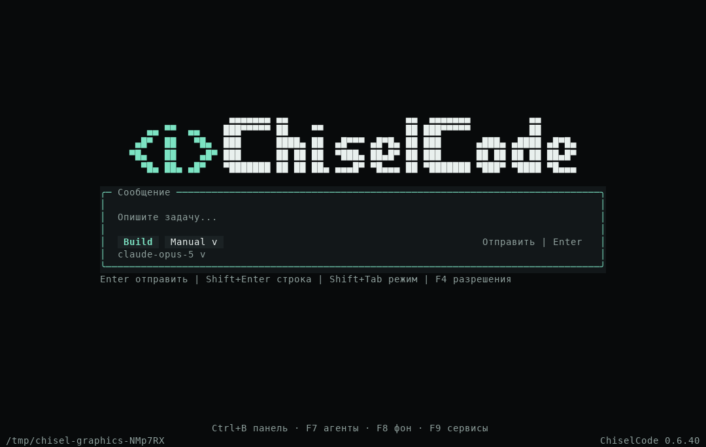
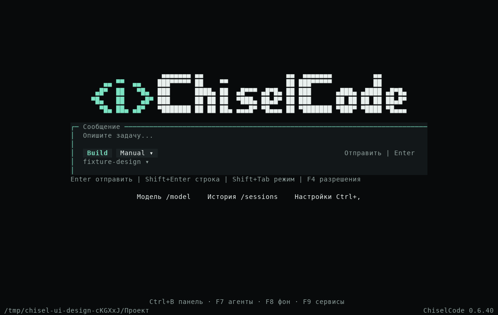
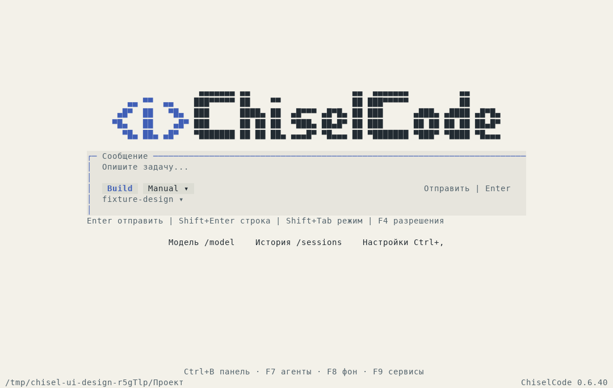
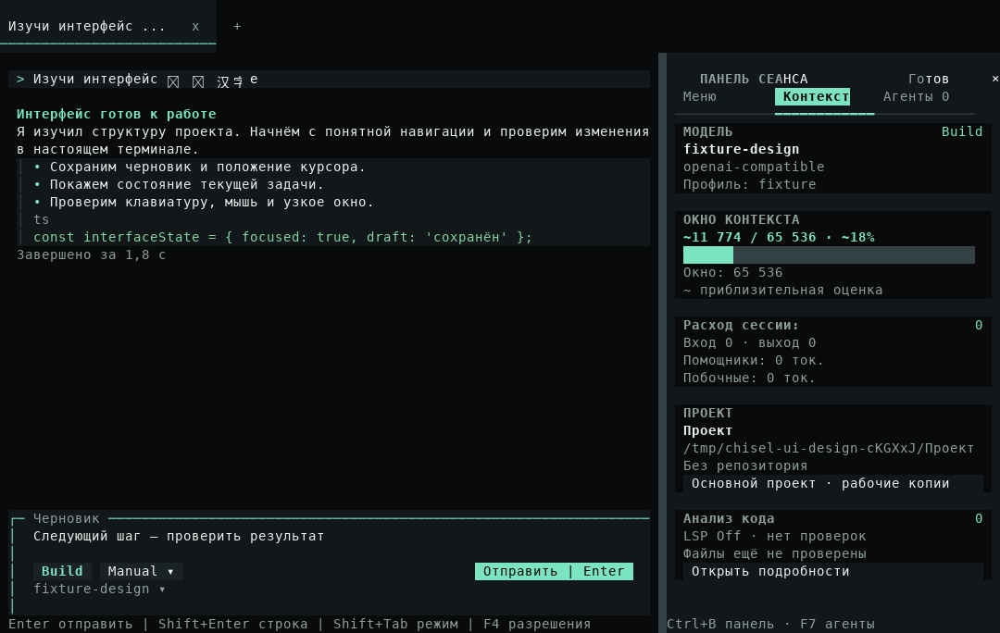
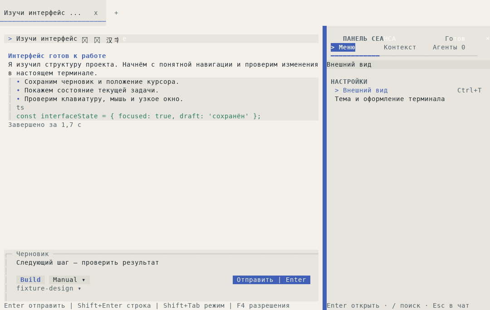
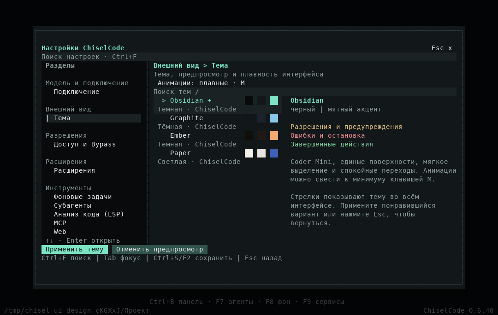
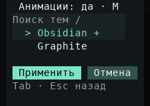
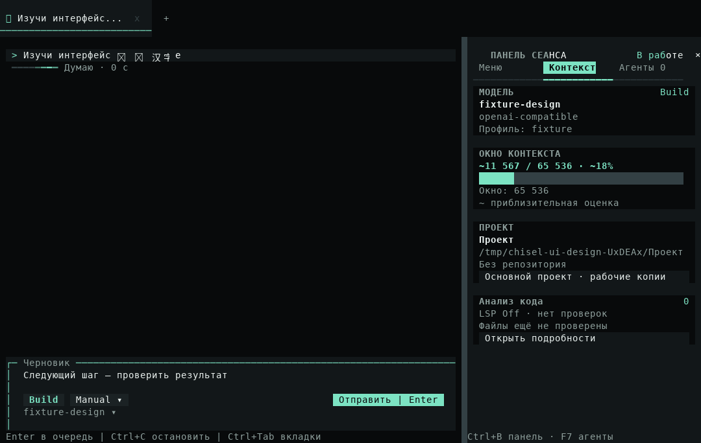

# Интерфейс ChiselCode: исследование OpenCode и реализация

[Материалы участников](../README.md) · [Темы и анимации](../../themes.md) · [Архитектура](../../architecture/interface-motion.md) · [Исходные кадры](../../assets/ui-design/README.md)

Изменения подготовлены в текущих исходниках после CLI 0.6.40. Это доработка ChiselCode CLI; опубликованный 0.6.40 и концепт Desktop сохраняют прежнее состояние. Ниже разделены изученные решения OpenCode, принятые решения ChiselCode и фактически выполненные проверки.

## Что изучено в OpenCode

Исследование закреплено на [`anomalyco/opencode@17b79f4`](https://github.com/anomalyco/opencode/tree/17b79f4e0c16dcff200b0417567ed22aeb2d7166/packages/tui/src), 24 октября 2026 года. Проверены исходники home, prompt footer, dialog/select, animation, spinner renderable, fade/shimmer, scroll и тема v2. Отдельно просмотрен [официальный скриншот из README](https://github.com/anomalyco/opencode/blob/17b79f4e0c16dcff200b0417567ed22aeb2d7166/packages/web/src/assets/lander/screenshot.png). Скриншот является иллюстрацией проекта; экспериментальные ветви `new-designs` в исходниках не объявляются включёнными у каждого пользователя.

| Наблюдение и первичный источник | Решение для ChiselCode |
| --- | --- |
| [Home](https://github.com/anomalyco/opencode/blob/17b79f4e0c16dcff200b0417567ed22aeb2d7166/packages/tui/src/routes/home.tsx): центрированный prompt с ограничением ширины, свободное пространство, отдельный footer | Сохранены Coder Mini и центральный ввод; рядом появились понятные переходы в модель, историю и настройки |
| [Dialog](https://github.com/anomalyco/opencode/blob/17b79f4e0c16dcff200b0417567ed22aeb2d7166/packages/tui/src/ui/dialog.tsx): общий контейнер, отступы, заголовок, тело и footer | Действующие окна используют общие поверхности и мягкое появление; фокус и кнопки доступны сразу |
| [Dialog select](https://github.com/anomalyco/opencode/blob/17b79f4e0c16dcff200b0417567ed22aeb2d7166/packages/tui/src/ui/dialog-select.tsx): поиск, группы, выбор и прокрутка | Меню ChiselCode получило поиск по словам и открытие по Enter; сохраняются существующие команды и владельцы действий |
| [Theme v2](https://github.com/anomalyco/opencode/blob/17b79f4e0c16dcff200b0417567ed22aeb2d7166/packages/tui/src/theme/assets/v2/opencode.json): base/raised поверхности, focused/hovered/selected, semantic feedback | Единые hover/selection и явная главная кнопка используют существующую Palette, включая светлые и внешние темы |
| [Animation](https://github.com/anomalyco/opencode/blob/17b79f4e0c16dcff200b0417567ed22aeb2d7166/packages/tui/src/ui/animation.ts): spring/tween, общий список tasks, отключение таймера в покое | Один clock на renderer, локальные подписки, конечные cubic-переходы; редактор и Markdown сохраняют identity |
| [Spinner renderable](https://github.com/anomalyco/opencode/blob/17b79f4e0c16dcff200b0417567ed22aeb2d7166/packages/tui/src/component/spinner-renderable.ts): ограниченная перерисовка индикатора и cleanup | Небольшие индикаторы вкладок и строки запроса; для ожидания разрешения используется неподвижный маркер |
| [Fade](https://github.com/anomalyco/opencode/blob/17b79f4e0c16dcff200b0417567ed22aeb2d7166/packages/tui/src/component/fade-in-text.tsx) и [shimmer](https://github.com/anomalyco/opencode/blob/17b79f4e0c16dcff200b0417567ed22aeb2d7166/packages/tui/src/component/shimmer-text.tsx): движение маски по тексту | Световая полоса в строке активного запроса; сообщение и ввод остаются полностью читаемыми |
| [Scroll](https://github.com/anomalyco/opencode/blob/17b79f4e0c16dcff200b0417567ed22aeb2d7166/packages/tui/src/util/scroll.ts): штатная acceleration и управление скоростью | Ограниченное native ускорение колеса; reduced оставляет линейную прокрутку |

Применён установленный [навык OpenTUI](https://github.com/msmps/opentui-skill): React, animation, layout, keyboard и testing. API сверены с установленным OpenTUI 0.5.12. Код custom renderables OpenCode, его бренд и настройки не переносятся в ChiselCode.

## Что мешало работе и что изменено

Меню требовало Space, хотя Enter обычно открывает выбранный пункт; поиск отсутствовал. Теперь действие открывается Enter/Space, а `/` быстро находит раздел. Введённые в поиск цифры не переключают вкладки панели. Повторный Enter не попадает в только что открывшееся окно и не отправляет черновик.

Тяжёлые одинаковые рамки композера и вкладок конкурировали с содержимым. Композер получил более спокойную верхнюю/левую границу и явную отправку; вкладки — активную нижнюю линию и более удобную область закрытия. У обычного ответа появилась ограниченная длина строки и отступ перед сообщением. Меню использует те же интерактивные строки, что остальные окна.

Раньше строка запроса меняла только elapsed раз в секунду. Теперь работа видна по полосе активности и индикаторам вкладок. Короткие цветовые переходы связывают выделение и появление окон. На экране настроек есть немедленно сохраняемый выбор плавных или минимальных анимаций. На 24×8 ввод и разрешения помещаются, а Enter и выход из настроек остаются подписаны.

## Настоящий интерфейс

До изменений, CLI 0.6.40:

После изменений:

PNG экспортированы из native `captureSpans`. GIF собран из 16 последовательных native кадров с сохранёнными интервалами; рядом лежат исходные JSON. До и после используются разные тестовые конфигурации: в новом сценарии выбран локальный `fixture-design`, в прежнем профиль не настроен. Это визуальное сравнение, а не замер скорости. Шрифт PNG-экспорта может иначе показать emoji, чем физический терминал; native текст и положение Unicode-курсора проверяются отдельно.

## Проверки реализации

Локально, Linux/Bun 1.4.4: быстрый набор 440 pass, 0 fail; typecheck, lint, build и compile успешны. В lint сохраняются прежние предупреждения проекта. Целевые наборы проверили навигацию (21 pass), настройки и motion (29 pass), меню/сообщения/логику (23 pass); наборы пересекаются и не суммируются. Остальные UI-регрессии входят в полный source CI.

Production-сценарий прошёл в Obsidian и Paper: обычный app/runtime, настоящий OpenAI SDK с локальным endpoint, сохранение настройки, Unicode draft/cursor, resize главной и настроек 120×36 / 80×24 / 40×18 / 24×8, настоящие изменения цветов полосы и кадров индикатора, ответ модели и поиск меню. Переключение экранов не создаёт модельных запросов.

Отдельно прошли compiled UI fixture, установленный npm manifest smoke и production-сценарий рабочих копий с настоящим Git, approval, изолированной записью, переносом и безопасным удалением. Публичные разрешения и lifecycle продолжают проверяться существующими сценариями. Итоговые source, Native CI и ограничения платформ фиксируются после прогона на трёх ОС.

## Обратная связь первого Native CI

[Первый run](https://github.com/TheAsrada/ChiselCode/actions/runs/40123916227) проверил source `6e80e401b89fe708281cb40176aa50f50f4e706f`: Linux native прошёл, полный Linux source дал 1356 pass, 3 skip, 7 fail; macOS — 360 pass, 3 skip, 1 fail; Windows — 361 pass, 1 skip, 2 fail в платформенном наборе.

Два production fixtures сохраняли прежнее ожидание, что Enter в меню бездействует. Они обновлены на открытие выбранного окна с сохранением черновика, работающего родительского запроса и отсутствия записи от одного просмотра. Пять Linux-проверок обнаружили лишнюю пустую строку в самостоятельном `FormattedMessage`: отступ перенесён в ленту, standalone/streaming assertions сохранены. Отдельный Windows-сбой произошёл при удалении тестовой папки (`EBUSY`) после disposal; для очистки этой папки задано три стандартных повтора с задержкой 50 мс, без изменения runtime deadlines и проверок lifecycle.

Все 19 проверок затронутых файлов прошли локально после исправлений. Периодические индикаторы дополнительно переведены на native text buffer: кадр обновляет маленький renderable, сохраняя React-компоненты и редактор.

## Обратная связь второго Native CI

[Второй run](https://github.com/TheAsrada/ChiselCode/actions/runs/40125136720) проверил source `c4d889938501174efe5eeb4de44d6042bc97e0fc`. Полный Linux source прошёл: 1363 pass, 3 skip, 0 fail, 353,29 с. Typecheck, lint и eval также прошли. Native Linux и macOS прошли, включая compiled интерфейс; платформенный набор macOS дал 361 pass, 3 skip, 0 fail за 149,24 с.

После полного набора отдельный шаг внешнего SDK обнаружил третье прежнее ожидание бездействующего Enter в `tui-external-extensions.ts`. Сценарий обновлён: Enter открывает выбранное расширение без изменения файла, Esc закрывает окно, Space повторно открывает его. Сохранены проверки approval, реальной записи и undo, недоступного источника, redaction, малого экрана и черновика. Весь fixture и typecheck прошли локально. Эта правка меняет тест и описание меню; продуктовый код остаётся тем же. Финальный Native run проверяет исправленный сценарий вместе с остальными обязательными jobs.

## Границы результата

Скорость отрисовки физического терминала и 60 FPS не измерялись. Clock задаёт частоту обновления небольших компонентов; реальная плавность зависит от терминала, шрифта, SSH и нагрузки. Тестовый renderer подтверждает кадры, фокус, границы и действия. Основная модель, сетевые задержки и скорость инструментов этим оформлением не ускоряются.
