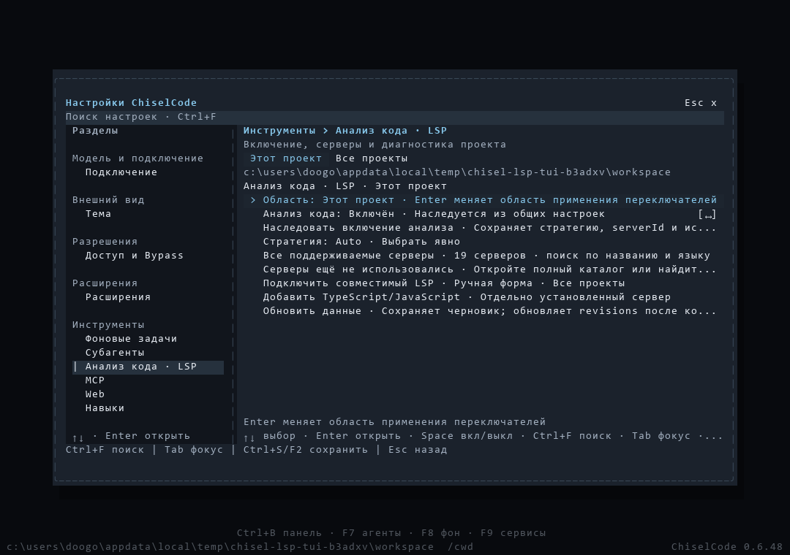

# Меню анализа кода: реализация и проверки

[Материалы для участников](../README.md) · [Принятое решение](../../architecture/lsp-menu.md) · [Пользовательский маршрут](../../interactive.md#анализ-кода-lsp)

В исходниках для CLI 0.6.48 реализованы единый маршрут панели/F9/Settings, общий и индивидуальные переключатели, наследование, карточки корней и диагностика, ручная форма с отдельным сохранением, прямой `ui_tool` и удаление пользовательских LSP-команд. React и закреплённые зависимости сохранены.

## Настоящий OpenTUI

Кадры получаются из production-сценария `tests/fixtures/tui-lsp-settings.ts` через `captureCharFrame()` и `captureSpans()`. PNG экспортируются `scripts/render-terminal-captures.py` без изменения текста и цветов renderer. Набор включает 120×40, 80×24, 40×12 и 24×8, тёмную и светлую темы, обзор, выключение, карточку, ошибку сервера и незавершённую форму.

| Размер | Тёмная тема | Светлая тема | Native spans |
| --- | --- | --- | --- |
| 120×40 | [Обзор](../../assets/lsp-menu/overview-120x40.png) | [Обзор](../../assets/lsp-menu/overview-paper-120x40.png) | [JSON](../../assets/lsp-menu/overview-120x40.json) · [текст](../../assets/lsp-menu/overview-120x40.txt) |
| 80×24 | [Обзор](../../assets/lsp-menu/overview-80x24.png) | [Обзор](../../assets/lsp-menu/overview-paper-80x24.png) | [JSON](../../assets/lsp-menu/overview-80x24.json) |
| 40×12 | [Обзор](../../assets/lsp-menu/overview-40x12.png) | [Обзор](../../assets/lsp-menu/overview-paper-40x12.png) | [JSON](../../assets/lsp-menu/overview-40x12.json) |
| 24×8 | [Обзор](../../assets/lsp-menu/overview-24x8.png) | [Обзор](../../assets/lsp-menu/overview-paper-24x8.png) | [JSON](../../assets/lsp-menu/overview-24x8.json) |

Отдельные состояния: [выключено](../../assets/lsp-menu/off-120x40.png), [работающий сервер](../../assets/lsp-menu/card-running-120x40.png), [диагностика](../../assets/lsp-menu/diagnostics-120x40.png), [ошибка](../../assets/lsp-menu/server-error-120x40.png), [ошибка в светлой теме](../../assets/lsp-menu/server-error-paper-120x40.png), [незавершённая форма](../../assets/lsp-menu/form-draft-120x40.png), [native input 24×8](../../assets/lsp-menu/form-input-24x8.png), [конфликт](../../assets/lsp-menu/form-conflict-120x40.png).

## Проверки

На Windows точечные проверки подтвердили strict schemas и patches, сохранение argv/trust после Off → On, конфликты revisions, shared preparation, отмену initialize/request, реальные TS/Python/Lua и отключение только Python. Production OpenTUI проверяет три входа, native ввод и resize, прямую очередь с approval/checkpoints, отсутствие model requests, отзыв доверия, реальный failed initialize и сохранение формы при конфликте.

Проверки canonical aliases и выхода за workspace используют настоящие directory junction на Windows; assertions сохранены без требования привилегии file symlink. Общее покрытие очереди, Plan/deny/Dont Ask, владельцев и отмены остаётся в `lsp-runtime.test.ts`, `ui-tools-runtime.test.ts` и существующих TUI command tests. Desktop fixture использует настоящий status tool и сохранённую историю вместо удалённой команды; публичный protocol не изменён.

Первый локальный запуск LSP-файлов завершился ошибкой подготовки: внешние TLS/TS ещё не были установлены. После `bun scripts/prepare-lsp-tests.ts` сценарии выполнены с закреплёнными зависимостями. Исправленные UI-fixtures ожидают фактический ввод, состояние и записанные bytes с конечными deadlines.

На Windows быстрый профиль завершил 492 теста без ошибок; typecheck и JS/SDK build прошли. В расширенном прогоне 100 проверок прошли, две потребовали исправления fixture: TS намеренно использует одну workspace entry, поэтому проверка отдельных корней перенесена на настоящий Pyright; последовательное заполнение LRU превысило 30 секунд. Подготовка 65 настоящих документов теперь выполняется группами по четыре с прежними policy/byte checks, didClose, cap и stale assertions. Полные service/runtime/multilingual файлы после исправления прошли: 32 теста, 108,98 с; LRU — 17,07 с. Deadline и production лимиты не повышались.

Compiled Windows CLI вернул 0.6.48 и прошёл настоящие TS/Python сценарии. Compiled menu smoke проверил три входа, очередь, approval, checkpoints и cleanup без внешнего test runtime. npm-пакет установлен отдельно из архива; version, SDK declarations и manifest runtime прошли. Зависшее сетевое получение npm metadata остановлено; установка из локального кеша завершилась. npm предупредил о Node ≥26.4.0 у OpenTUI; исполнение проверяется через Bun 1.4.2. При подготовке installed UI bundle обнаружена необходимость `--outdir` для нескольких assets; smoke и CI используют этот способ, включая настоящий gzip payload.

Навыки установлены из источников, закреплённых в AGENTS.md. `skillfish` завис на разрешении npm metadata; `opentui-design` получен из того же akiojin/skills через `skills`. Инструкции React/API, ввода, навигации, состояния, адаптации размеров, тестирования и визуальной иерархии прочитаны; зависимости приложения сохранены.

Первый Native run на `49fed85` нашёл три ошибки полного Linux-набора: проверка контекста ожидала прежнее «Файлы ещё не проверены» при явном Off, а два Settings-сценария использовали локальный поиск серверов для перехода в другие разделы. Они воспроизведены на Windows. Проверка Off теперь требует точного сообщения о выключении; переход в общий поиск использует Shift+Tab → Ctrl+F с проверкой владельца native input. Нажатие верхнего поля также устанавливает фокус оболочки. Assertions MCP, навыков, черновиков, разрешений и отсутствия model requests сохранены; deadlines не повышены.

Windows native subset подтвердил ту же ошибку Settings; остальные 427 проверок прошли. Два macOS jobs первого Native run не получили runner и были отменены GitHub с сообщением о capacity constraints для arm64. Отдельный [LSP catalog](https://github.com/TheAsrada/ChiselCode/actions/runs/41476304340) на `49fed85` прошёл на Linux, Windows и macOS, включая SourceKit на macOS; последующие исправления относятся к фокусу UI и fixtures, backend не меняется.

CLI 0.6.48 [опубликован](https://github.com/TheAsrada/ChiselCode/releases/tag/v0.6.48) из `cd4bd74c33cc2d626131d243a36aa504063c6dd0`. Шесть обязательных Native jobs, Release и проверки опубликованных Windows/npm payload прошли. [Отчёт выпуска](release-0.6.48.md) содержит результаты, один сетевой повтор Windows, контрольные суммы, кадр окончательного source и непроверенные платформы.
