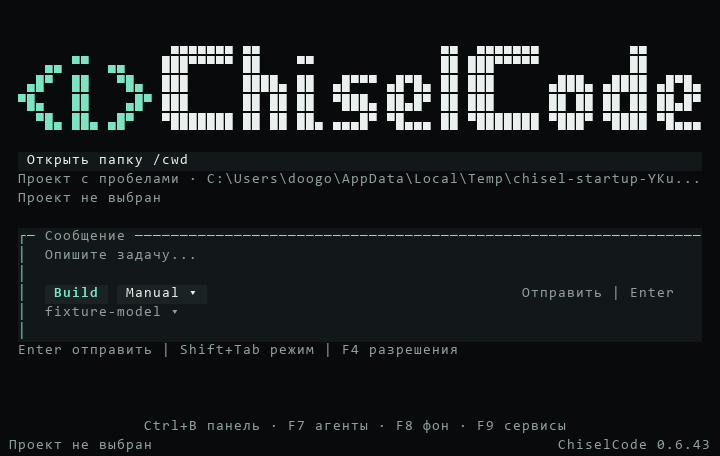
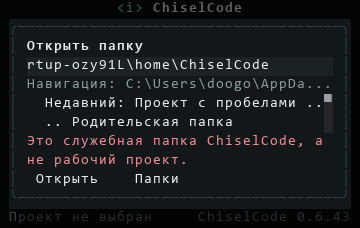
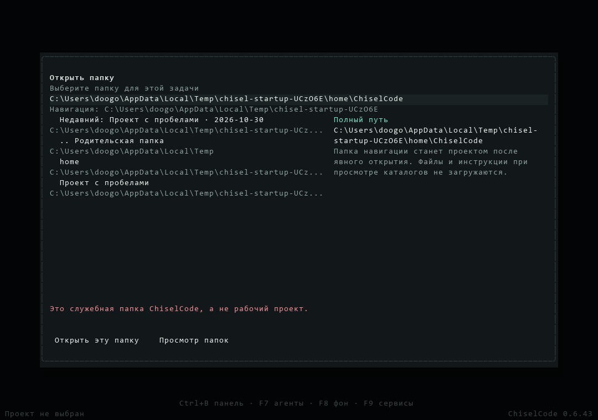

# Запуск без проекта: реализация и проверки

[Материалы для участников](../README.md) · [Принятое решение](../../architecture/project-startup.md) · [Исходный план](../plans/project-startup.md) · [Первый запуск](../../getting-started.md)

Дата: 30 октября 2026 года. Основание реализации — `main`, source `d7fe083679a655732e89eaf2dd7d2303f3045a97` и последующие изменения рабочего дерева этого задания. Это состояние `Unreleased`, а не новый опубликованный выпуск. Версия пакета остаётся 0.6.43; release source и обязательный удалённый CI для него ещё не зафиксированы.

## Реализованное поведение

- Главная имеет отдельный черновик без executor и подставного root. Настройки, модель, библиотека, история и обновления доступны на уровне приложения.
- Явный `--cwd`, папка терминала и `--launcher` сохраняют своё происхождение. Общий допуск проверяет root до project config, instructions и активации workspace. Файловые инструменты исключают служебные поддеревья и при более широком проекте; проверенные managed worktrees используют существующие registry, Git и leases.
- Picker принимает полный путь, показывает недавние проекты и ограниченные страницы каталогов. Открытие имеет владельца, отмену и deadline. Выбор сохраняет ввод и возвращает фокус; отправка требует отдельного Enter.
- Защищённые черновики используют отдельные identity и revision-specific payload. Конфликт сохраняет оба текста. Старые служебные сессии доступны только для чтения; resume сохраняет исходный root и проверяет canonical identity.
- Runtime получает identity текущего процесса и фактической модели запроса. Ephemeral снимок OpenTUI относится только к владельцу и не сохраняется в истории. Точные HTML-токены переноса корректно отображаются в Markdown, включая таблицы.
- Windows-ярлыки, finish-page и updater без проекта используют общий `--launcher`. Перезапуск с настоящим проектом сохраняет `--cwd` и session.

Пользовательские инструкции обновлены в руководствах [запуска](../../getting-started.md), [CLI](../../cli.md), [интерактивного режима](../../interactive.md), [сессий](../../sessions.md), [установки](../../installation.md), [безопасности](../../security.md) и [клавиш](../../keybindings.md). Исходные планы сохранены как история решения; текущие контракты вынесены в архитектуру.

## Локальные результаты Windows x64

Среда: Windows, Bun 1.4.2, зависимости из закреплённого lockfile. Проверки выполнялись на рабочем дереве задания; они не являются результатом Native validation на release commit.

| Проверка | Результат и покрытие |
| --- | --- |
| `bun run test:fast` | 488 pass, 0 fail, 3433 assertions, 50 файлов, 4,50 с. Включает логику допуска и контекста; renderer и процессы в fast не добавлены. |
| `bun run typecheck`, `bun run lint`, `bun run build` | Успешны. Lint без ошибок, с предупреждениями. JS CLI и публичные SDK собраны штатным script. |
| `bun run docs:check` | 124 страницы, 1361 локальная ссылка, 0 ошибок; проверены anchors, изображения и достижимость новых страниц. |
| Допуск и encrypted drafts | Полные файлы `project-admission.test.ts`, `terminal-drafts.test.ts`: 11 pass, 0 fail в итоговом прогоне. Реальные junction, замена каталога, поздний A после B, default config при отсутствии `APPDATA`, отказ atomic metadata publication и два процесса с конфликтующими текстами. |
| OpenTUI и контекст | Итоговый прогон восьми затронутых файлов: 61 pass, 0 fail, 569 assertions, 14,89 с, включая допуск и drafts выше. Настоящий `project-startup.test.ts` с HTTP SSE проверяет архив без extensions/model и изменения session, выбор папки без Git и сохранение текста без отправки. Следующий Enter делает один запрос с identity/UI snapshot; snapshot отсутствует в сохранённой сессии. Дополнительно пройден вход в глобальные настройки без проекта и API-ключа. |
| Git/worktrees | Все 15 тестов `worktrees-runtime.test.ts` прошли на Windows: настоящий Git, ownership, leases, перенос, конфликт и cleanup. Production worktree manager также прошёл с реальными approvals. |
| Model hooks и Settings | 36 pass, 0 fail в дополнительном прогоне четырёх файлов: `extension-agent-events`, `opentui-navigation`, `runtime-environment`, `settings-tools-runtime`. Проверены routing модели после hook и обе темы Settings. |
| Установленный npm-пакет | Изолированный `npm pack` / `npm install`, затем `manifest-cli.ts`: отказ launcher до inference и настоящий SSE → tool → model → persisted source. Пользовательская установка не заменялась. |
| Compiled CLI и OpenTUI | Настоящий Windows EXE прошёл manifest smoke. Отдельная compiled production composition прошла запуск без проекта, native picker, сохранение draft и явную отправку. Полный source-сценарий архива в compiled smoke не повторяется. |
| NSIS launcher | Настоящие `.lnk`, COM-проверка TargetPath/Arguments/WorkingDirectory, запуск обоих ярлыков через ShellExecute и общий finish-page handler. Все действия изолированы от пользовательских ярлыков. |
| Полный installer script | `installer/chiselcode.nsi` собран с настоящим compiled CLI в отдельном staging-каталоге. Установщик не исполнялся; установка и пользовательский реестр не менялись. |
| NSIS updater | Production OpenTUI → проверенное скачивание → выход/cleanup → настоящая замена EXE → новая консоль. Пройдены блокировка EXE с сохранением старого файла, ошибка/восстановление, drive root, session resume и временные данные. |

При подготовке исправлены найденные ошибки приоритета approval над историей, раннего Esc во время сохранения Settings и нескольких быстрых Tab в picker. Узкие кадры потребовали ожидать видимый маркер архива вместо обрезанного заголовка. Первые launcher-прогоны выявили кодировку PowerShell и очистку ещё завершающегося процесса: fixture теперь читает UTF-8, ждёт фактического выхода и ограниченно повторяет только файловую очистку. Assertions не отключены, production deadlines не сокращены.

## Настоящие кадры OpenTUI

PNG получены из `captureSpans()` production composition через `tests/fixtures/project-startup.ts`; размеры и содержимое терминала сохранены. Данные проектов и провайдера синтетические. Это кадры renderer, а не сгенерированные макеты или проверка физического терминала.

Дополнительные кадры: [главная 40×12](../../assets/project-startup/home-40x12.png), [проект выбран и текст сохранён](../../assets/project-startup/project-ready-80x24.png), [компактный режим 24×8](../../assets/project-startup/home-24x8.png).

## Границы результата

Изолированные копии npm-пакетов и staging установщика сохранены в `.git/startup-*`: автоматическая проверка отклонила их очистку с причиной `blocked by policy`. Это не отказ runtime cleanup в перечисленных тестах.

Linux/macOS, удалённые Quick CI и Native validation на итоговом source в этой локальной работе не запускались. Полный source-набор Windows целиком не запускался; выполнены затронутые файлы и перечисленные native smoke. CI дополнен platform subset, проверкой ярлыков и коротким compiled startup smoke, но наличие workflow не означает успешный run.

Не проверены недоступный сетевой UNC share и все физические терминалы. UNC ожидание в UI ограничено, но ОС может завершить underlying I/O позже. Контролируемый HTTP-провайдер подтверждает payload и runtime-путь; качество ответа живой модели на вопрос о собственной среде требует отдельного ручного прогона. OS shell, доверенный JS и сторонние MCP/LSP не превращаются в файловую песочницу.

Для выпуска по отдельному поручению нужен выбранный release source, успешные обязательные native jobs на нём и обычный порядок публикации. Tags, assets, опубликованный CLI и отдельный концепт Desktop этим заданием не изменялись.
