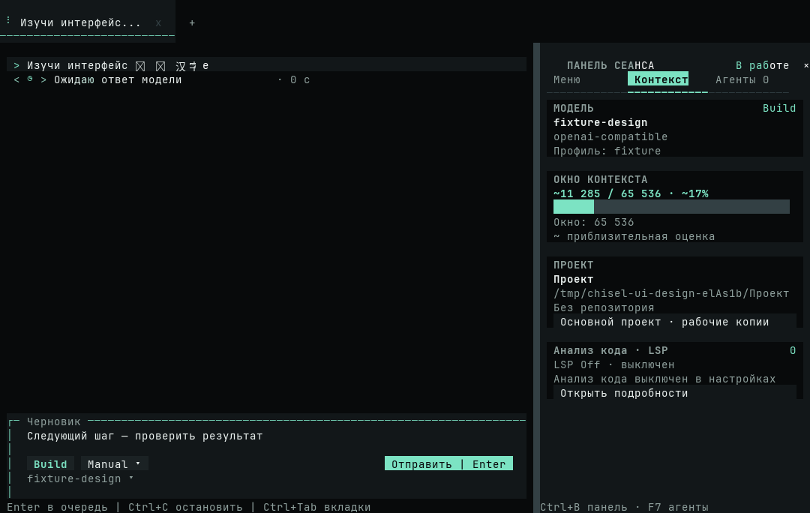

# Ожидание модели и подготовка HTML LSP

[Материалы участников](../README.md) · [Состояние запроса](../../interactive.md#состояние-запроса) · [Потоковые ответы](../../architecture/provider-streams.md)

## Разбор сессии

В Windows-сессии с `claude-haiku-5-5` через OpenAI-совместимый шлюз один запрос отменили через 305,8 с. После пользовательского сообщения в истории нет ответа или вызова инструмента. Другой запрос отменили через 66,8 с. Команда запуска Firefox уже записала результат с кодом 0, а итогового ответа модели нет. Предыдущий запуск Firefox в той же сессии вместе с итоговым ответом занял 10,3 с. Эти длительности включают весь запрос. Экспорт не содержит HTTP-трассировки или времени первого байта, поэтому причину задержки внутри шлюза определить нельзя.

Клиент использовал SDK-тайм-аут до 600 с на попытку. Такой предел мог оставить интерфейс в ожидании на несколько минут. Теперь агентный цикл отменяет запрос после 60 с без содержательного события, в том числе при ожидании продолжения после инструмента. Завершённая команда остаётся в истории.

Первый вызов HTML-диагностики завершился `WEB_TIMEOUT` на подготовке. Клиент записывал в состояние LSP общую ошибку и при дальнейшем запросе мог показывать сообщение о завершении процесса до его запуска. Теперь тайм-аут подготовки выделен отдельно и следующая явная диагностика может повторить её. По экспорту нельзя восстановить причину возможного завершения процесса без журнала LSP.

Команда Python для внешней фотографии получила HTTP 403. В свёрнутой группе раньше отображалась строка из стека. Теперь в сводку попадает строка исключения. Штатный `web_download` затем успешно сохранил файл в исходной сессии.

## Воспроизведение

Установленный Linux CLI 0.6.50 с той же моделью и локальным профилем `work2` получил HTTP 422 `ExceededBudget` за 2,26 с в пустом изолированном проекте. Профиль `work1` из экспорта в этой установке отсутствовал. Успешный ответ реального шлюза с инструментом в этом прогоне не получен.

На контролируемом SSE проверены тайм-аут до заголовков, тайм-аут посреди аргументов и отмена пользователем. Реальный холодный HTML LSP прошёл на Linux за 45,26 с от первого запроса до диагностики. [Каталог HTML LSP на исходном main](https://github.com/TheAsrada/ChiselCode/actions/runs/42649960291) прошёл на Linux, macOS и Windows.

Кадр получен из настоящего OpenTUI в сценарии с локальным API и штатным клиентом. Снять исходные кадры можно командой `CHISEL_DESIGN_CAPTURES=dist/performance-open-tui bun tests/fixtures/tui-ui-design.ts`.

