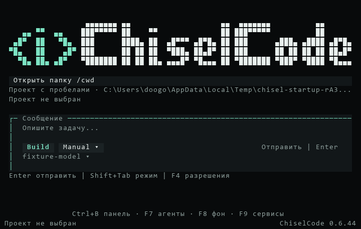

# Выпуск CLI 0.6.44

[Материалы для участников](../README.md) · [Установка](../../installation.md) · [Первый запуск](../../getting-started.md) · [Архитектура запуска](../../architecture/project-startup.md)

[CLI 0.6.44](https://github.com/TheAsrada/ChiselCode/releases/tag/v0.6.44) опубликован 01.11.2026 в 21:54:41 UTC+05:00 (Asia/Yekaterinburg). Выпуск добавляет главную без проекта, единый допуск путей, защищённые черновики и контекст текущего запроса агента. Полный список — в [CHANGELOG](../../../CHANGELOG.md#0644---2026-11-01). [Локальный отчёт от 30 октября](project-startup.md) сохранён как история этапа реализации.

Release source — `89a6fe2b0ae0bd87575efdade95377e0d6f8acf4` из `main`. Версии `package.json`, обеих записей `package-lock.json` и `src/version.ts` равны 0.6.44. Annotated tag `v0.6.44` создан после допуска четырёх обязательных jobs и указывает на этот source; объект тега — `2a90a203507fc59de1fe4b831e625069a6520ea7`.

## Проверки release source

[Native validation](https://github.com/TheAsrada/ChiselCode/actions/runs/41327242438), [Quick CI](https://github.com/TheAsrada/ChiselCode/actions/runs/41326949195) и [Docs CI](https://github.com/TheAsrada/ChiselCode/actions/runs/41326949132) прошли на точном release source. Все четыре обязательных Native jobs завершились с первой попытки, без повторов. Перед тегом `verify-release-ci.ts` подтвердил допуск; Release повторно проверил тот же source через GitHub API. Использована закреплённая версия Bun 1.4.2.

| Job | Результат | Время job |
| --- | --- | ---: |
| Full source, Linux | 1454 pass, 3 skip, 0 fail; 1457 тестов в 184 файлах за 288,80 с; typecheck, lint, eval и дополнительные UI-fixtures прошли | 330 с |
| Native Linux | Installed npm/SDK, compiled CLI и OpenTUI-сценарии прошли | 143 с |
| Native macOS | Платформенный набор путей, atomic storage и процессов; installed/compiled smoke и OpenTUI прошли | 395 с |
| Native Windows | Платформенный набор, настоящий updater с заменой EXE, ярлыки/finish-page, installed/compiled smoke и OpenTUI прошли | 784 с |

Полный source-набор выполнен один раз на Linux. Windows/macOS получили платформенный набор и проверки поставки; пересекающиеся результаты не суммируются. Суммарное время четырёх jobs — 1652 с (27 мин 32 с runner time); это сумма занятости runner, а не длительность ожидания workflow.

На Windows локально прошли 490 быстрых тестов (0 fail, 3440 assertions, 50 файлов, 9,33 с), typecheck и JS/SDK build. Lint завершился без ошибок с 412 предупреждениями и 58 информационными замечаниями. Отдельные полные файлы проверили открытие/отмену проекта и контекст запроса: 47 pass, 0 fail, 433 assertions в пяти файлах; `subagents-runtime.test.ts` — 4 pass, 0 fail; `background-process.test.ts` — 9 pass, 1 skip, 0 fail. Эти локальные результаты дополняют удалённый допуск.

### Найденные сбои и исправления

Подготовительные прогоны выявили реальные ошибки и расхождения fixtures с новым поведением. Операции библиотеки навыков получили собственную проверенную файловую границу вместо отказа со стороны политики workspace. Исправлены ранняя инициализация выбора проекта и компактный fallback, сохранены проверки первого пользовательского сообщения помощника и отсутствующих расширений. Прямой `/cwd path` теперь возвращает редактор при отмене, а deadline остаётся явным отказом; поздний результат не меняет проект. Защищённое сохранение черновика входит в ту же отменяемую операцию до допуска.

Windows [Native run на `bd7525e`](https://github.com/TheAsrada/ChiselCode/actions/runs/41311978179) выявил пустые поля ярлыка при чтении через WScript Automation на англоязычном runner. Передача пути через Unicode environment сама по себе не исправила проверку. Диагностика подтвердила наличие правильных Unicode-полей в LNK. Fixture теперь читает `IShellLinkW`/`IPersistFile` с `SLGP_RAWPATH`; [отдельная проверка ярлыков](https://github.com/TheAsrada/ChiselCode/actions/runs/41323658807) прошла на `29cca229a01322dd08a14e18656afe719163ca1b`. Настоящие ShellExecute обоих ярлыков и finish-page handler сохранены.

В [Native run на `29cca229`](https://github.com/TheAsrada/ChiselCode/actions/runs/41323867077) первая попытка Windows завершилась ошибкой освобождения дочернего процесса. После диагностики и успешной локальной проверки разрешён один повтор только Windows job на том же source. Повтор выявил другой сбой: внешний предел 15 с завершал тест inherited output раньше возможного окончания command deadline 10 с и teardown до 10 с. Третьего повтора не было. На release source внешний предел fixture разделён с командным deadline, добавлены watchdog с фазой выполнения, обязательный `process.stop()` в `finally` и assertion отсутствия `timed_out`. Production deadlines не увеличены, assertions не отключены.

[Отдельный Windows process run](https://github.com/TheAsrada/ChiselCode/actions/runs/41326959475) на release source прошёл: 13 pass, 1 skip, 0 fail, два полных файла за 94,16 с. После него весь обязательный Native validation на этом source прошёл с первой попытки.

## Публикация и проверка файлов

[Release workflow](https://github.com/TheAsrada/ChiselCode/actions/runs/41328518341) успешно завершил все шесть jobs: допуск source, сборки Windows/macOS/Linux и npm/SDK, публикация. Release API подтвердил `v0.6.44`, отсутствие draft/prerelease и ровно пять assets в состоянии `uploaded`. npm-пакет опубликован в GitHub Release как архив `chiselcode-0.6.44.tgz`.

Все пять опубликованных файлов скачаны; их размеры и SHA-256 совпали с Release API.

| Asset | Размер, байт | SHA-256 |
| --- | ---: | --- |
| `ChiselCode-Setup-0.6.44-linux-amd64.deb` | 37036140 | `87544e214548b897311f32f451fe27a52b60721084563ba81e4bda656dc69687` |
| `ChiselCode-Setup-0.6.44-macos-arm64.pkg` | 33420306 | `5de1ab71d9e099dc2ef048919bde9e67044b27fb6b11adc0dee3f8044f0038b9` |
| `ChiselCode-Setup-0.6.44-macos-x64.pkg` | 36004057 | `faaa0399acfbaf03477b4c167c13d374e7681927b68e02a72120689e725bf4f1` |
| `ChiselCode-Setup-0.6.44.exe` | 38769796 | `a148511ca0034ac9c9a606986e5201f520e2b0be67edf33a230a3ae33d775118` |
| `chiselcode-0.6.44.tgz` | 5920064 | `6ecb5ff751a6bd08e8c10a88690407b707b88fd32bdc391615e1f469a4af64ff` |

Из опубликованного Windows установщика извлечён настоящий payload; бинарник запущен в отдельном каталоге с изолированными путями данных. Опубликованный npm-архив установлен в отдельный каталог через `npm install --offline` из прогретого кэша зависимостей, без пропуска install scripts. Первоначальное сетевое ожидание установки было остановлено; offline-установка завершилась успешно за 10 с. npm под Node 24.19.0 выдал `EBADENGINE` для требования Node у OpenTUI; CLI проверен под предназначенным для него Bun 1.4.2. Node runtime этой проверкой не подтверждается.

Обе опубликованные поставки вернули 0.6.44 и прошли `manifest-cli.ts` и `skill-install-cli.ts`: настоящий SSE → tool → model → persisted source, установка навыка через HTTPS/proxy, восстановление неверного revision до сети и немедленная загрузка инструкций и references. В npm-пакете дополнительно проверены declarations extension SDK и UI composition, встроенный `extension-creator`. Пользовательская установка и данные не заменялись.

`update --json` опубликованного Windows binary подтвердил `current: 0.6.44`, `latest: 0.6.44`, `updateAvailable: false` и пять assets. После публикации обновлены руководства установки/первого запуска, архитектура, статусы планов и индекс отчётов. Последующий коммит содержит только документацию и кадр интерфейса; tag и assets остаются привязаны к release source выше.

## Настоящий кадр OpenTUI

Кадр получен из `captureSpans()` production composition через startup fixture версии 0.6.44. После его получения до release source менялись только тесты и CI. Данные провайдера и проектов синтетические; это настоящий терминальный renderer, а не макет.

## Ограничения проверки

Полный source-набор выполнен на Linux. На Linux пропущены системный clipboard без desktop-сессии и две Windows-only проверки CMD/Python. На macOS пропущены detached orphan и две Windows-only проверки; на Windows — detached orphan. Windows/macOS имеют платформенные проверки и installed/compiled smoke, а не второй полный source-прогон.

После публикации локально исполнены Windows payload и npm-пакет; DEB и macOS PKG после скачивания проверены по размерам и SHA-256. Linux и macOS ARM64 binaries запускались в Release workflow. macOS Intel собран на ARM64 runner; отдельный запуск на Intel Mac не выполнялся.

Ручная установка через GUI и физические терминалы на всех платформах не проверялись. Windows установщик имеет статус Authenticode `NotSigned`; установщики macOS не подписаны и не прошли notarization. Совместимые тестовые API используют настоящий транспорт, но качество ответов живых моделей разных провайдеров не проверяется.
