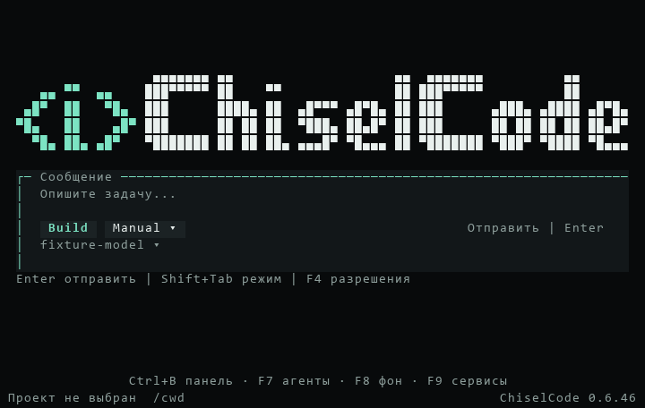

# Выпуск CLI 0.6.46

[Материалы для участников](../README.md) · [Установка](../../installation.md) · [Интерактивный режим](../../interactive.md) · [Диагностика контекста](../../troubleshooting.md#неизвестное-окно-контекста)

[CLI 0.6.46](https://github.com/TheAsrada/ChiselCode/releases/tag/v0.6.46) опубликован 02.11.2026 в 13:40:14 UTC+05:00 (Asia/Yekaterinburg). Исправлен `/compact` после обычного сообщения, дополнен каталог точных ID моделей, кнопка `/cwd` перенесена в нижнюю строку главной. Полный список — в [CHANGELOG](../../../CHANGELOG.md#0646---2026-11-02).

Release source — `e8fa9a76ffdf8eb03c2d84d4d880d5192a38377d` из `main`. Annotated tag `v0.6.46` указывает на этот SHA; объект тега — `749e5646eebae9d357dfdb739e53930e709f3929`. Версии `package.json`, обеих записей `package-lock.json` и `src/version.ts` равны 0.6.46.

## Проверки release source

[Quick CI](https://github.com/TheAsrada/ChiselCode/actions/runs/41412229044), [Docs CI](https://github.com/TheAsrada/ChiselCode/actions/runs/41412228134) и [Native validation](https://github.com/TheAsrada/ChiselCode/actions/runs/41412228850) прошли на точном release source. Все четыре обязательных Native jobs завершились с первой попытки. `scripts/verify-release-ci.ts` подтвердил допуск перед созданием тега; Release повторил проверку через GitHub API.

| Job | Результат | Время job |
| --- | --- | ---: |
| Full source, Linux | 1461 pass, 3 skip, 0 fail; 1464 теста в 185 файлах за 378,15 с; typecheck, lint, eval и дополнительные UI-fixtures прошли | 434 с |
| Native Linux | Installed npm/SDK, compiled CLI и OpenTUI прошли | 202 с |
| Native macOS | Платформенные проверки путей, atomic storage и процессов; installed/compiled smoke и OpenTUI прошли | 452 с |
| Native Windows | Платформенный набор, настоящий updater и ярлыки; installed/compiled smoke и OpenTUI прошли | 767 с |

От создания Native run до его завершения прошло 770 с; сумма длительностей четырёх jobs — 1855 с, или 30 мин 55 с runner time. Это измерения timestamps GitHub API, без оценки ускорения. Release workflow завершился за 159 с от создания run до обновления итогового статуса.

Локально на Windows прошли 492 быстрых теста и 37 тестов главной, навигации и production startup с локальным HTTP-провайдером. Typecheck, JS/SDK build и проверка документации прошли; lint завершился без ошибок, с 412 предупреждениями и 58 информационными замечаниями. Пропуски Linux source относятся к настоящим Windows CMD/Python и native OS clipboard.

Настоящий кадр OpenTUI получен на release source через `CHISEL_STARTUP_CAPTURES` и `CHISEL_STARTUP_RECENT=1 bun test tests/integration/project-startup.test.ts`; PNG экспортирован из `captureSpans` без изменения содержимого.

## Публикация и проверка файлов

[Release workflow](https://github.com/TheAsrada/ChiselCode/actions/runs/41414451837) успешно завершил все шесть jobs. Release API подтвердил `v0.6.46`, опубликованное состояние без draft/prerelease и ровно пять assets в состоянии `uploaded`. npm-пакет CLI с SDK опубликован в GitHub Release как архив `chiselcode-0.6.46.tgz`.

Все пять файлов скачаны; их размеры и локальные SHA-256 совпали с Release API.

| Asset | Размер, байт | SHA-256 |
| --- | ---: | --- |
| `ChiselCode-Setup-0.6.46-linux-amd64.deb` | 37036690 | `76d6ad8099f577ad49e162a5f8b7b8b18a6ffb0499ee884cb7a7cf0ef8baab9f` |
| `ChiselCode-Setup-0.6.46-macos-arm64.pkg` | 33421095 | `f0aaa84eb71de0f120baa91a9a439ab40d78d59ebbe3e6ff1912864585cbadae` |
| `ChiselCode-Setup-0.6.46-macos-x64.pkg` | 36005258 | `7c48146201cddd71dece72354ca6e7012958be5793696d711e26f051ab0b3763` |
| `ChiselCode-Setup-0.6.46.exe` | 38770298 | `e9256259add6ddb256238023750cea133b1e00159d7ea785e2af0c82ad59c869` |
| `chiselcode-0.6.46.tgz` | 5921256 | `393267f9b03d79a7f22e0bc68f9c58c340c067ded9855a4748539d8ada1b94e4` |

Windows EXE извлечён через 7-Zip в отдельную папку без запуска установщика; его payload вернул `0.6.46`. Опубликованный npm-архив установлен отдельно в offline-режиме: CLI вернул `0.6.46`, declarations extension SDK присутствуют. В обоих payload локальный HTTP-провайдер вернул точный ID `deepseek-v4.1-flash-1017` без лимитов: проверены окно 1 000 000 из каталога, исходящий предел ответа 393216 и сохранённый контекстный снимок. `manifest-cli.ts` также подтвердил настоящий цикл API → инструмент → API и сохранение результата в обоих форматах.

Локальные TLS timeout при получении отчёта и двух assets устранены повторным скачиванием; CI и Release jobs не перезапускались. Метаданные, tag/source и SHA-256 проверены после успешной загрузки.

## Ограничения проверки

Полный source-набор выполнен на Linux; Windows и macOS получили платформенные проверки и installed/compiled smoke. Опубликованные macOS PKG и Linux DEB после скачивания локально сверены по размеру и SHA-256, но не запускались на этом Windows-компьютере. Отдельный запуск macOS Intel binary на Intel Mac не подтверждён. Ручная установка через GUI, физические терминалы и native OS clipboard не проверялись.

Windows установщик не подписан (`Get-AuthenticodeSignature`: `NotSigned`); пакеты macOS не подписаны и не notarized. npm сообщил `EBADENGINE`: OpenTUI требует Node ≥26.4.0, локально установлен Node 24.19.0. Запуск npm-поставки проверен через Bun 1.4.2; обычный запуск через Node не проверялся.
