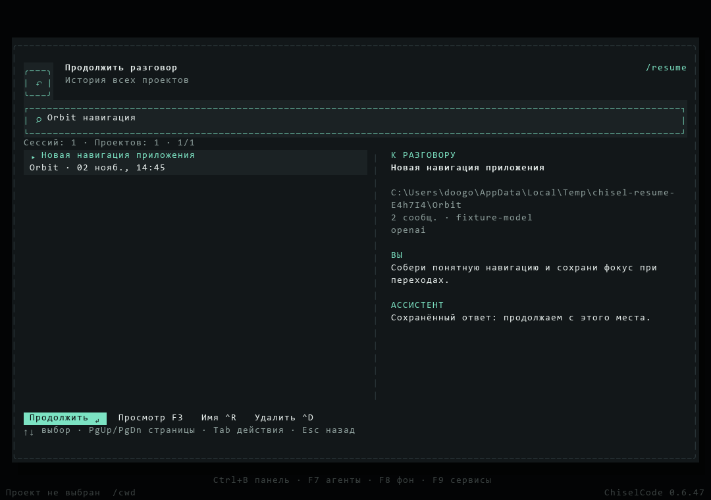

# Выпуск CLI 0.6.47

[Материалы для участников](../README.md) · [Установка](../../installation.md) · [Сессии и история](../../sessions.md)

[CLI 0.6.47](https://github.com/TheAsrada/ChiselCode/releases/tag/v0.6.47) опубликован 02.11.2026 в 15:07:11 UTC+05:00 (Asia/Yekaterinburg). Удалены `/home` и `/sessions`, `/resume` получил общее окно истории всех проектов, поиск и предпросмотр. Восстановление открывает исходный runtime, переименование и удаление доступны между проектами. [Изменения выпуска](../../../CHANGELOG.md#0647---2026-11-02).

Release source — `af9326ea68f38af50c6569dd4289c810fde742f3` из `main`. Annotated tag `v0.6.47` указывает на этот SHA; объект тега — `0951e0bf5f0d9a5f7911ed3f5b8cbb8497ebd954`. Версии `package.json`, обеих записей `package-lock.json` и `src/version.ts` равны 0.6.47.

## Проверки release source

[Quick CI](https://github.com/TheAsrada/ChiselCode/actions/runs/41423581112), [Docs CI](https://github.com/TheAsrada/ChiselCode/actions/runs/41423580942) и [Native validation](https://github.com/TheAsrada/ChiselCode/actions/runs/41423582481) прошли на точном source. Четыре обязательных Native jobs успешны с первой попытки. `scripts/verify-release-ci.ts` подтвердил допуск перед тегом; Release повторил проверку через GitHub API. Предыдущий Native run другого source отменён после уточнения подписи кнопки истории и быстрого старта; для допуска он не использовался.

| Job | Результат | Время job |
| --- | --- | ---: |
| Full source, Linux | Полный unit/integration набор, typecheck/lint, eval и заключительные UI-fixtures прошли | 425 с |
| Native Linux | Installed npm/SDK, compiled CLI и OpenTUI прошли | 177 с |
| Native macOS | Платформенный набор, сценарий `/resume`, installed/compiled smoke и OpenTUI прошли | 435 с |
| Native Windows | Платформенный набор, сценарий `/resume`, настоящий updater и ярлыки, installed/compiled smoke и OpenTUI прошли | 898 с |

От создания Native run до завершения прошло 936 с; сумма длительностей jobs — 1935 с, или 32 мин 15 с runner time. Release завершился за 168 с. Это измерения timestamps GitHub API, без оценки ускорения. Результаты и шаги сверены через API; скачивание полного текстового лога локально не завершилось из-за TLS timeout.

Локально на Windows прошли 492 быстрых теста и точечные файлы сессий, навигации, автодополнения, общего каталога и production startup/resume. Typecheck, lint без ошибок, JS/SDK build и проверка документации прошли. Native renderer проверен на 120×40, 80×24, 60×15 и 32×10. Production fixture действительно продолжил запрос в исходном проекте и проверил его инструкции, сохранение ответа, переход между проектами, переименование/удаление и readonly fallback недоступной папки. Unit test проверяет отказ неоднозначного UUID и чтение повреждённого индекса без перезаписи.

Кадр выпущенного интерфейса получен из настоящего OpenTUI через `CHISEL_RESUME_CAPTURES` и экспорт `captureSpans` в PNG:

После публикации по замечанию владельца квадратная иконка заголовка удалена в `main` и отмечена в `Unreleased`. [Текущий кадр](../../assets/resume.png) отражает эту последующую правку; опубликованные tag и assets 0.6.47 сохранены без изменений.

## Публикация и проверка файлов

[Release workflow](https://github.com/TheAsrada/ChiselCode/actions/runs/41425788518) успешно завершил все шесть jobs. API подтвердил опубликованное состояние `v0.6.47` без draft/prerelease и ровно пять assets `uploaded`. npm-пакет CLI с SDK опубликован в GitHub Release как `chiselcode-0.6.47.tgz`.

Все пять файлов скачаны; локальные размеры и SHA-256 совпали с Release API.

| Asset | Размер, байт | SHA-256 |
| --- | ---: | --- |
| `chiselcode-0.6.47.tgz` | 5923537 | `bc2752732dfc8554e64386b5938e8e55e53517cd787ea60086d294ab44a02ea7` |
| `ChiselCode-Setup-0.6.47-linux-amd64.deb` | 37039302 | `3ce1a80547877b426cbf908ec4b904a4982f0ba5dc6d68ab337890f0ab71262e` |
| `ChiselCode-Setup-0.6.47-macos-arm64.pkg` | 33423246 | `75b84d67f04b82e9710573e602adf1e4a4132aaa342312d085d0bc89a9ad8420` |
| `ChiselCode-Setup-0.6.47-macos-x64.pkg` | 36007354 | `3737d7732b963f81ac86df227d4f0ba2184f304f687225e2ca6f66fba1675f3b` |
| `ChiselCode-Setup-0.6.47.exe` | 38772680 | `d7f41540d6748e5bb692c72812ad0424231034afa35de2de848f7d0e3b98f62c` |

Windows NSIS извлечён через 7-Zip в отдельную папку без установки. Его `chisel-update.new.exe` вернул `0.6.47` и прошёл `manifest-cli.ts`: настоящий API → инструмент → API → сохранённая сессия. npm-архив установлен отдельно с `--offline`: CLI вернул ту же версию, extension SDK declarations присутствуют, тот же runtime smoke прошёл.

При чтении API и скачивании возникали локальные TLS timeout. Проверка продолжена через другой HTTP-клиент; итоговая сверка всех файлов завершена. Native и Release jobs не перезапускались.

## Ограничения проверки

Полный source-набор выполнен на Linux; Windows/macOS получили платформенные проверки и installed/compiled smoke. Сценарий `/resume` выполнен на всех трёх ОС через настоящий native test renderer, без ручной проверки физических терминалов. Опубликованные macOS PKG и Linux DEB после скачивания сверены по размеру и SHA-256, но не запускались на этом Windows-компьютере. Отдельный запуск macOS Intel binary на Intel Mac не подтверждён. GUI-установка и native OS clipboard локально не проверялись.

Windows установщик не подписан (`Get-AuthenticodeSignature`: `NotSigned`); macOS PKG не подписаны и не notarized. npm сообщил `EBADENGINE` для Node 24.19.0 при требовании OpenTUI Node ≥26.4.0; опубликованная npm-поставка проверена через Bun 1.4.2, запуск через Node не подтверждён. `/resume` и `/resume <id>` используют общий каталог; флаг терминального запуска `--resume` сохраняет поиск ID в текущем проекте или `--cwd`.
