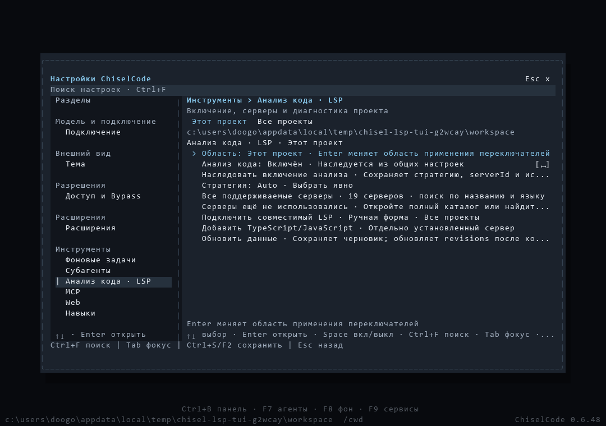

# Выпуск CLI 0.6.48

[Материалы для участников](../README.md) · [Установка](../../installation.md) · [Меню LSP и кадры](lsp-menu.md)

[CLI 0.6.48](https://github.com/TheAsrada/ChiselCode/releases/tag/v0.6.48) опубликован 03.11.2026 в 11:22:42 UTC+05:00 (Asia/Yekaterinburg). Единое меню анализа кода открывается из панели, F9 и Settings. Общие и индивидуальные переключатели сохраняются сразу, наследование и ручные настройки сохраняются при Off → On, включение остаётся ленивым. Пользовательские LSP-команды удалены; шесть инструментов и штатные разрешения сохранены. [Изменения выпуска](../../../CHANGELOG.md#0648---2026-11-03).

Release source — `cd4bd74c33cc2d626131d243a36aa504063c6dd0` из `main`. Annotated tag `v0.6.48` указывает на этот SHA; объект тега — `361ebf8b8dd03eacbe0d9b6ecd23c4f68dc78e4e`. Версии `package.json`, обеих записей `package-lock.json` и `src/version.ts` равны 0.6.48. Последующие изменения документации не меняют tag и assets.

## Проверки release source

[Quick CI](https://github.com/TheAsrada/ChiselCode/actions/runs/41586627512), [Docs CI](https://github.com/TheAsrada/ChiselCode/actions/runs/41586627515) и [Native validation](https://github.com/TheAsrada/ChiselCode/actions/runs/41586628314) успешны на точном source. Штатный `scripts/verify-release-ci.ts` подтвердил шесть обязательных jobs перед созданием тега; Release повторил проверку через GitHub API.

| Job | Результат | Время job |
| --- | --- | ---: |
| Full source, Linux | 1476 pass, 3 skip, 0 fail; typecheck, lint, eval и заключительные UI-fixtures прошли | 328 с |
| Native Linux | Installed npm/SDK, compiled CLI, реальный TS/Python и OpenTUI прошли | 219 с |
| Native macOS | Платформенный набор, installed/compiled CLI и native OpenTUI прошли | 267 с |
| Native Windows, повтор | 429 pass, 1 skip, 0 fail; настоящий updater/ярлыки, installed/compiled smoke и OpenTUI прошли | 855 с |
| LSP lifecycle, macOS | 56 тестов в 8 файлах и installed/compiled меню прошли | 116 с |
| LSP lifecycle, Windows | 56 тестов в 8 файлах и installed/compiled меню прошли | 199 с |

Первый Windows job этого source прошёл все 429 source-проверок, затем Chocolatey получил HTTP 504 при подготовке NSIS. Updater явно завершился ошибкой из-за отсутствующего `makensis`. Выполнен один повтор только Windows job на том же SHA; пять успешных jobs сохранены. На повторе подготовка, реальная замена EXE и остальные проверки прошли. Deadlines и assertions не изменялись.

От создания Native run до завершения, включая повтор, прошло 1513 с (25 мин 13 с). Сумма длительностей шести итоговых jobs — 1984 с; вместе с первым неуспешным Windows job (577 с) — 2561 с (42 мин 41 с). Это измерения timestamps GitHub API, а не оценка ускорения или округлённое оплачиваемое время. Release завершился за 154 с.

Предыдущий [Native run на `49fed85`](https://github.com/TheAsrada/ChiselCode/actions/runs/41476297119) выявил устаревшее ожидание текста при Off и два сценария, использовавших локальный поиск LSP для перехода между разделами Settings. Они воспроизведены и исправлены на Windows: переход использует Shift+Tab → Ctrl+F с проверкой владельца ввода; верхнее поле принимает фокус мышью. Его macOS jobs не получили runners из-за capacity constraints. Этот run для допуска выпуска не использовался. Подробности локальных проверок и исправлений сохранены в [отчёте реализации](lsp-menu.md#проверки).

Отдельный [LSP catalog](https://github.com/TheAsrada/ChiselCode/actions/runs/41476304340) прошёл на `49fed85735da939e6a11b123ba2c5646ff01d8a3`: 17 внешних backend на Linux/Windows/macOS и SourceKit на macOS. Backend после этого source не менялся. Jobs заняли 259/628/373 с соответственно, весь run — 679 с. Каталог проверяет доступные capabilities: для Kotlin подтверждён ответ symbols, диагностика в этом fixture остаётся `unavailable`; `observed` результаты не объявляются `current`.

Локально на Windows прошли 492 быстрых теста, затронутые runtime/UI-файлы, typecheck, build, lint без ошибок и документация. Lint сохраняет 417 предупреждений и 58 информационных замечаний. Настоящие TS/Python/Lua, отмена подготовки/initialize/request, cleanup с отказом и повтором, permissions, owner fences, revisions и чужие секции конфигурации проверяются реальными сценариями, без расширения fast сетевыми fixtures.

## Настоящий интерфейс

После фиксации release source `cd4bd74` повторно выполнен production OpenTUI fixture с сохранением native spans и текста; PNG экспортирован штатным `render-terminal-captures.py`. Проверены три входа, переключатели, прямой `ui_tool`, approval/checkpoints, ручная форма, конфликты, ошибки сервера и cleanup. [Полная галерея разработки](lsp-menu.md#настоящий-opentui) содержит обе темы и размеры до 24×8.

## Публикация и проверка файлов

[Release workflow](https://github.com/TheAsrada/ChiselCode/actions/runs/41589228411) завершил все шесть jobs успешно. API подтвердил `v0.6.48` без draft/prerelease и ровно пять assets `uploaded`. npm-пакет CLI с SDK опубликован в GitHub Release как `chiselcode-0.6.48.tgz`.

Все пять файлов скачаны; локальные размеры и SHA-256 совпали с Release API.

| Asset | Размер, байт | SHA-256 |
| --- | ---: | --- |
| `chiselcode-0.6.48.tgz` | 5929841 | `3295da35954fb5ec0f8aa987527ba66b6d1e1ae9b8196a936bda3ff844844e1c` |
| `ChiselCode-Setup-0.6.48-linux-amd64.deb` | 37047944 | `a23a1b7423a0acb6e0cd6721c5f859efad002ac1e3d0dc0679c234d162d411ac` |
| `ChiselCode-Setup-0.6.48-macos-arm64.pkg` | 33428049 | `2d511b82aebbf86e6c228d3941a1f4c59beb7d3def743224b39df066c7cff22f` |
| `ChiselCode-Setup-0.6.48-macos-x64.pkg` | 36010902 | `a622aa1e7fd88f7cabb89525bf1be64920f97c450160908b6534f41e3334a939` |
| `ChiselCode-Setup-0.6.48.exe` | 38774377 | `15876cc09625ec7748f46a051f7ebbff85e8dc151b3cadd7b14543f68db2494d` |

Windows NSIS извлечён через 7-Zip в отдельную папку без установки. Его `chisel-update.new.exe` вернул `0.6.48` и прошёл `manifest-cli.ts`: настоящий API → инструмент → API → сохранённая сессия. npm-архив установлен отдельно с `--offline --ignore-scripts`: CLI вернул ту же версию, extension SDK declarations присутствуют, тот же runtime smoke прошёл.

После публикации обновлены установка, оглавление, отчёт реализации и инструкция допуска к выпуску. `bun run docs:check` подтвердил 133 страницы, 1503 локальные ссылки и 0 ошибок; новый отчёт и кадр достижимы из оглавления.

## Ограничения проверки

Полный source-набор выполнен на Linux. Windows/macOS получили платформенные проверки, полные затронутые LSP-файлы и installed/compiled smoke. Три Linux skips относятся к двум Windows-only сценариям и opt-in системному clipboard; Windows subset также не включает opt-in clipboard. Физические терминалы, native OS clipboard и GUI-установка опубликованных установщиков вручную не проверялись.

Опубликованные macOS PKG и Linux DEB после скачивания сверены по размеру и SHA-256, но не запускались на этом Windows-компьютере. Запуск macOS x64 binary на Intel Mac не подтверждён: Release собирает его на arm64 runner. Windows ARM64, Linux ARM64 и другие дистрибутивы отдельного покрытия здесь не получили.

Windows установщик не подписан (`Get-AuthenticodeSignature`: `NotSigned`); macOS workflow создаёт PKG без подписи и notarization. npm сообщил `EBADENGINE` для Node 24.19.0 при требовании OpenTUI Node ≥26.4.0; npm-поставка проверена через Bun 1.4.2, исполнение через Node не подтверждено. React и закреплённые зависимости сохранены; отдельный концепт ChiselCodeDesktop не менялся и не выпускался.
