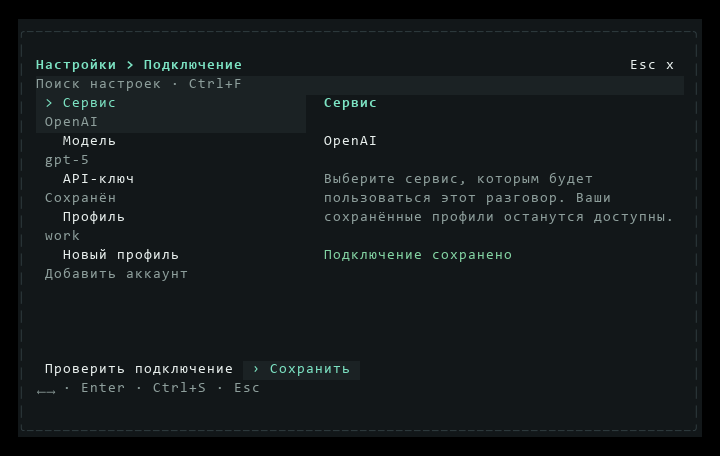

# Выпуск CLI 0.6.49

[Материалы для участников](../README.md) · [Установка](../../installation.md) · [Навигация меню и кадры](menu-keybindings.md)

[CLI 0.6.49](https://github.com/TheAsrada/ChiselCode/releases/tag/v0.6.49) опубликован 03.11.2026 в 20:30:14 UTC+05:00 (Asia/Yekaterinburg).

Release source — `a95967724238acba8417ad31c6790f2ae279343d` из актуального `origin/main`. Annotated tag `v0.6.49` указывает на этот SHA; объект тега — `d5314a760eb11e2b674d5d4ed6e6f6a902d8a0a7`. Версии `package.json`, обеих записей `package-lock.json` и `src/version.ts` равны 0.6.49. Локальные изменения сохранены, ветки и development worktrees не создавались.

Выпуск объединяет обычную навигацию встроенных меню и все шесть записей из `Unreleased`: обработку аргументов инструментов, остановку повторных отказов, пустой итог после инструментов, работу без Git и проверку полноты CI. [Полный список изменений](../../../CHANGELOG.md#0649---2026-11-03), [реализация меню](menu-keybindings.md), [надёжность цикла инструментов](tool-cycle-reliability.md).

## Проверки release source

Последний коммит меняет только Markdown, поэтому [Native validation](https://github.com/TheAsrada/ChiselCode/actions/runs/41647492634) запущен вручную из main с `platform=all`. Все шесть обязательных jobs и steps завершились успешно на точном `a959677`. [Docs CI](https://github.com/TheAsrada/ChiselCode/actions/runs/41647467550) также прошёл. Штатный `scripts/verify-release-ci.ts` подтвердил допуск до создания тега; Release повторяет эту проверку через GitHub API.

| Job | Результат | Время job |
| --- | --- | ---: |
| Full source, Linux | 1517 pass, 3 skip, 0 fail; JUnit подтверждает все 192 test files; typecheck, lint, eval и заключительные UI-fixtures прошли | 392 с |
| Native Linux | Installed CLI/SDK, compiled CLI, реальные TS/Python и OpenTUI прошли | 166 с |
| Native macOS | 467 pass, 3 skip, 0 fail; installed/compiled smoke и native clipboard прошли | 256 с |
| Native Windows, повтор | 469 pass, 1 skip, 0 fail; updater, ярлыки, installed/compiled smoke и native clipboard прошли | 712 с |
| LSP lifecycle, macOS | 56 tests в 8 файлах и installed/compiled меню прошли | 139 с |
| LSP lifecycle, Windows | 56 tests в 8 файлах и installed/compiled меню прошли | 154 с |

Первый Windows job остановился с `EBUSY` при удалении изолированной папки в `background-cli.ts`; результат этого smoke первой попыткой не подтверждён. Тот же сценарий со свежей compiled-сборкой локально на Windows прошёл. Выполнен один повтор только Windows job на том же SHA; пять успешных jobs сохранены. На повторе background smoke и все оставшиеся compiled UI-сценарии прошли. Таймауты и assertions не менялись.

Первый attempt занял 705 с, повтор после возобновления работы — 718 с. Между ними была пауза 4346 с; от создания run до итогового завершения прошло 5769 с (96 мин 9 с), включая эту паузу. Сумма длительностей шести итоговых jobs — 1819 с; с первым неуспешным Windows job (700 с) — 2519 с (41 мин 59 с). Это измерения timestamps GitHub API, а не оценка ускорения или оплачиваемого времени.

В итоговом Linux lint нет ошибок, 416 warnings и 58 infos. Три Linux skips относятся к двум Windows-only shell-сценариям и системному clipboard без desktop display. Три macOS skips — два Windows-only shell-сценария и Linux-сценарий detached orphan; Windows пропускает только последний. Полные затронутые UI-файлы входят в platform subset, быстрый профиль не расширялся runtime fixtures.

## Настоящий интерфейс

Модели, навыки, история, Settings/MCP, рабочие копии, помощники и фон используют Tab/Shift+Tab, стрелки и именованные действия. Глобальные клавиши главной сохранены; `/help` не возвращён. React и закреплённый OpenTUI 0.5.12 не менялись.

Кадры получены настоящим OpenTUI renderer через native spans с изолированными демонстрационными данными. [Сравнение до/после](menu-keybindings.md#настоящие-кадры-до-и-после) и [галерея 120×40–32×10](../../assets/menu-keybindings/README.md) сохраняют PNG, TXT и JSON.

## Публикация и проверка файлов

[Release workflow](https://github.com/TheAsrada/ChiselCode/actions/runs/41663512071) завершил все шесть jobs успешно на том же source; перед публикацией повторно подтверждены source тега и Native validation. От создания run до завершения прошло 369 с, сумма длительностей jobs — 326 с. API подтвердил `v0.6.49` без draft/prerelease и ровно пять assets `uploaded`: четыре установщика и `chiselcode-0.6.49.tgz` с npm-пакетом CLI и SDK. npm-архив опубликован в GitHub Release, не в npm registry. Последующие изменения отчёта не меняют tag и assets.

Все пять файлов скачаны; локальные размеры и SHA-256 совпали с Release API.

| Asset | Размер, байт | SHA-256 |
| --- | ---: | --- |
| `chiselcode-0.6.49.tgz` | 5935480 | `b2fc44b397302d3ef9569e481f0897d20b2c0eb75ea2a6f44dc5a639b6f950dc` |
| `ChiselCode-Setup-0.6.49-linux-amd64.deb` | 37045908 | `4e5caecadc03241a9ef765c84fc23d809e7f199c7fa0861b7ce8654f63012fe4` |
| `ChiselCode-Setup-0.6.49-macos-arm64.pkg` | 33433256 | `5fcddbc07585f0b697f228b7ec8aa8f39fa10888510adc9db3614ed28875909d` |
| `ChiselCode-Setup-0.6.49-macos-x64.pkg` | 36018636 | `7098b560c5729adf5ee79f5cf6583aa95d6085eaff3ef93c1dd5458f2b22eda9` |
| `ChiselCode-Setup-0.6.49.exe` | 38779868 | `e9df7e56e651ff98f0afc82eabd0a04ead5494a17e8b2f7c2180b618f28884cb` |

Windows NSIS извлечён через 7-Zip в отдельную папку без установки. Его `chisel-update.new.exe` вернул `0.6.49` и прошёл `manifest-cli.ts`: настоящий API → инструмент → API → сохранённая сессия. npm-архив установлен отдельно с `--offline --ignore-scripts`: CLI вернул ту же версию, extension SDK declarations присутствуют, тот же runtime smoke прошёл через Bun 1.4.2.

После публикации обновлены установка, оглавление и отчёт реализации меню. `bun run docs:check` подтвердил 139 страниц, 1561 локальную ссылку и 0 ошибок; новый отчёт и галерея достижимы из оглавления.

## Ограничения проверки

Полный source-набор выполнен на Linux. Windows/macOS получили платформенные проверки, полные затронутые LSP-файлы и installed/compiled smoke; системный clipboard проверен на обеих ОС. Физические терминалы и GUI-установка опубликованных установщиков вручную не проверялись.

Опубликованные macOS PKG и Linux DEB после скачивания сверены по размеру и SHA-256, но не запускались на этом Windows-компьютере. Запуск macOS x64 binary на Intel Mac не подтверждён: Release собирает его на arm64 runner. Windows ARM64, Linux ARM64 и другие дистрибутивы отдельного покрытия здесь не получили.

Windows установщик не подписан (`Get-AuthenticodeSignature`: `NotSigned`); macOS workflow создаёт PKG без подписи и notarization. npm сообщил `EBADENGINE` для Node 24.19.0 при требовании OpenTUI Node ≥26.4.0; npm-поставка проверена через Bun 1.4.2, исполнение через Node не подтверждено. Отдельный концепт ChiselCodeDesktop не менялся и не выпускался.
