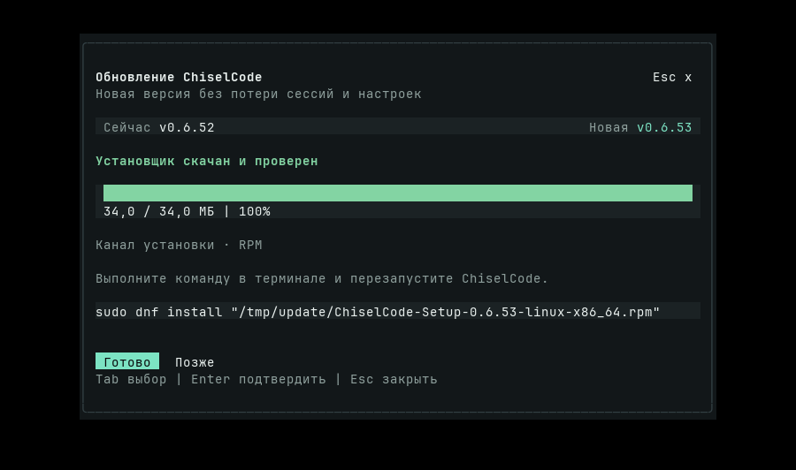

# Выпуск CLI 0.6.52

[Материалы для участников](../README.md) · [Установка](../../installation.md) · [Каналы обновления](../../architecture/self-update.md)

[CLI 0.6.52](https://github.com/TheAsrada/ChiselCode/releases/tag/v0.6.52) опубликован 10 ноября 2026 года в 20:52:50 (UTC+05:00). [История изменений](../../../CHANGELOG.md#0652---2026-11-10).

Тег `v0.6.52` указывает на коммит `49a4924152465fb6b4cc093001413b2b1a688408` из `main`. Объект аннотированного тега — `29077db80b0c70843f49667e41c174345bf72531`. Версия совпадает в `package.json`, обеих записях `package-lock.json` и `src/version.ts`.

## Проверки исходников

[Quick CI](https://github.com/TheAsrada/ChiselCode/actions/runs/42845009983) и [Native validation](https://github.com/TheAsrada/ChiselCode/actions/runs/42845009486) завершились успешно на коммите тега. До отправки тега скрипт допуска подтвердил все шесть задач и обязательные шаги.

| Задача | Результат | Длительность, с |
| --- | --- | ---: |
| [Full source (ubuntu-latest)](https://github.com/TheAsrada/ChiselCode/actions/runs/42845009486/job/129930039200) | 1586 прошли, 3 пропущены. JUnit подтвердил 1589 тестов в 203 файлах. Прошли документация, typecheck, lint, eval и отдельные UI-сценарии. | 484 |
| [LSP lifecycle (macos-latest)](https://github.com/TheAsrada/ChiselCode/actions/runs/42845009486/job/129930039966) | Конфигурация, процессы, отмена, native меню и installed/compiled smoke. | 136 |
| [LSP lifecycle (windows-latest)](https://github.com/TheAsrada/ChiselCode/actions/runs/42845009486/job/129930039677) | Конфигурация, процессы, отмена, native меню и installed/compiled smoke. | 219 |
| [Native smoke (macos-latest)](https://github.com/TheAsrada/ChiselCode/actions/runs/42845009486/job/129930039828) | Платформенные проверки, native clipboard, installed и compiled CLI. | 393 |
| [Native smoke (ubuntu-latest)](https://github.com/TheAsrada/ChiselCode/actions/runs/42845009486/job/129930039666) | Installed и compiled CLI, OpenTUI, пакеты Arch, Fedora 43 и Ubuntu 24.04, сценарий `install.sh` с повреждённой загрузкой. | 243 |
| [Native smoke (windows-latest)](https://github.com/TheAsrada/ChiselCode/actions/runs/42845009486/job/129930039798) | Платформенные проверки, native clipboard, NSIS с заменой EXE и перезапуском, ярлыки, installed и compiled CLI. | 897 |

Native validation заняла 901 с от создания до завершения. Сумма длительностей задач — 2372 с. Полный набор Linux выполнен за 426,71 с.

На Linux локально прошли 73 точечных теста обновления и допуска, 528 быстрых тестов, `docs:check`, typecheck, lint, чистый `npm ci` и запуск через PATH после установки архива через npm и Bun в изолированных каталогах. Arch, Fedora 43 и Ubuntu 24.04 прошли установку, обновление и удаление с проверкой встроенных навыков, PATH и сохранения данных. После повреждённой загрузки `install.sh` вернул ошибку SHA-256, а запущенный через PATH `chisel` сохранил версию 0.6.51.

[Первый Quick CI](https://github.com/TheAsrada/ChiselCode/actions/runs/42844436392) и [первый Native validation](https://github.com/TheAsrada/ChiselCode/actions/runs/42844436668) на `71fd339` остановились на `npm ci`. Пробная локальная установка Bun записала зависимость на временный tarball в манифест. Запись удалена, установки повторно проверены в изоляции.

На кадре `/update` предлагает команду для проверенного RPM. Версия 0.6.53 взята из тестовой фикстуры.

## Публикация и проверка файлов

[Release workflow](https://github.com/TheAsrada/ChiselCode/actions/runs/42847721796) завершился за 431 с на том же SHA. Перед публикацией он повторно проверил Native validation, точный состав, размеры и SHA-256 черновика.

| Файл | Размер, байт | SHA-256 |
| --- | ---: | --- |
| `ChiselCode-0.6.52-linux-x64.tar.gz` | 46380708 | `4c7a0cdbc4a7b9c752cbd9fd00098d482ad7e8b65bbbcb80a420199fcdac54d3` |
| `ChiselCode-Setup-0.6.52-linux-amd64.deb` | 39442776 | `4c7b475d820c3b07121ed320d3b45d8855dc6f0a37f9b9915fdd087a0599fcaa` |
| `ChiselCode-Setup-0.6.52-linux-x86_64.pkg.tar.zst` | 45494622 | `1167392d8c8e45699f63e05f184b3d78b664239a6c2a5c5228c5bd65e22fafc7` |
| `ChiselCode-Setup-0.6.52-linux-x86_64.rpm` | 45725930 | `580431141ee9cd36cecd2a091a55f6b3c17f8df04b2ff3ddec965a44cad65278` |
| `ChiselCode-Setup-0.6.52-macos-arm64.pkg` | 33460183 | `38c883e7502cb9bd00098172ce65049725c2c767c4ac7a3ac1cbfec386583e81` |
| `ChiselCode-Setup-0.6.52-macos-x64.pkg` | 36042417 | `fcecf066fcecf171dcc68e54791f41cc55f6cfd2266c9baa353b7363f40435c5` |
| `ChiselCode-Setup-0.6.52.exe` | 38794683 | `c4fc3da7de8618d533dd1ec7968a7668207ee9ee124e97b136c372e107fa6986` |
| `SHA256SUMS` | 1073 | `e44fa7d1681d833e1ffa08db9c3d03d9cff50935a8b66b3a8b1f89ea1661df89` |
| `chiselcode-0.6.52-aur.tar.gz` | 716 | `2b324f37fa4f2aaa1aa04b5ef51d735e85711baa96807bb5c5b15c1ee39a6d55` |
| `chiselcode-0.6.52.tgz` | 5962343 | `20caeab6f9e89e09d8a48cef62df654ffa1835b4ba846ccea5759dd5354b6aa4` |
| `chiselcode.rb` | 571 | `b98b848aa74ab990cb5d345a909e17af810bc50e53c4ab275348437ce55a7497` |
| `install.sh` | 2730 | `0f6020454f9e787b2c181a74ac3468ba74dd430bdd3437208bfbcec7a3596f75` |

Все 12 файлов скачаны с GitHub. Для них совпали размеры и SHA-256 из API. `sha256sum -c SHA256SUMS` подтвердил перечисленные в манифесте файлы. Бинарник из DEB, RPM, Arch-пакета и переносимого архива имеет один SHA-256 `e0ad018cbc6860213272be59bfad813df481ba80b9378a343321ae98075f0a08`.

Установка из опубликованного `releases/latest/download/install.sh` прошла в отдельном домашнем каталоге. Проверены PATH, версия, SHA-256 установленного бинарника, загрузка встроенного навыка и `chisel update --json`. Опубликованный архив установлен по прямой ссылке через npm и Bun в отдельные каталоги. В обоих случаях проверены запуск из PATH и декларации SDK. Формула Homebrew прошла проверку синтаксиса Ruby. В формуле и рецепте AUR проверены архив тега и его SHA-256. Рецепт AUR собран через `makepkg` с архивом из Release workflow, `pacman -Qp` подтвердил имя и версию пакета.

## Границы проверки

Полный набор исходных тестов прошёл на Linux. macOS и Windows прошли платформенные наборы и smoke в CI. Ручная установка опубликованных EXE и PKG, запуск на Intel Mac и установка через Homebrew не выполнялись. Установщики выпущены без подписи, PKG без нотариального заверения. Linux-поставка рассчитана на x64 с glibc, Linux ARM64 и musl не проверялись.

Архив npm/Bun и рецепты доступны через GitHub Releases. Публикация по имени требует доступа к npm registry, отдельного Homebrew tap или аккаунта сопровождающего AUR.
