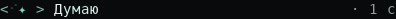
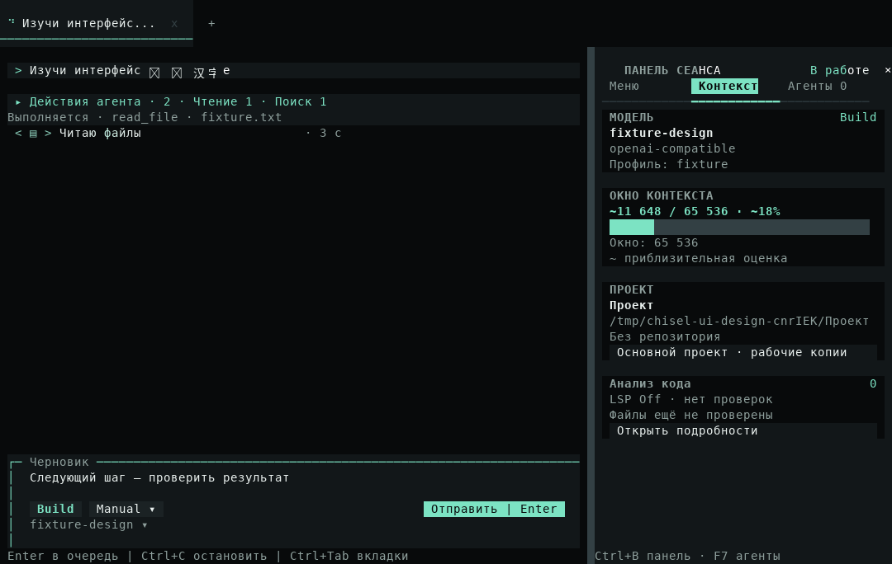
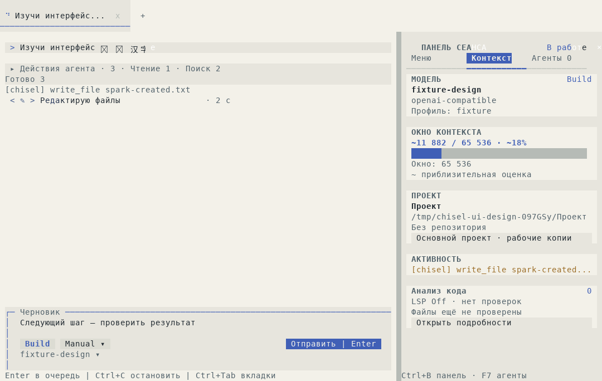

# Искра и состояния активного запроса

[Материалы для участников](../README.md) · [Темы и анимации](../../themes.md) · [Архитектура](../../architecture/interface-motion.md)

Реализация 25 октября 2026 года заменяет полосу активности фирменными скобками с искрой и включена в [CLI 0.6.41](release-0.6.41.md). Ниже сохранены результаты этапа реализации; опубликованный CLI 0.6.40 сохраняет свой интерфейс.

## Движение и смысл

Пятисимвольный знак сохраняет ширину: искра движется между скобками, а по подписи проходит мягкая цветовая волна. При начале инструмента орбита собирается в центре и появляется его значок. Переход занимает 180 мс, цикл ожидания — 1400 мс, более спокойный ответ — 2200 мс. Это сроки animation clock, а не измерение FPS физического терминала.

| Реальное действие | Подпись |
| --- | --- |
| Запрос модели / поступление ответа | Думаю / Отвечаю |
| Чтение файла, каталога, результата | Читаю файлы |
| Поиск файлов, grep, Web Search, навигация LSP | Ищу |
| Запись, изменение, удаление файла | Редактирую файлы |
| Диагностика встроенного LSP | Проверяю код |
| Git status/diff | Проверяю Git |
| Web Fetch / Download | Читаю страницу / Скачиваю файл |
| Shell | Выполняю команду |
| Неизвестный инструмент, MCP, стороннее расширение | Выполняю инструмент |

Подписи определяются событиями runtime и доверенным `ToolSource`. Shell-команда с тестами не объявляется проверкой кода по догадке. Состояния отдельных вызовов учитываются по ID: несколько чтений сохраняют значок и счётчик, смешанная работа показывает число действий. Завершение одного вызова не прячет продолжающийся.

При подтверждении появляется статический жёлтый знак, при отказе запроса — красный, при отмене — приглушённый статус остановки. Режим «Минимум» оставляет статические значок и подпись. Таймер закреплён справа; в узком окне подписи сокращаются, в самом маленьком статус имеет приоритет над временем. Завершение запроса передаёт место обычной итоговой строке с реальной длительностью.

Кадры обновляют только native text buffer. Они не меняют snapshot контроллера, историю модели, редактор и transcript. Задача общего clock освобождается при паузе, reduced, ошибке, отмене и unmount; elapsed в статическом состоянии обновляется локально раз в секунду. Настройка движения, темы и управление вводом используют существующие механизмы.

## Настоящий OpenTUI

GIF собраны из 22 последовательных снимков строки в работающем приложении. Первые 16 кадров показывают движение; затем следуют реальные параллельные вызовы, чтение, поиск, редактирование, команда и потоковый ответ. Сохранены интервалы capture с существующим пределом экспортёра 30–1000 мс. Это выборка кадров сценария, а не запись каждого кадра перехода.

Obsidian:

Paper:

Чтение файла в полном окне:

Редактирование в светлой теме:

[Исходные captures и воспроизведение](../../assets/request-activity/README.md) содержат JSON цветов, TXT кадров и источник каждой вырезанной строки. Временные пути и текст относятся только к изолированному fixture.

## Проверки

Локально на Linux, Bun 1.4.4:

- `typecheck` и `lint` прошли; lint сохраняет 401 существующее предупреждение и 58 информационных замечаний.
- Быстрый профиль: 446 pass, 0 fail, 47 файлов, 3,09 с. Новая чистая проекция не запускает серверы и renderer.
- Шесть затронутых файлов тестов: 23 pass, 0 fail, 202 assertions, 6,04 с. Проверены параллельные вызовы, разрешения, смена вкладок, восстановление после ошибки, отмена, native цвета обеих тем, стабильность строки/snapshot, узкие размеры и освобождение clock при unmount.
- Production fixture прошёл в Obsidian и Paper; JS/SDK build и compiled-вариант того же fixture прошли. Используются настоящий SDK, executor, чтение, grep, подтверждённые запись и shell. Observer расширения удерживает начавшиеся вызовы для capture, не заменяя события или результаты. Локальный endpoint выполняет пять заданных model turns; меню не добавляют запросов.

В `tui-agent-navigation.test.ts` исправлена внешняя граница времени: дочерний процесс уже имел жёсткий deadline 15 с, а обёртка Bun завершалась через стандартные 5 с при совместном запуске. Теперь она даёт 17 с на выполнение и передачу результата; deadline дочернего процесса и все проверки параллельности и отмены сохранены. Прямой fixture и весь затронутый набор прошли.

Полный source-набор локально повторно не запускался; его выполнила CI один раз на Linux.

## Итоговая CI

[Native validation](https://github.com/TheAsrada/ChiselCode/actions/runs/40171937940) и [Quick CI](https://github.com/TheAsrada/ChiselCode/actions/runs/40171933918) прошли на source `95b4e36ccf94b9e8411ef179bd8e8826af1ba7a6`, Bun 1.4.2. Все jobs завершились успешно с первой попытки.

| Job | Результат | Время job |
| --- | --- | --- |
| Full source, Linux | 1373 pass, 3 skip, 0 fail; 1376 тестов в 177 файлах за 351,69 с; typecheck, lint, eval и дополнительные source UI-fixtures прошли | 412 с |
| Native Linux | Installed SDK/runtime, compiled CLI и UI, включая новый сценарий состояний, прошли | 169 с |
| Native macOS | Платформенный набор: 361 pass, 3 skip, 0 fail за 135,38 с; installed/compiled smoke и новый UI-сценарий прошли | 334 с |
| Native Windows | Платформенный набор: 363 pass, 1 skip, 0 fail за 380,00 с; настоящее обновление EXE, installed/compiled smoke и новый UI-сценарий прошли | 830 с |

От создания workflow до последнего job прошло 833 с (13 мин 53 с), сумма jobs — 1745 с (29 мин 5 с runner time). Эти длительности относятся к проверкам, а не к скорости интерфейса. Последующая фиксация этого результата меняет только отчёт; продуктовый код остаётся проверенным source.

Полный source-набор выполнен на Linux. Windows и macOS получили платформенные tests и installed/compiled smoke; production-сценарий анимации в CI использует Obsidian. Paper отдельно прошла локальный production fixture и native unit tests обеих тем на Linux. На Linux пропущены системный clipboard без desktop-сессии и два Windows-only сценария CMD/Python; на macOS — detached orphan и два Windows-only сценария; на Windows — detached orphan. Скорость физического терминала, SSH и аппаратный clipboard новым сценарием не измеряются. На этом этапе релиз и tags ещё не создавались; последующая публикация описана в [отчёте CLI 0.6.41](release-0.6.41.md).
