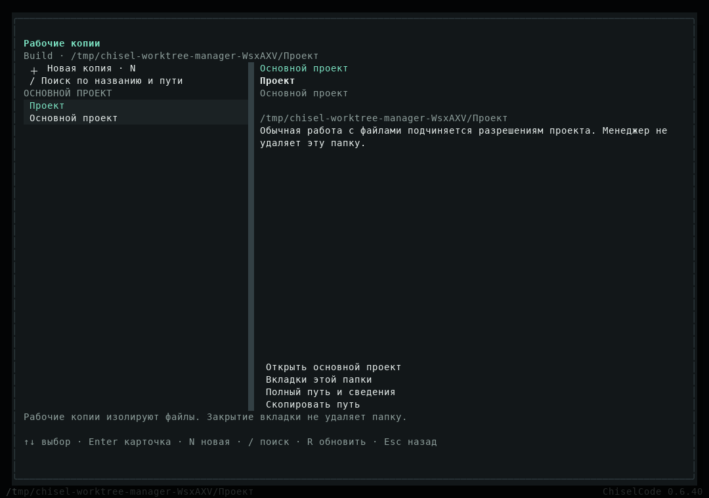
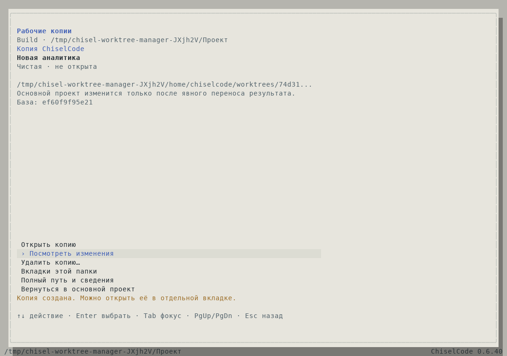
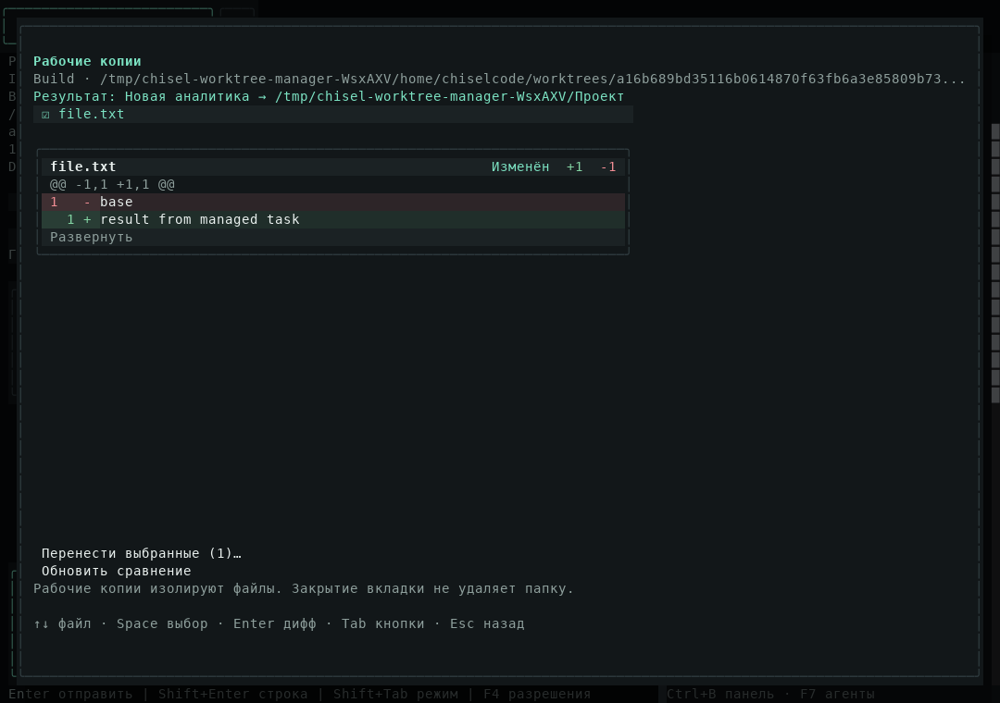
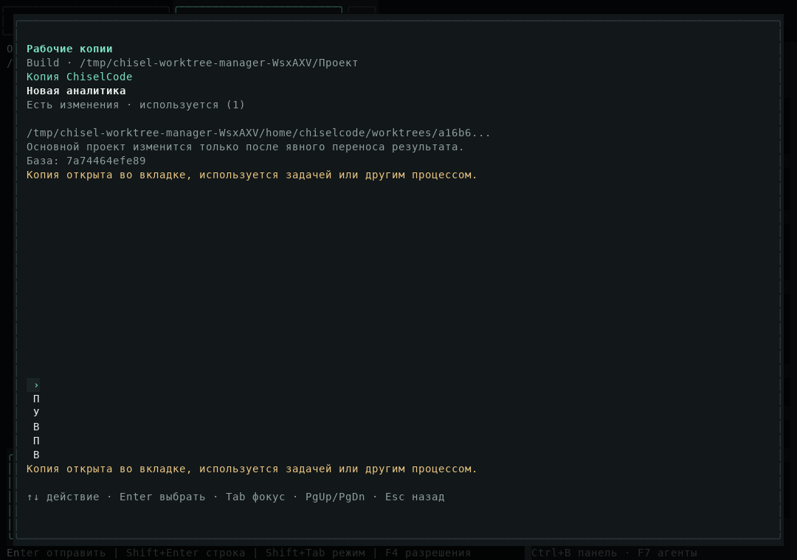
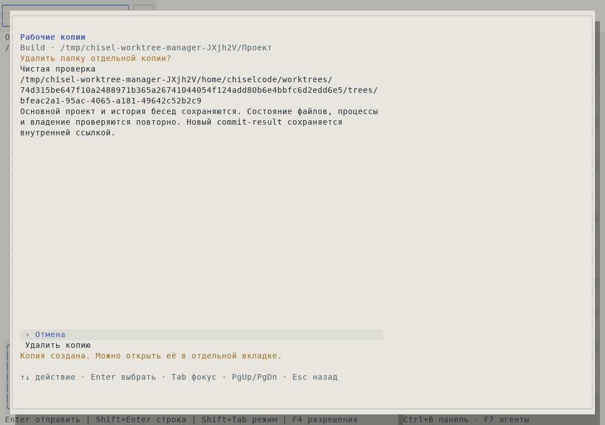
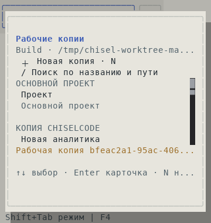
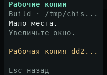

# Менеджер рабочих копий для CLI 0.6.40

[Материалы для участников](../README.md) · [Руководство](../../worktrees.md) · [Архитектура](../../architecture/worktree-manager.md) · [Исходный разбор](worktree-session-review.md)

Подготовлен реальный менеджер OpenTUI по [плану](../plans/worktree-manager.md). Это реализация CLI; репозиторий концепта Desktop не изменялся. Публикация CLI 0.6.40 готовится; статус выпуска и результаты точного source фиксируются после CI.

## Что реализовано

Меню «Рабочие копии», интерактивный `/worktree` и переход из панели контекста открывают один менеджер. Список различает основной проект, управляемые копии и другие копии Git. Есть форма создания от локальной базы, открытие копии и возврат в origin, полный путь/ID, поиск, штатные diff-карточки и выбор файлов для переноса, закрытие вкладок, причины блокировки и подтверждение удаления чистой копии.

Исправлены ложная интерпретация management readonly, приписывание обычному HEAD commit-result и использование нулевых shell UUID. Ошибка неизвестного ID отделена от реального mismatch. GUI передаёт fingerprints просмотренных файлов в apply: изменившийся результат не записывается под старым просмотром.

Права, режимы Plan/Build, Session ownership, очереди, отмена, блокировки активных процессов, unsupported/ignored files, конфликт до записи и retention результата остаются в действующем backend. Нет отдельного UI shell или обходного удаления.

## Реальный сценарий

Production fixture создаёт обычный Git-репозиторий и запускает стандартный `runOpenTuiAgent`. Пользователь создаёт копию через окно с настоящим Git approval, открывает её, затем агент через OpenAI SDK читает и меняет файл обычными инструментами. Пока результат не перенесён, origin содержит исходные байты.

Менеджер показывает реальный diff, передаёт выбранные файлы в apply и проходит обычные разрешения. После переноса исходный проект меняется, копия сохраняется. Возврат в origin и закрытие вкладки освобождают использование папки. Изменённая копия не удаляется; отдельная чистая копия удаляется после отдельной проверки и approval. Три модельных генерации относятся только к запросу агента изменить файл; меню дополнительных генераций не создаёт. Списки не попадают в model messages и не размножают chatPresentations.

Native renderer проверяет размеры 120×40, 80×24, 40×20 и 24×8. Кадры реализации сохраняются из `captureSpans`, PNG экспортируются без перерисовки. Существующие картинки в плане остаются демонстрационными и не выдаются за продуктовую проверку.

## Локальные проверки

На Linux/Bun 1.4.4 прошли 18 целевых проверок runtime/логики и 69 проверок UI/navigation/команд/tools/recovery в семи файлах. После уточнения поведения навигации отдельно прошли 9 проверок менеджера и его actions. Наборы пересекаются и не суммируются. Быстрый профиль: 438 pass, 0 fail в 45 файлах. Typecheck, lint, build и compile завершились успешно; lint сохраняет предупреждения существующего проекта, блокирующих ошибок нет.

Полный production-сценарий менеджера успешно выполнен в исходниках для Obsidian и Paper, а также в compiled fixture с реальными Git, SDK, executor и подтверждениями. Установленный npm-пакет 0.6.40 прошёл version/manifest smoke, compiled CLI — manifest и полный worktree smoke с сохранением результата. Native CI, точный source и опубликованная поставка фиксируются в отчёте выпуска после завершения CI.

Исходная пользовательская Windows-папка и причина её 425 строк modified не воспроизводятся по одному журналу. Менеджер исправляет подтверждённый смысл статусов и маршрутизацию; он не утверждает, что неизвестная конфигурация Git или отказ внешнего провайдера устранены.
