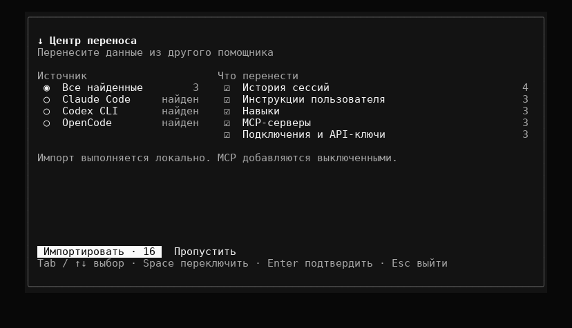

# Перенос из другого помощника

[Документация](README.md) · [Быстрый старт](getting-started.md)

Начиная с CLI 0.6.59, ChiselCode на первом интерактивном запуске ищет локальные данные Claude Code, Codex CLI и OpenCode. Если есть данные, после заставки открывается **Центр переноса**. Чтобы открыть его позже, введите `/import` на главной или в беседе.

1. Оставьте **Все найденные** или выберите одного помощника. Числа справа показывают, сколько исходных записей обнаружено для каждой категории.
2. Выберите категории и нажмите **Импортировать**. Мышь работает на строках и кнопках. С клавиатуры используйте Tab или стрелки для перехода, Space для переключения и Enter для подтверждения. **Пропустить** или Esc на первом запуске открывает «Подключения».
3. Проверьте итог по категориям. В «Подключениях» выберите импортированный профиль, проверьте сервис и модель и нажмите **Использовать подключение**. История доступна через `/resume`, библиотека через `/skills`, серверы через `/mcp`.

В режиме «Плавные» после подтверждения пять секунд идёт волна частиц. Процент в центре показывает время анимации. Если запись ещё идёт, затем виден статус переноса. В режиме «Минимум» окно показывает итог сразу по завершении записи. [Анимации](themes.md#анимации-и-плавность).

## Что читается из источников

| Данные | Claude Code | Codex CLI | OpenCode |
| --- | --- | --- | --- |
| Сессии | JSONL в `projects/` | JSONL в `sessions/` и `archived_sessions/` | `opencode.db` с таблицами `session` или `session_v2`, а для старых установок JSON в `storage/` |
| Инструкции пользователя | `CLAUDE.md` | `AGENTS.override.md` или `AGENTS.md` | `AGENTS.md` |
| Навыки | `skills/` | `skills/` и `~/.agents/skills/` | `skills/`, `skill/` и `~/.agents/skills/` |
| MCP | Пользовательские `mcpServers` в `.claude.json` | `mcp_servers` в `config.toml` | `mcp` в глобальном `opencode.json` или `opencode.jsonc` |
| API-ключи | `ANTHROPIC_API_KEY` из `settings.json` или сохранённый `primaryApiKey` | `OPENAI_API_KEY` в `auth.json` | Ключи поддерживаемых провайдеров в таблице `credential`, старом `auth.json` или в пользовательской конфигурации провайдера |

ChiselCode ищет данные в `~/.claude` и `~/.codex`, а также учитывает `CLAUDE_CONFIG_DIR` и `CODEX_HOME`. Для OpenCode используются `$XDG_CONFIG_HOME/opencode` и `$XDG_DATA_HOME/opencode` с обычными значениями по умолчанию `~/.config/opencode` и `~/.local/share/opencode`. Учитываются `OPENCODE_CONFIG_DIR` и `OPENCODE_CONFIG`. Скопировать можно ключи Anthropic, OpenAI, AgentRouter, OpenRouter и шлюзов, явно настроенных с `@ai-sdk/openai-compatible` и адресом.

- **История.** Переносятся текст переписки, название, время и путь проекта. Сессии недоступных проектов, вложения, вызовы инструментов, состояние разрешений и незавершённые действия пропускаются. При продолжении сессии можно выбрать профиль через `/model`.
- **Инструкции и навыки.** Пользовательские Markdown-инструкции хранятся в `instructions/` внутри ChiselCode Home и применяются вместе с правилами проекта. Навыки копируются с локальными файлами пакета. Символические ссылки и конфликтующие пакеты пропускаются либо отмечаются как ошибки. [Конфигурация](configuration.md#инструкции-пользователя) · [Навыки](skills.md).
- **MCP и ключи.** Поддерживаются глобальные настройки stdio и Streamable HTTP. Импортированные серверы добавляются выключенными. Проверьте параметры до включения в `/mcp`. Ключи и значения заголовков и переменных MCP хранятся через зашифрованное локальное хранилище ChiselCode. Для OAuth, подписок и системной связки ключей пройдите авторизацию в ChiselCode. [Провайдеры](providers.md) · [MCP](mcp.md).

Повторный импорт пропускает уже сохранённые записи, включая отредактированные разговоры. Исходные файлы других помощников сохраняются. Если часть данных недоступна, исправьте путь или формат в источнике и снова откройте `/import`.
