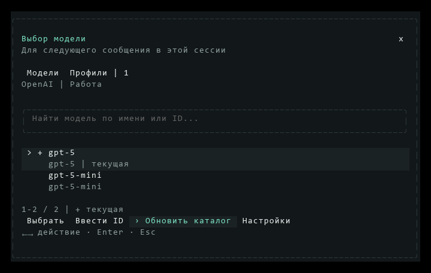

# Выбор модели

[Документация](README.md) · [Подключение провайдера](providers.md) · [Горячие клавиши](keybindings.md#настройки-модели-навыки-и-сессии)

## Выбрать модель для следующего сообщения

1. Выполните `/model` или нажмите название модели под вводом.
2. Найдите модель по ID или названию. Текущий выбор отмечен +.
3. Выберите строку и нажмите Enter либо «Выбрать». Esc закрывает окно.

Поиск охватывает весь доступный каталог. Сведения о цене и возможностях показываются только тогда, когда они известны. Если каталог устарел, выберите действие **Обновить каталог**: обычный успешный ответ кешируется на пять минут, принудительное обновление запрашивает его заново.

Для ChatGPT список загружается из каталога выбранного аккаунта. Когда сервис возвращает пустой каталог или отклоняет запрос, окно показывает причину и оставляет доступными ручной ввод и обновление.

## Сменить аккаунт

Откройте вкладку «Профили» мышью или через Tab на полосу подразделов и ←/→ и выберите настроенное подключение. Это меняет только список моделей: для переключения беседы затем выберите модель этого профиля. Одинаковое имя модели у двух профилей не делает их одним аккаунтом. Для добавления профиля нажмите «Настройки»; создание профиля описано в [подключении сервисов](providers.md#рабочий-и-личный-аккаунты). В самих настройках профиль выбирается для беседы отдельным действием «Использовать подключение».

## Ввести ID вручную

Через Tab перейдите к действиям, стрелками выберите «Ввести ID» и нажмите Enter, укажите точное имя модели и подтвердите выбор. Это полезно, если сервис не поддерживает список моделей или новая модель ещё не появилась в каталоге. Сам ввод ID не проверяет доступность: отправьте короткий запрос.

## Что происходит с работающим запросом

Модель, профиль и адрес API фиксируются при отправке сообщения. Смена выбора во время работы применяется к следующему отправленному сообщению; уже отправленные запросы, включая очередь, сохраняют прежний выбор.

Начиная с CLI 0.6.50 последний явно выбранный профиль и модель сохраняются между запусками, даже если разговор ещё не создан. Новый разговор наследует текущий выбор, восстановленный использует собственные сохранённые профиль и модель. Открытие истории не меняет последний явный выбор. Параметры `--model`, `--profile`, `--provider` и `--base-url` имеют приоритет при запуске и сами по себе не перезаписывают этот выбор.

Быстрый выбор не меняет профиль и модель подключения по умолчанию и не сохраняет новые ключи. Если сохранённый профиль удалён или привязан к другому провайдеру, запуск использует обычные настройки подключения. В `/settings` действие «Использовать подключение» обновляет запомненный выбор. Автосохранение модели уже выбранного подключения обновляет его модель; редактирование другого профиля не выбирает его для беседы.

## Если модели нет или список не загружается

- Проверьте профиль в настройках. Для ChatGPT проверьте вход в аккаунт, для подключения по API проверьте адрес и ключ.
- Обновите каталог действием «Обновить каталог» либо введите известный ID вручную.
- Сверьте доступность модели в кабинете сервиса. Имя из чужого аккаунта или другого шлюза может не подходить.

[Решение проблем подключения](troubleshooting.md#проверка-подключения) · [Устройство выбора и сохранения](architecture/model-selection.md).

Tab/Shift+Tab обходят полосу подразделов, поиск, список и действия. На малом экране стрелки в строке «Действия: …» выбирают операцию; Enter или Space выполняет её.

