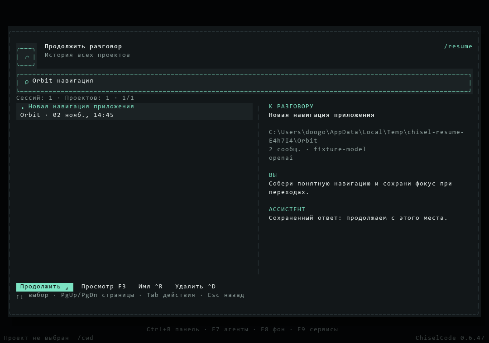

# Сессии и история

[Документация](README.md) · [Главная](../README.md)

`/resume` открывает общее окно истории из любого проекта и с главной без выбранной папки. Список отсортирован по последней активности; поиск учитывает название и путь проекта, название разговора, последнее сообщение, ветку, модель, провайдера и ID. На широком терминале справа показаны сведения и последние сообщения. F3 или Ctrl+P открывает полный разговор для чтения, без runtime и инструментов; Esc возвращает к списку. Пробел в поле поиска разделяет слова. Служебные источники выделены подписью «Архив». Их история не удаляется и не получает права выбранной впоследствии папки. Для такой работы выберите настоящий проект и начните новый разговор; при необходимости перенесите нужный текст явно.

Enter продолжает обычную сессию только после проверки её исходного root и canonical identity. Если папка пропала, история остаётся доступной для просмотра; другая папка не подменяет прежнюю. Ctrl+R переименовывает обычную сессию, Ctrl+D запрашивает удаление, Y или Н подтверждает его. Эти действия доступны независимо от открытого проекта, после проверки исходной папки. Служебный архив изменить нельзя. Активные задачи нужно остановить перед удалением. Стрелки выбирают сессию, PgUp/PgDn листают список, Tab/Shift+Tab переходят между поиском и кнопками. Esc сначала отменяет действие или очищает поиск, затем закрывает окно; черновик чата сохраняется.

Главный черновик без проекта получает отдельный UUID экземпляра. Его текст хранится в защищённом `CredentialStore`, а metadata публикуется атомарно. Восстановление закрытого экземпляра копирует текст в новую identity; черновик живого экземпляра не перезаписывается. При конфликте сохраняются оба текста и показывается причина. Выбор проекта сохраняет уже набранный текст; сохранённый проектный черновик подставляется только в пустое поле, которое не успел изменить пользователь.

Сессии хранятся отдельно от проекта в ChiselCode Home: `%LOCALAPPDATA%\ChiselCode\sessions` в Windows или `$XDG_DATA_HOME/chiselcode/sessions` (обычно `~/.local/share/chiselcode/sessions`) в macOS/Linux. `projects.json` связывает папку проекта с её ID; внутри `projects/<project-id>/` лежат `project.json`, быстрый `index.json` и отдельный JSON для каждого разговора. `/resume <id>` принимает полный ID или однозначный префикс среди всех проектов. Если разговор уже открыт, приложение переключает его вкладку, сохраняя её черновик и активную работу. Флаг терминального запуска `chisel --resume <id>` по-прежнему разрешает ID в папке `--cwd` или текущем каталоге.

Старые сессии копируются в новую структуру при открытии соответствующего проекта; исходные файлы остаются на месте. Индекс можно восстановить из файлов разговоров. `/clear` и «+» открывают новый черновик на главной, сохраняя текущий разговор. Отдельная вкладка создаётся после отправки сообщения. Закрытие вкладки не удаляет сохранённую сессию; её можно открыть с главной или через `/resume`. Неотправленные черновики сохраняются отдельно от истории модели и восстанавливаются после перезапуска. Обычное обновление и удаление приложения сохраняют `sessions/` и пользовательские данные; для полного удаления данных их нужно удалить отдельно вручную.

Количество сессий не ограничено: автоматическое удаление после 10 разговоров не выполняется. Историю удаляют вручную через выбор сессии. При записи ChiselCode временно блокирует индекс проекта, чтобы параллельные процессы не потеряли изменения друг друга. Если процесс аварийно завершился, оставшаяся блокировка автоматически распознаётся и убирается при следующем обращении к хранилищу; сами разговоры при этом сохраняются.



Кадр настоящего OpenTUI размером 120×40; на узком терминале сведения доступны через F3.

## Повторный запуск из терминала

`/compact` сжимает старую историю внутри текущего разговора и сохраняет сводку для следующих сообщений. Полный сохранённый текст не удаляется, последний запрос и незавершённые вызовы инструментов остаются в контексте. Команда работает и после обычного ответа, и после восстановления сессии; она не создаёт нового разговора и не отменяет помощников или фоновые задачи. Если новой истории для сжатия нет, повторная команда сообщает об этом без нового запроса к модели. Учёт расхода включает запрос сводки, когда она получена от модели.

Неудачные запросы сохраняют код и причину ошибки отдельно от сообщений модели. После открытия разговора причина снова видна в чате. Известные секреты скрываются до записи. У старых записей, где сохранён только статус `failed`, причину восстановить нельзя: её нельзя достоверно приписать приложению или провайдеру.

```bash
chisel --cwd ./my-project --resume <session-id>
chisel --cwd ./my-project --resume <session-id> "Продолжи разбор тестов"
```

Для флага `--resume` укажите ту же папку проекта. Для выбора между проектами откройте интерактивный `/resume`: исходная папка определяется из сохранённой истории. `/clear` не удаляет сохранённую историю; удаление выполняется в выборе сессии и требует подтверждения.

## Резервная копия и приватность

Перед переносом или ручными изменениями остановите ChiselCode и скопируйте каталог `sessions/` целиком, включая индекс проектов. Сессии содержат сообщения и могут содержать код, результаты инструментов и полные diff. Они сохраняются как JSON, а не как зашифрованный архив: не добавляйте их в публичный репозиторий.

Расположение данных — в [конфигурации](configuration.md); технические детали diff — в [file-edit-ux.md](file-edit-ux.md).

## Побочные ответы и рабочие копии

Сохранённые побочные ответы отображаются отдельными записями. Их можно открыть после возвращения к разговору; они не добавляются в основную историю для модели и не отправляются повторно. Незавершённый при аварийном выходе запрос помечается как прерванный. [Срок хранения текстов и ограничения](side-questions.md#сохранённые-ответы).

Разговор в рабочей копии относится к её папке и хранится отдельно от исходного проекта. Закрытие вкладки не удаляет папку или изменения. Для возвращения используйте `/worktree list` и `/worktree open <ID>`. [Управление копиями](worktrees.md).

Старые форматы разговоров читаются автоматически. Историю можно открыть, даже если прежний провайдер больше недоступен; для нового запроса выберите доступный профиль и модель. [Технический формат и совместимость](architecture.md#формат-сессий-и-совместимость).

## Помощники

Истории помощников отдельны от основного разговора; просмотр не запускает модель и не повторяет незавершённые инструменты. См. [Помощники и делегирование задач](subagents.md).

## Фоновые задачи

Фоновые команды принадлежат разговору и продолжаются между его ответами. Закрытие разговора останавливает его процессы, а сохранённая история не повторяет shell. Session хранит refs и последние карточки; полные логи читаются страницами отдельно. См. [Фоновые задачи](background-tasks.md#история-и-восстановление).
