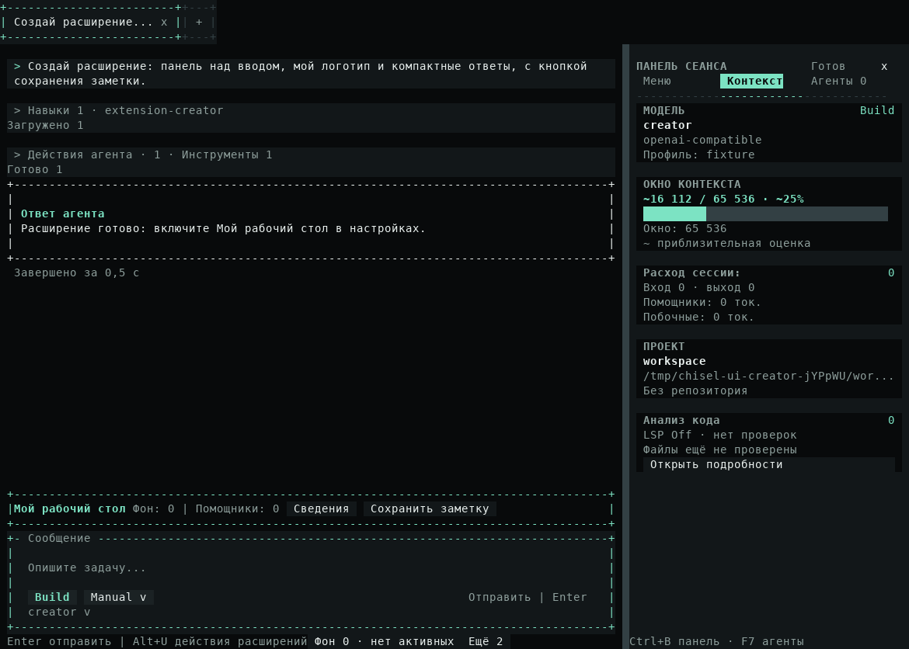
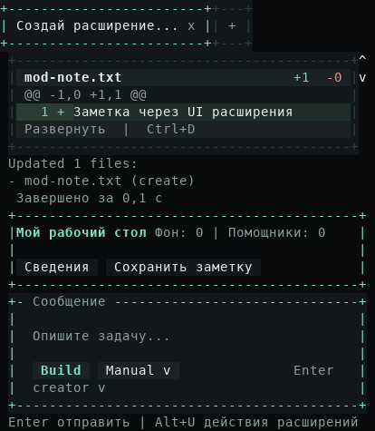

# Изменить интерфейс расширением

[Документация](README.md) · [Пакеты расширений](extensions.md) · [SDK композиции](extensions/ui-composition.md)

Возможность относится к `Unreleased` после 0.6.32. В опубликованной 0.6.32 её ещё нет.

## Создать под свою задачу

Попросите агента, например: «Сделай панель над сообщением с числом фоновых задач, замени логотип и сократи подсказки». Агент может сам загрузить встроенный навык `extension-creator`. Для явного выбора отправьте:

```text
/extension-creator Добавь панель над вводом с кратким состоянием проекта
```

Навык описывает актуальный SDK. Названия, пояснения и README создаваемого расширения должны быть на языке пользователя. Агент передаёт готовый ESM-пакет инструменту `create_extension`: тот проверяет manifest, пути, синтаксис и известные импорты, затем устанавливает пакет выключенным. Проверка использует пассивный JavaScript parser; macro imports отклоняются, их нужно убрать при сборке. Чтение навыка и установка не исполняют код расширения и не выдают доверие.

Откройте **Настройки → Расширения**, выберите пакет и нажмите **Доверить и включить**. Проверьте содержимое и подтвердите доверие в существующей форме. UI-расширение с `kind: "ui"` появится сразу, в том же приложении. Отключение вернёт стандартные элементы. Настройки и подтверждённые обновления этого пакета также применяются сразу.

## Что можно изменить

Расширение может добавлять элементы перед или после стандартного участка, скрывать его, заменять своим деревом или оборачивать стандартное содержимое. Доступны сообщения, группы инструментов и навыков, diff и карточки, загрузка и прогресс, логотип, вкладки, подсказки и элементы ввода, боковая панель и её разделы. Все 29 имён участков перечислены в [SDK](extensions/ui-composition.md#участки-интерфейса).

Несколько расширений складываются в определённом порядке. Обёртка может сохранить результат предыдущих расширений. Текст, кнопки и контейнеры используют выбранную тему; рамки учитывают Unicode/ASCII. Кнопки работают мышью. **Alt+U** открывает список действий интерфейса: ↑/↓ или Tab выбирают, Enter выполняет, Esc возвращает в чат.

Ядро сохраняет родной редактор и защищённые окна разрешений, доверия и настроек. Обёртки `App`, `Main`, `Home`, `Composer` должны сохранять стандартное содержимое один раз. Ошибка инструмента также остаётся видимой. Ошибка UI-провайдера возвращает стандартный вид участка и показывает короткое уведомление.

## Когда нужен перезапуск

`kind: "ui"` подходит для представлений, панелей и их собственных инструментов. UI-инструмент запускается по явному действию пользователя через обычную очередь беседы, с Plan/Build, guards и подтверждениями. Он не добавляется в набор инструментов модели.

Расширение с командами для агента, сервисами, runtime-хуками, context providers или общей палитрой использует обычный жизненный цикл: такие пакеты и их параметры применяются после перезапуска. Навык должен выбрать подходящий тип и назвать это условие.

Доверенный JavaScript работает внутри процесса с правами пользователя. Изоляция UI-lifecycle не является системной песочницей и не выгружает уже импортированный JS. Используйте `--no-external-extensions`, чтобы запустить стандартный интерфейс без внешнего кода; [восстановление](extensions.md#запуск-статусы-и-восстановление).

## Пример настоящего интерфейса

Пакет [workbench](../examples/extensions/workbench/) меняет логотип, оформление ответов, добавляет панель и окно сведений. [Отчёт с проверками и кадрами](contributors/reports/ui-composition.md) содержит также исходные terminal captures.




